# 设置
## 概 述
设置提供了一个友好的图形用户界面，用于对操作系统常用配置项进行管理。主界面如图所示。

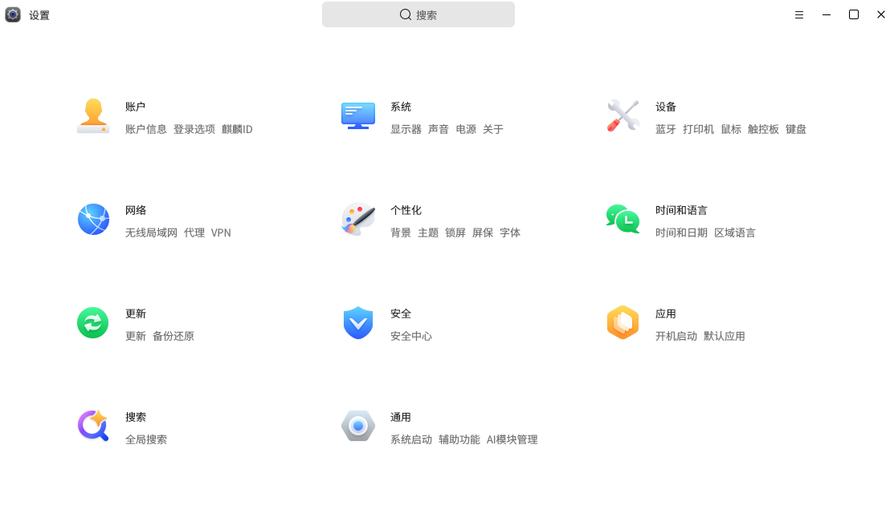

 

## 账 户
账户设置提供了账户信息、登录选项和麒麟ID三个模块。

### 账户信息

对系统用户进行管理配置，允许管理员创建用户、删除用户、修改用户信息。

**安全风险提示**

开启操作系统免密登录或自动登录功能后，设备将跳过身份验证环节直接进入系统，存在显著安全隐患：若设备丢失、被盗或被他人未经允许接触，非授权人员可直接访问本机全部数据、文件、账号信息及隐私内容，造成信息泄露、数据篡改、财产损失等风险；同时，该功能会降低系统访问门槛，易被恶意程序、非法入侵利用，提升设备被攻击的概率。

为保障您的信息安全，非必要请勿开启免密登录、自动登录功能，建议使用密码、指纹等强身份验证方式登录系统，避免设备脱离管控后引发安全事故。

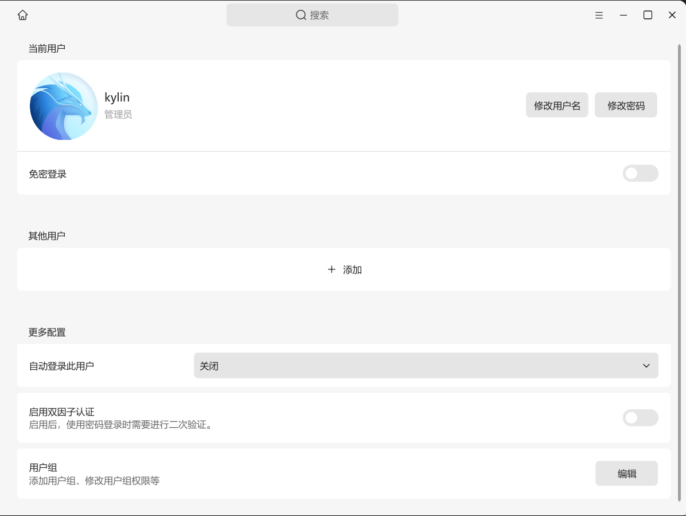

#### 更改用户头像

点击用户头像，即可进行修改，图片可从本机图片中选择。

#### 更改密码

点击“修改密码”，即可修改当前用户的密码。

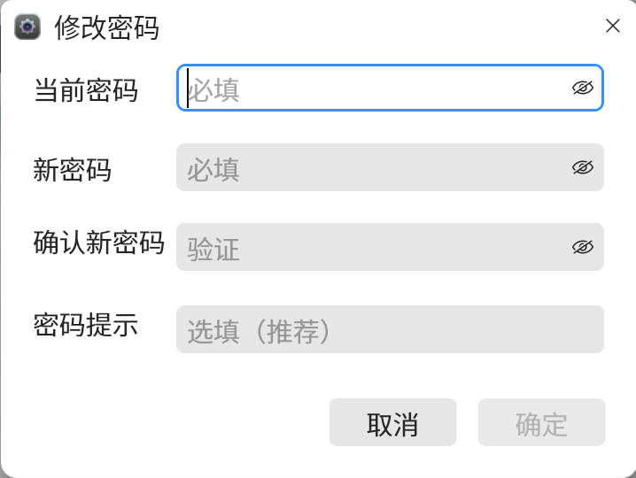

#### 更改账户类型

系统用户类型分两种：标准用户和管理员用户。

- 管理员用户：输入用户密码，可以临时提升root权限
- 标准用户：无法提升权限

Tips：系统至少需要存在一个管理员用户。

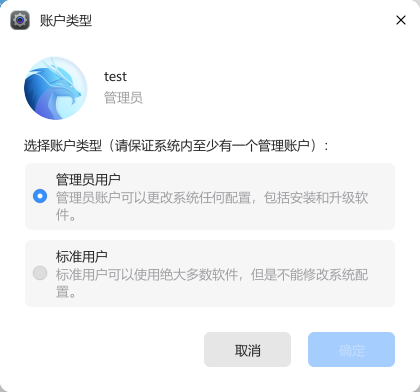

#### 编辑用户组

编辑用户组可以对用户组进行增删改查。
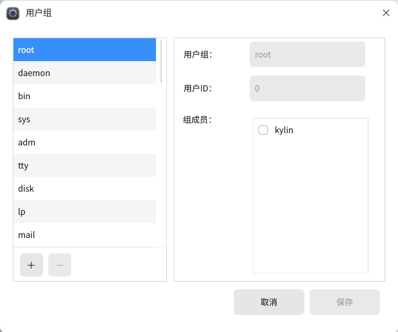

#### 其他用户

可编辑其他用户信息，添加新用户，删除用户等。

- 添加新用户：输入用户名、密码，密码提示，并选择用户类型，勾选设置密码安全问题可设置该账户安全问题，在忘记密码时通过回答安全问题重置密码，如图所示

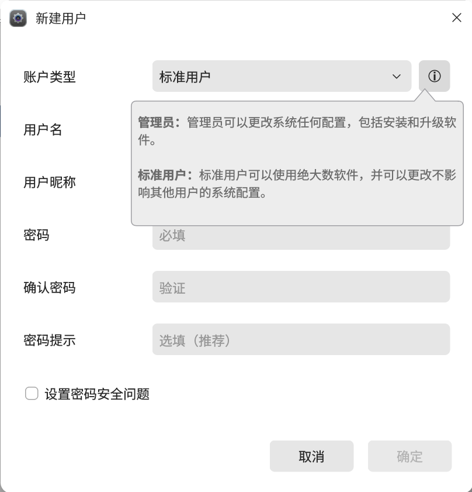

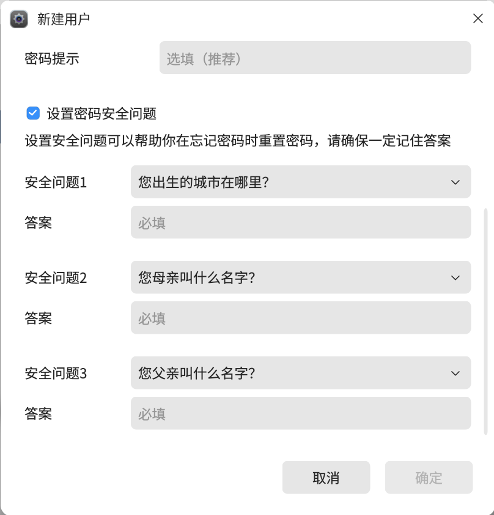

- 编辑用户

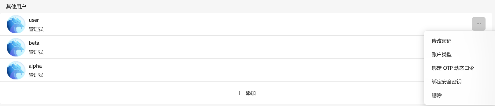

#### 更多配置

可开启双因子认证，绑定第二因子等。系统中需存在软件包 kylin-mfa，若不存在则不支持此功能，隐藏该功能。

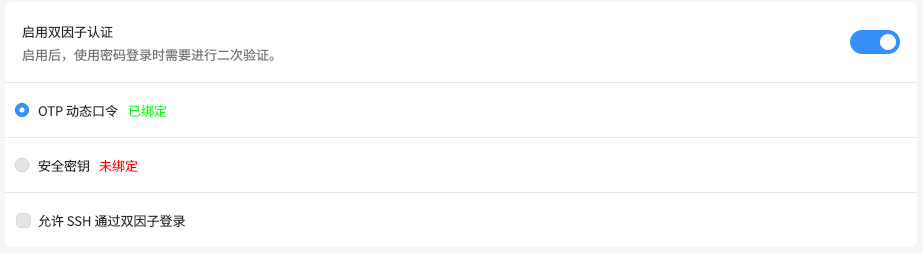

开启双因子认证时，若用户未绑定第二因子，则需要绑定第二因子后才可开启，第二因子包括OTP动态口令与安全秘钥，绑定安全秘钥需安装相关驱动。

注意：允许SSH通过OTP双因子登录时，如果ssh客户端版本低于1:9.6p1-3，ssh远程登录时绑定二维码无法正常显示。

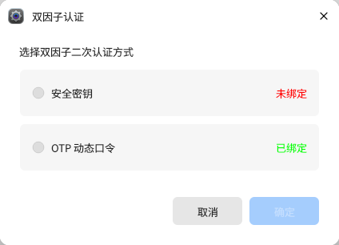

绑定 OTP 动态口令

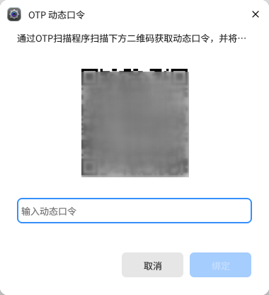

绑定安全秘钥

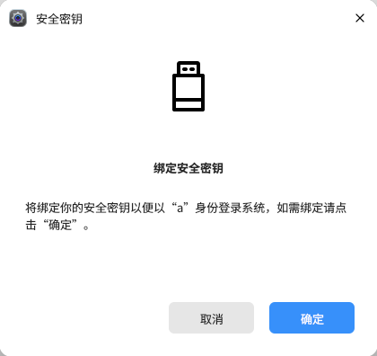

### 登录选项

可对登录选项进行配置。

- 关闭生物识别：登录时禁用生物识别。

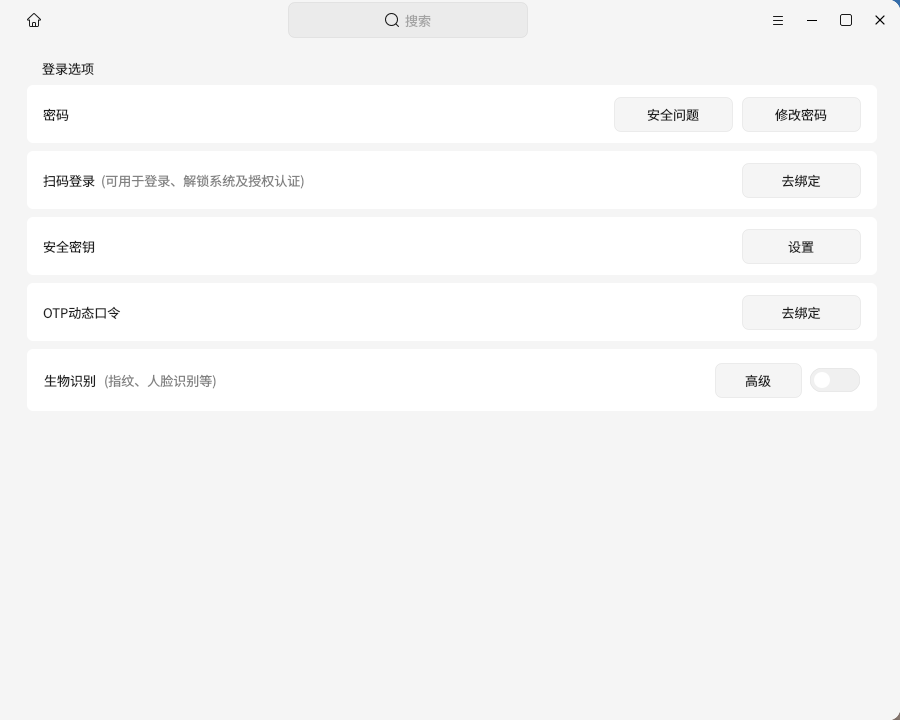

- 打开生物识别：登录时可以使用生物识别，可以对生物特征进行录入、重命名、删除。

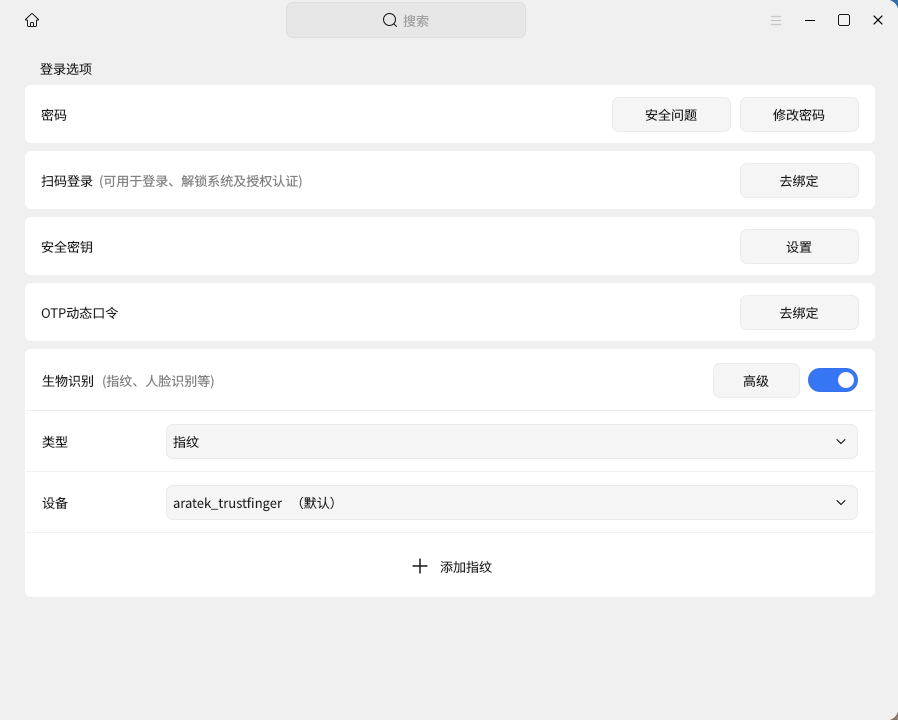

- 录入新特征

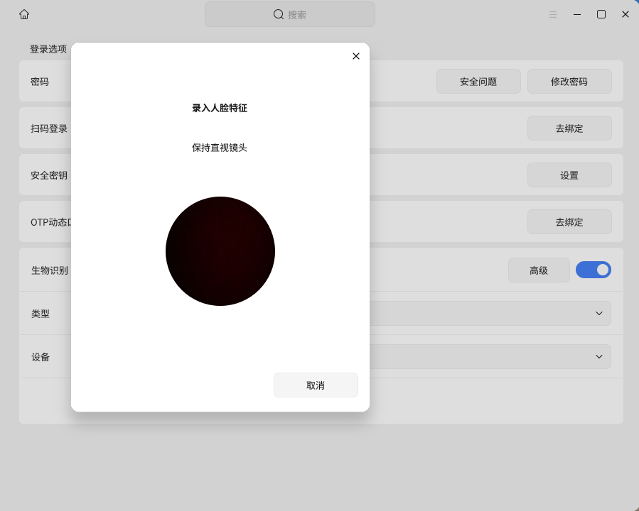

- 修改特征名

### 麒麟ID
麒麟ID是麒麟软件为其下用户提供的统一身份管理系统，允许用户通过单一凭据访问多种麒麟软件服务。

#### 打开方式
“开始菜单”>“设置”>“账户”>“麒麟ID”

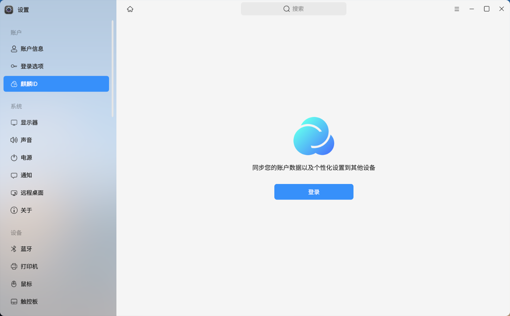

#### 麒麟ID注册

如您尚未注册麒麟ID，请点击登录框“**注册**”按钮跳转至麒麟ID中心进行账号注册。

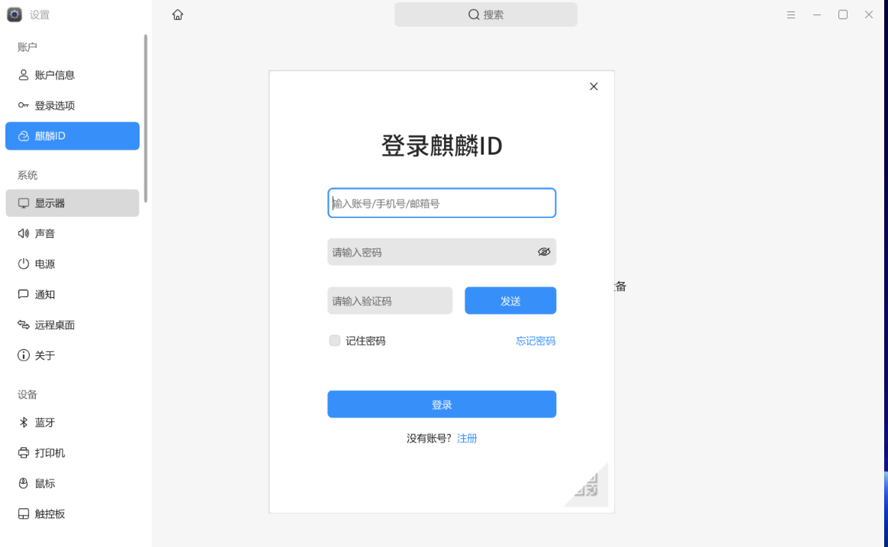

#### 麒麟ID登录

如您已注册麒麟ID，可通过密码登录、微信扫码两种方式登录。对于不同系统版本，登录界面存在差异性，请以实际页面为准。

##### 密码登录
- 输入账号/手机号/邮箱与密码后点击“**发送**”按钮，会弹出滑动验证码进行验证；
- 验证通过后向注册手机号/邮箱发送验证码，输入相应验证码；
- 点击“**登录**”即可登录麒麟ID；
- 登录时可选择是否记住密码。

##### 微信扫码登录

- 点击登录框右下角二维码，使用微信扫一扫快速登录；
- 注意如果微信所在账户未注册过麒麟ID，需注册后再次扫码登录。

如您忘记密码，点击登录框“**忘记密码**”，跳转至麒麟ID中心，使用手机号、邮箱两种方式中任意一种找回密码。

#### 麒麟ID首页

登录麒麟ID后默认首页如图4-3所示。用户可通过此页面进行麒麟ID与终端本地账户的绑定与云账户数据同步操作。

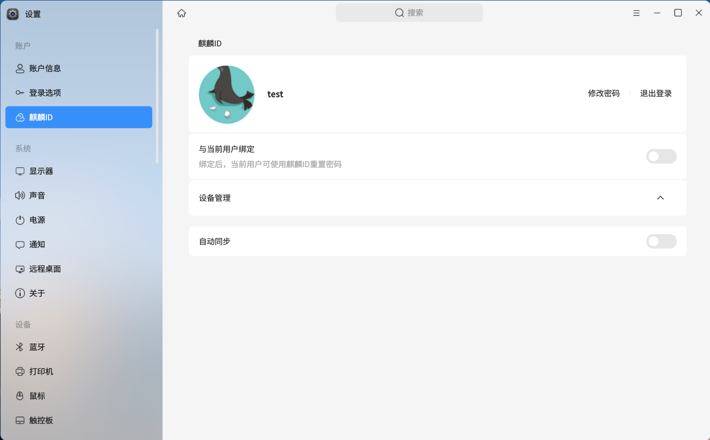

#### 麒麟ID与终端本地账户绑定

- 点击首页“**与当前用户绑定**”栏位右侧开关按钮，会弹出当前本地账户密码验证窗口；
- 验证通过后即可绑定成功，绑定成功后可在首页“**设备管理**”栏位查看当前麒麟ID已绑定的所有终端设备。

麒麟ID与当前本地账户密码绑定后，当您忘记本地账户密码时，在终端登录页面可通过麒麟ID的“**忘记密码**”找回当前本地账户对应的密码。

#### 麒麟ID与终端本地账户解除绑定

- 麒麟ID与终端本地账户绑定成功后，点击首页“**与当前用户绑定**”栏位右侧开关按钮，会弹出当前本地账户密码验证窗口；
- 验证通过后即可解除麒麟ID与当前本地账户的绑定关系

#### 云账户可同步项

- 桌面背景：同步桌面背景
- 锁屏和屏保：同步屏保壁纸、屏保休眠时间等
- 字体：同步设置字体设置
- 头像：同步系统用户头像
- 任务栏： 同步任务栏位置、大小等
- 快速启动栏：同步任务栏插件快速启动栏相关设置
- 主题：同步设置主题设置
- 鼠标：同步设置鼠标设置
- 触摸板：如果有触控板的话，同步设置触控板界面
- 键盘：同步设置键盘设置
- 时间格式：同步时间，并非一一对应设置
- 文件管理器：同步文件管理器的设置，不包括置顶窗口设置
- 电源管理：同步设置电源相关选项

#### 使用须知

- 使用麒麟ID登录云账户，首次打开默认会同步一次，如果云端有配置文件，则会先把云端配置下载下来同步到本地，否则把本地账户配置上传到云端。
- 登录云账户之后，如果打开了自动同步按钮，用户无需其他操作，云账户每隔5分钟会同步一次本地配置到云端，上传的配置可供跨机器，跨用户同步。
- 单独的同步开关关闭会导致此项停止上传到云端，如果开启，则会将之前的此项的云端配置同步到本地。
- 如果关闭自动同步按钮，所有云端配置将会保留在关闭同步前最后一次上传到云端的本地配置。
- 如果开启自动同步按钮，则将云端配置下载下来并同步到本地。
- 单独的开关类似自动同步按钮效果，只是同步效果范围变成了当前项的同步效果。

 

## 系 统
系统配置设置提供了显示器、声音、电源、通知、远程桌面、关于、触摸校准七个模块。

### 显示器
显示器可以配置显示相关的设置，上方彩色矩形代表当前屏幕，中间显示了显示器名称及接口名，如图所示。

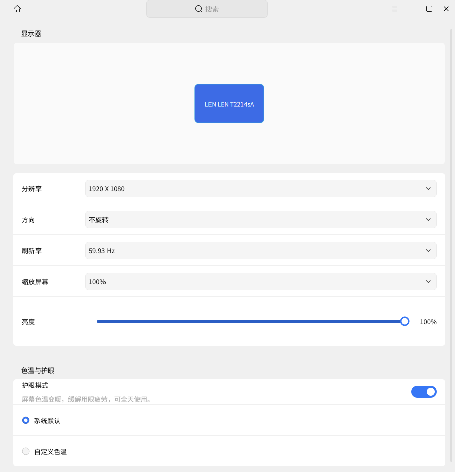

- 显示器：选择当前显示器
- 分辨率、方向、刷新率、缩放屏幕的修改都是针对当前活动显示器
- 在硬件支持情况下，可具备自动亮度调节功能；同时也提供护眼模式与色温功能
- 屏幕缩放为全局缩放，可以设置的缩放项与屏幕当前的分辨率有关，具体如下：

| 分辨率宽度w | 最大缩放 |
| :---: | :---: |
| （0,1080] | 100% |
| (1080,1920) | 125% |
| 1920 | 150% |
| (1920,2560] | 200% |
| (2560,3072] | 225% |
| (3072,3840) | 250% |
| 3840+ | 275% |

- 夜间模式具有调整色温度、夜间模式自定义时间段打开/关闭

### 声 音
对输出、输入、系统音效和高级设置进行设置，如图所示。

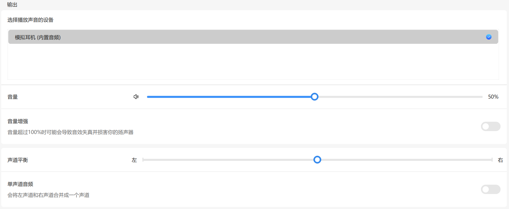

- 选择播放声音的设备：获取声卡选择的输出配置文件生成的输出设备，可根据需要切换对应的输出设备
- 音量：调节当前的输出音量，通过移动滑动条来控制系统输出音量大小
- 音量增强：开启音量增强，音量的可调节区间由0-100%转变为0-125%
- 声道平衡：调节输出音量的左右声道音量大小比例的功能，让不同位置的听众都能听到均衡协调的声音
- 单声道音频：通过一个音频信号通道播放声音，听起来声音来自同一个方向，没有左右声道的位置差异

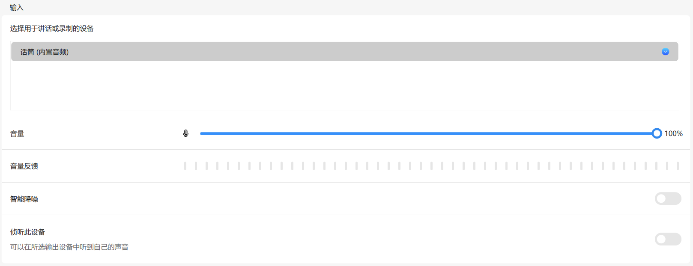

- 选择用于讲话或录制的设备：获取声卡选择的输入配置文件生成的输入设备，可根据需要切换对应的输入设备（输入设备主要用来录音视频以及通话）
- 音量：调节当前的输入音量，通过移动滑动条来控制系统输入音量大小
- 音量反馈：检测当前输入设备接收音频信号强弱的功能，帮助用户判断输入音量是否合适，避免过大失真或或小听不清（检测到有可用的输入设备时开始检测输入等级）
- 智能降噪：通过技术主动识别并削弱环境中无用噪音，同时保留人声或目标声音的功能
- 侦听此设备：可以在所选输出设备中听到自己的声音

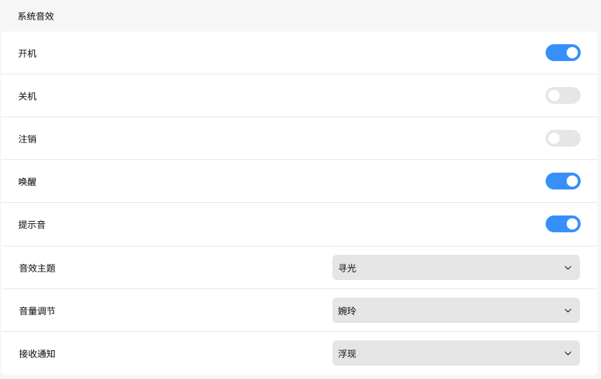

- 开机：控制系统开机时是否播放开机音乐
- 关机：控制系统关机时是否播放关机音乐
- 注销：控制系统注销时是否播放注销音乐
- 唤醒：控制系统唤醒时是否播放唤醒音乐
- 提示音：控制系统收到通知或改变音量时播放提示音
- 音效主题：系统的声音主题
- 音量调节：调节音量时播放的提示音类型
- 接收通知：系统收到通知时播放的提示音类型

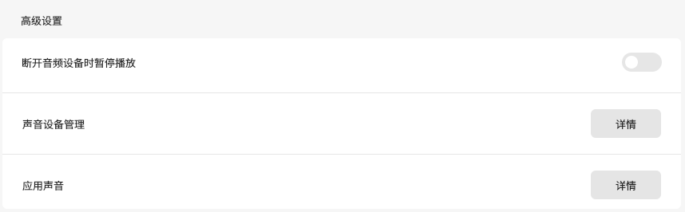

- 断开音频设备时暂停播放：控制系统在断开音频设备时，暂停正在播放的音视频
- 声音设备管理：显示系统中可用的声音设备，可禁用设备或打开设备
- 应用声音：显示系统中正在使用声音的应用，可单独调节应用的音量大小以及设置应用的输入输出设备

### 电 源

可进行通用功能设置，电源计划和电池节能计划设置（机器存在电池的情况下）

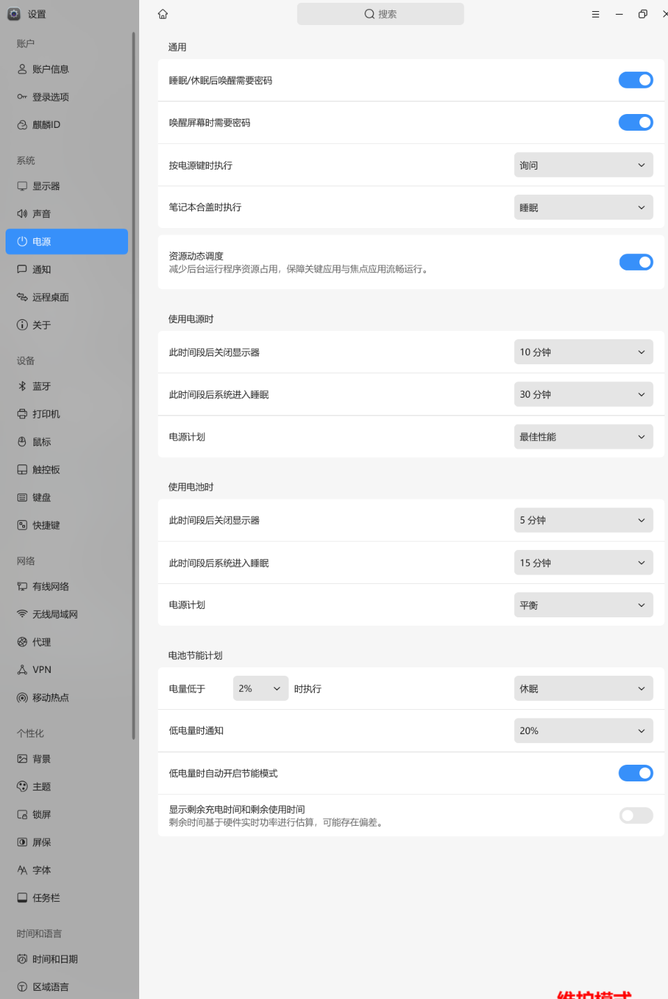
- 在通用设置中，可以对系统唤醒功能进行设置，以及设置系统进入睡眠等操作的时间。此外，还可以打开/关闭分级冻结功能，打开之后，可以进一步提升系统的流畅度，默认是打开状态。打开分级冻结之后，可以打开冰冻模式，该功能会对应用资源进行进一步的限制，以提升电池续航时间，但是会冻结部分后台应用，默认是关闭状态。
- 在电源计划中，选择不同的模式对应不同的系统性能消耗
- 在电池节能计划中，通过选择对应的选项达到电池节能效果

### 通 知

可通过开关的开启/关闭，选择是否获取来自对应应用的通知

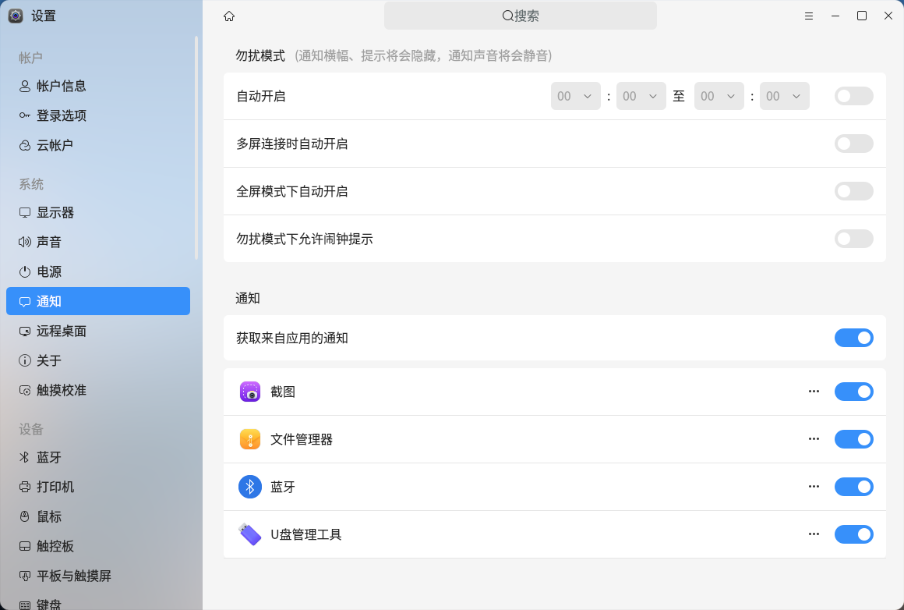

### 远程桌面
通过开启和关闭本地 VNC/RDP 服务来控制是否可远程访问你的桌面。

- “远程连接这台电脑”默认关闭
- “远程连接协议”包含 VNC 与 RDP，默认使用 VNC
- “允许其他用户控制这台电脑的屏幕”默认状态为开启，可被操控
- “每次访问这台电脑时需要确认”默认状态为关闭，需应答每次访问请求
- “使用VNC远程连接时需要输入密码”默认状态为开启，开启后密码默认非明文显示
- “允许远程访问的显示器”可设置允许被远程控制的显示器
- “允许连接的远程客户端数量”可设置允许远程连接的最大客户端数量

**安全风险提示 **

开启操作系统远程桌面并采用 VNC 连接协议时，若同时关闭远程访问身份确认开关和访问密码校验开关，将带来极高安全风险：外部网络内任何知晓本机远程地址、端口的人员，均可绕过身份核验直接建立 VNC 远程连接，未经授权操控本机桌面，以及查看、篡改、拷贝设备内所有业务数据、隐私文件、账号配置等敏感信息；设备极易遭遇非法入侵、恶意操作、数据泄露、勒索病毒植入等安全事件，一旦被恶意攻击者利用，将造成业务中断、重要资料丢失、信息外泄乃至经济损失。

建议您务必保持远程访问确认、访问密码验证功能持续开启，设置高强度远程访问密码，非运维必要时及时关闭 VNC 远程桌面服务，防范非法远程入侵风险。

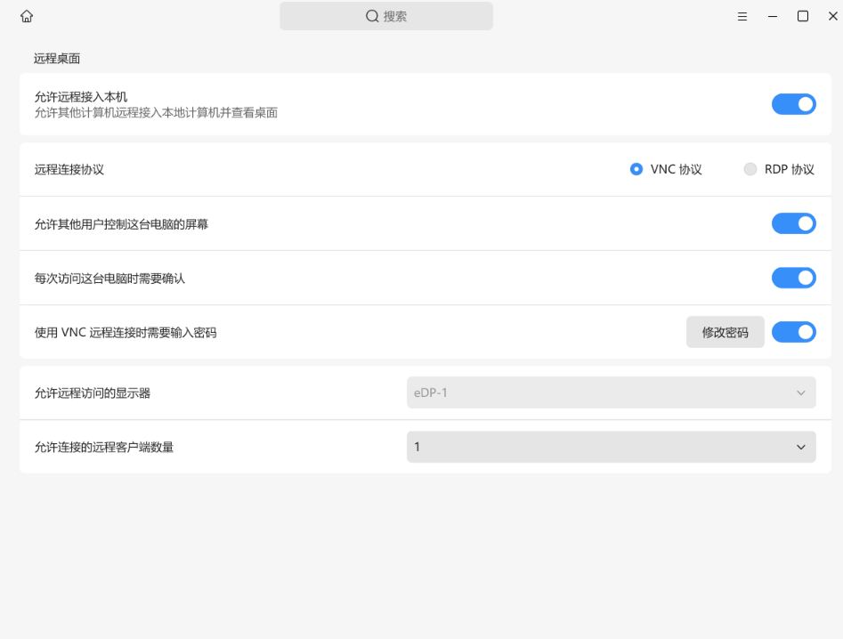

### 关 于

显示本机系统的版本、设备规格、用户部分信息、以及隐私协议相关信息

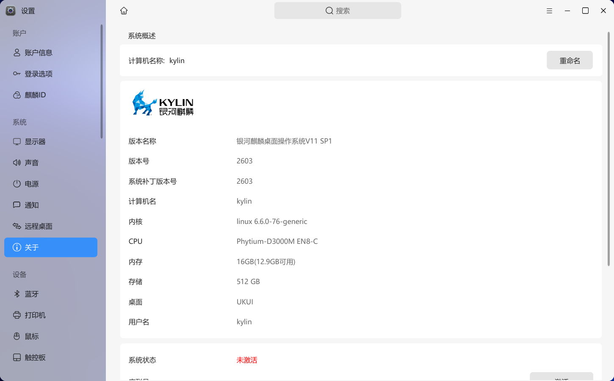

### 维护模式

不可变系统是一种被设计为不可更改且只读的操作系统，用户或者运维人员无法在系统上对系统核心进行修改，如安装软件包、安装第三方驱动等。如果用户或者运维人员需要像可变系统一样便捷地处理包安装等行为，可以开启维护模式。在默认情况下，维护模式是关闭的：

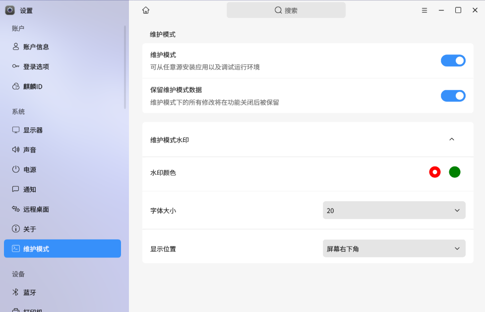

打开维护模式开关，即可开启维护模式（需要根据提示，重启系统使维护模式生效）。 成功开启后，默认会在桌面右下角显示一个“维护模式”的水印：

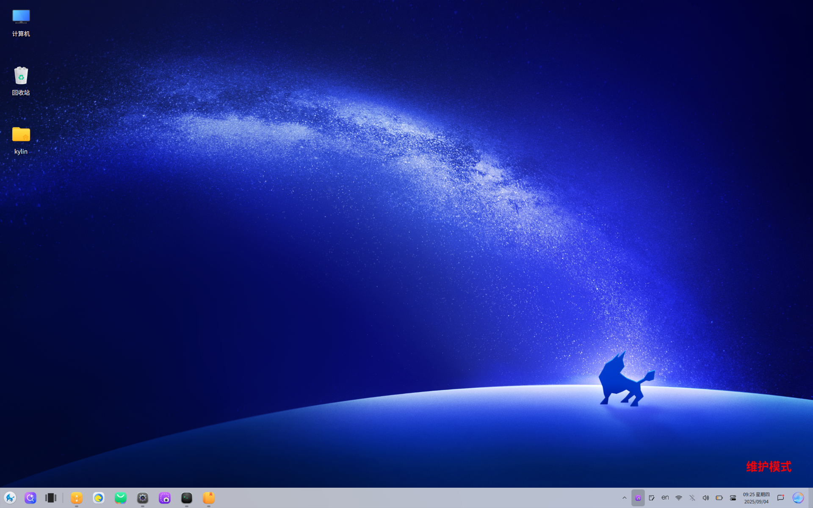

维护模式开启后，会发现界面多了几个配置项：

- 保留维护模式数据：在关闭维护模式时，如果打开该配置，会保存维护模式期间产生的数据，比如安装的软件包等。如果不打开该配置，就不会保存维护模式期间产生的数据，并恢复到开启维护模式之前的状态。
- 维护模式水印：设置维护模式水印的样式。
  - 水印颜色：用于设置水印的颜色。
  - 字体大小：设置水印的字体大小。
  - 显示位置：设置水印的显示位置。

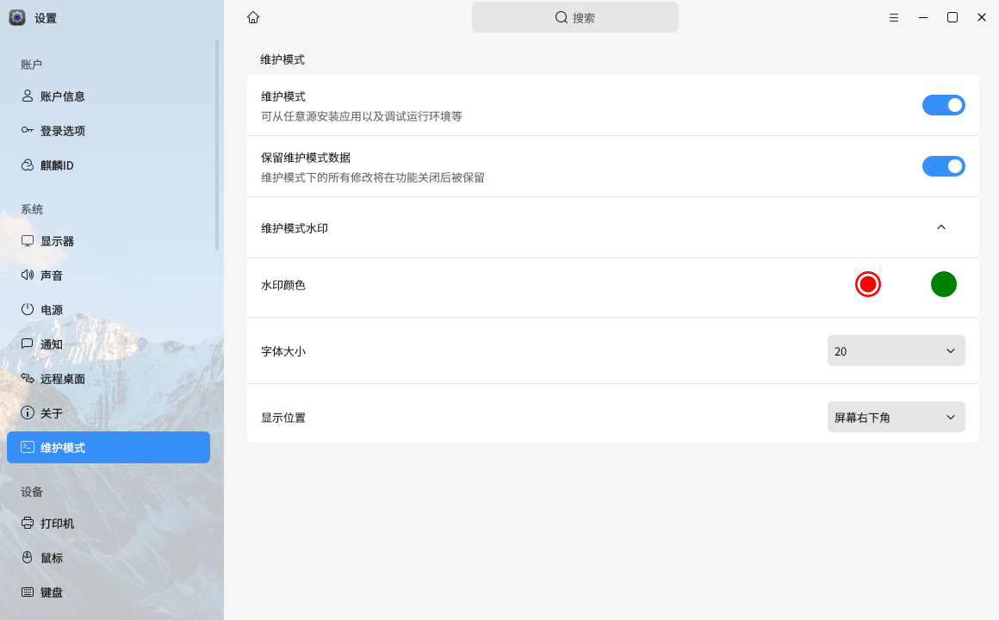

将以上配置项配置好后，关闭维护模式开关，即可关闭维护模式（需要根据提示，重启系统生效）。

## 设 备

设备设置提供了蓝牙、打印机、鼠标、触控板、平板与触摸屏、键盘、快捷键和多屏协调八个设置模块。

### 蓝 牙

蓝牙模块提供了开关蓝牙、修改蓝牙名称、显示隐藏蓝牙任务图标、自动发现周围蓝牙设备、本机设备的可见性；与发现的蓝牙设备配对、连接、断开、移除蓝牙设备、文件传输的基本功能、自动发现蓝牙音频设备、已连接设备重命名，如图所示。

- 开关蓝牙：点击开启蓝牙按钮，对本机的蓝牙适配器开启和关闭
- 修改蓝牙名称：将鼠标在“修改图标”或者“蓝牙名称”上单击，在弹出输入框输入想要的名称
- 显示隐藏蓝牙任务栏图标：点击按钮，可以在任务上显示或者不显示托盘上的蓝牙图标
- 蓝牙设备分类 ： 通过选择下拉框选择显示的蓝牙设备类型，类型选项(所有、音频设备、键鼠设备、电脑、手机、其他)
- 发现的蓝牙设备基础操作：鼠标单击已发现的蓝牙设备执行连接，断开、移除和发送文件选项需要通过蓝牙设备的设置选项打开(注：部分蓝牙设备/机型无发送文件选项)
- 自动发现蓝牙音频设备：自动发现蓝牙音频设备功能开关开启后，蓝牙服务会开启对周围3m内的音频设备进行检测，检测符合条件则提示用户是否需要连接；功能开关关闭则不会处理
- 已连接设备重命名：对用户已连接的设备提供本地的重命名功能
- 蓝牙音频组合设备：启用后，已连接的2台音频设备将会同时播放声音

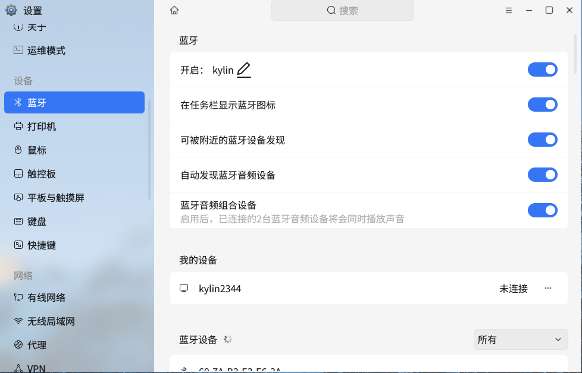

### 打印机

打印机功能提供了打印机程序入口

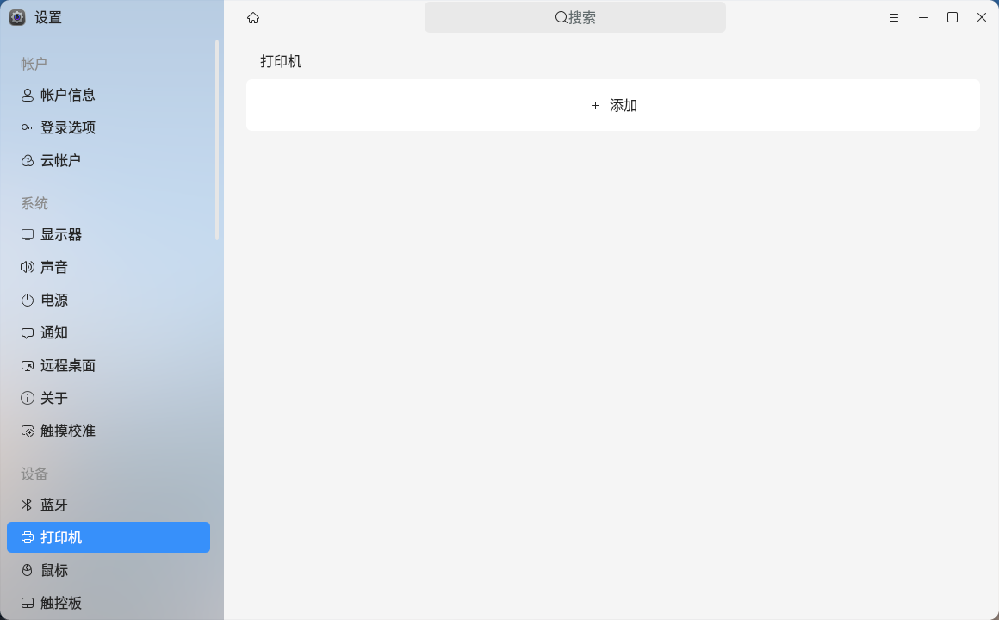

### 鼠 标

为满足您对鼠标使用习惯的个性化需求，可在“鼠标”配置中，可进行鼠标、指针、光标的个性化设置。

1）鼠标键设置：

- 鼠标主按键设置（左键/右键）
- 鼠标双击速度
- 鼠标滚轮速度
- 鼠标滚动方向

2）指针设置：

- 指针移动速度设置
- 启用鼠标加速以提高指针精确度
- 定位指针位置（不定位、按 Ctrl 键显示指针位置、来回晃动指针显示指针位置）
- 指针大小设置（小，中，大）

3）光标设置：

- 启用文本光标闪烁
- 光标闪烁频率设置

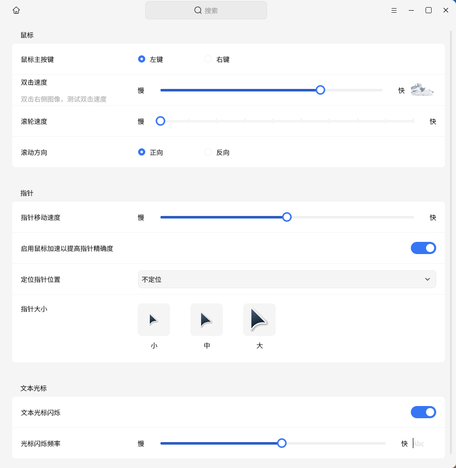

### 触控板

触控板提供了以下功能设置

1）插入鼠标时触控板开启/关闭

2）指针速度慢/快

3）打字时禁用触控板开启/关闭

4）使用单个手势点击即可单击开启/关闭

5）使用两个手指点击即可右键单击开启/关闭

6）点击两次之后再拖动即可多选开启/关闭

7）按压触摸板右下角进行右键单击开启/关闭

8）边缘滚动手势开启/关闭

9）触控滚动方向(手指向下移动时向上滚动/手指向下移动时向下滚动)

10）触控滚动区域(中间区域滚动，边界滚动，禁用滚动)，设置边界滚动时，垂直边界及水平边界滚动有效，设置为中间区域滚动时，垂直中间及水平中间滚动有效。

11）捏合进行缩放开启/关闭

12）三、四指手势配置

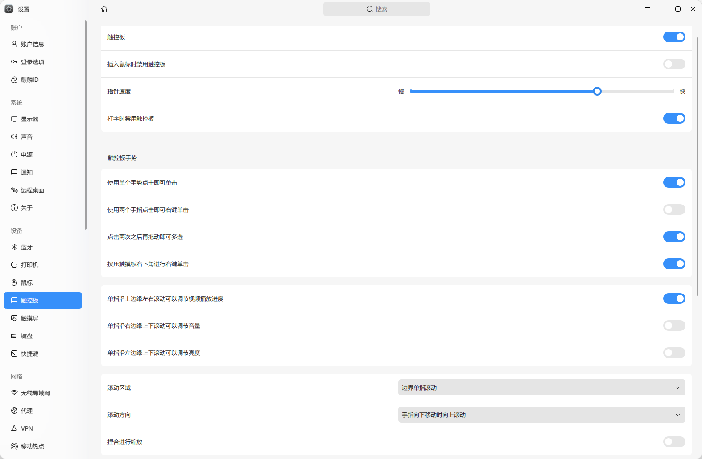

### 触摸屏

系统支持多任务、多场景的桌面触控交互，若您的设备支持触控功能，可使用多种触控手势进行桌面操作。

触摸屏又称为“触控屏”、“触控面板”，使用规范手势触碰计算机显示屏上的图符或文字即可实现与桌面的交互。

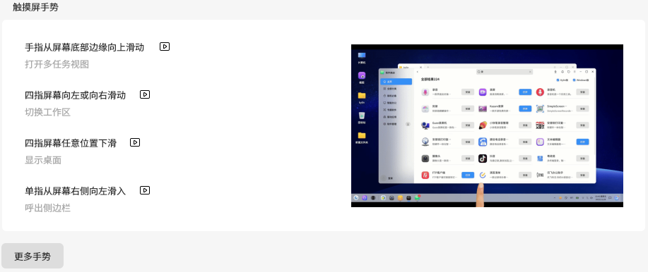

触摸屏基础手势交互如下：
- 单击：手指轻点触控设备，触发功能，例如：选择对象、打开菜单栏、执行按钮命令等
- 双击：手指快速点击两次触控设备，触发功能，例如：打开桌面应用、打开文件夹/文件、选择文字等
- 长按：手指长按某个元素触发功能，例如：显示弹出菜单栏、右键菜单栏、多选、选择文字等
- 滑动：滑动以连续滚动列表和页面、切换页面/对象、滑动以调节滑动条数值
- 拖动：移动对象位置，或拖动进行批量操作，例如：移动窗口/文件、框选图标/文字等
- 捏合：两个手指按住屏幕向外展开以放大内容，向内收拢以缩小内容，例如：网页、图片

注意：若您的设备不具有此功能，且未外接触摸屏，控制面板中不显示触摸屏的设置。

触摸校准：

在“触摸校准”设置中，显示您的显示器、触摸设备及ID，您可以选择显示器和触摸设备ID后，点击设置触摸屏进行触摸映射触摸屏。
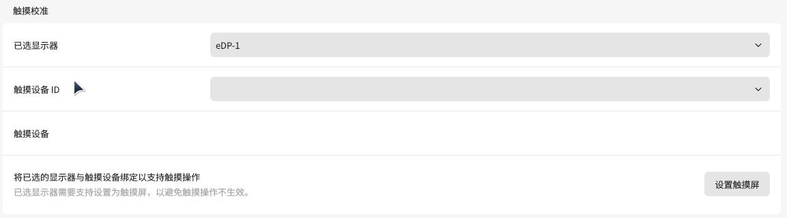

 

### 键 盘

您可在“键盘”配置中，进行键盘响应速度、键盘布局、添加输入法等相关配置。

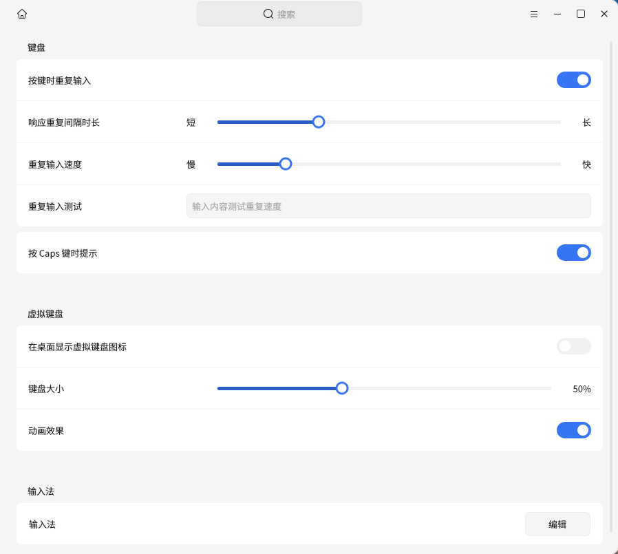

1）通用设置：
- 可设置启用按键时重复输入设置：按下某个按键不放，系统会将该行为作为重复的键盘输入。启用按键重复设置后，可对延时、速度两个选项进行设置。
- 可设置响应重复间隔时长：按下按键后，到系统开始接收键盘输入之间的间隔
- 可设置重复输入速度：按下按键后，重复输入之间的间隔；间隔越长，同样时间内，重复输入的次数越少
- 可设置启用按 Caps 键时提示：大小写切换提示。

2）虚拟键盘：

- 在桌面显示虚拟键盘图标
- 键盘大小
- 动画效果

3）输入法设置：
- 输入法语言、国家设置
- 全局配置

### 快捷键

您可在该配置中查看系统应用快捷键，添加自定义快捷键等相关配置，并为系统应用提供恢复默认功能。

快捷键根据系统版本有所调整。

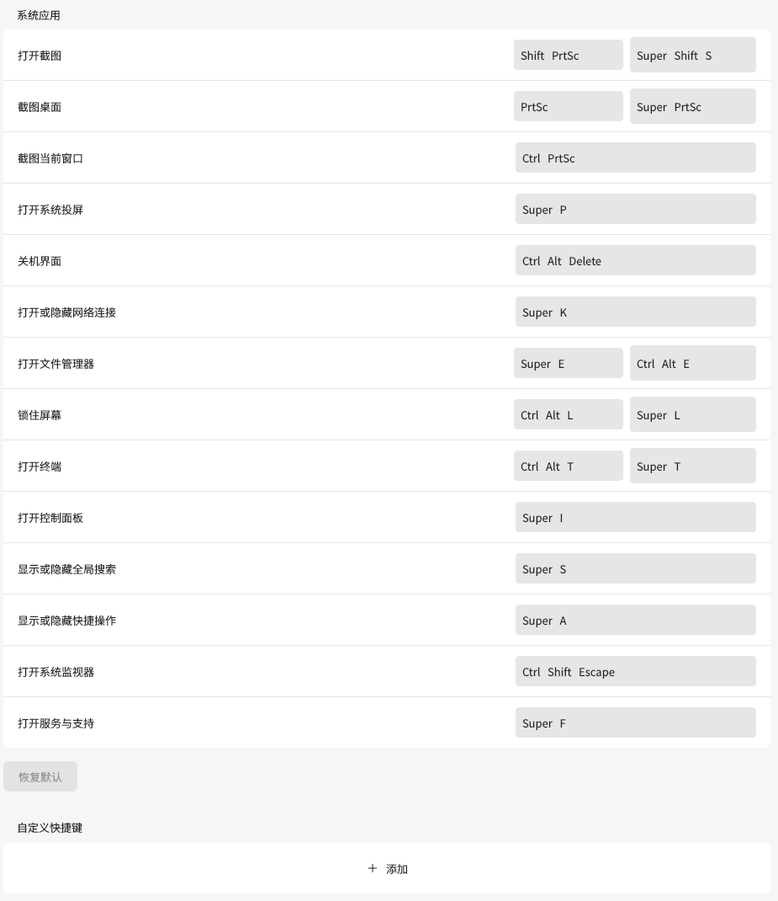

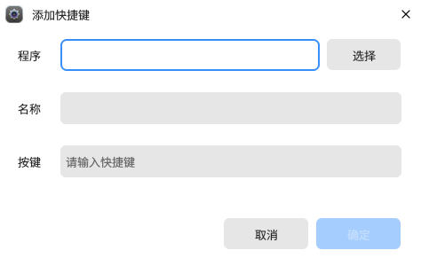

 

## 网 络

网络主要包含了有线网络、无线局域网、代理、VPN和移动热点五个模块。

### 有线网络

提供有线网络的显示、连接或断开，可以分别对单张有线网卡进行开关管理。

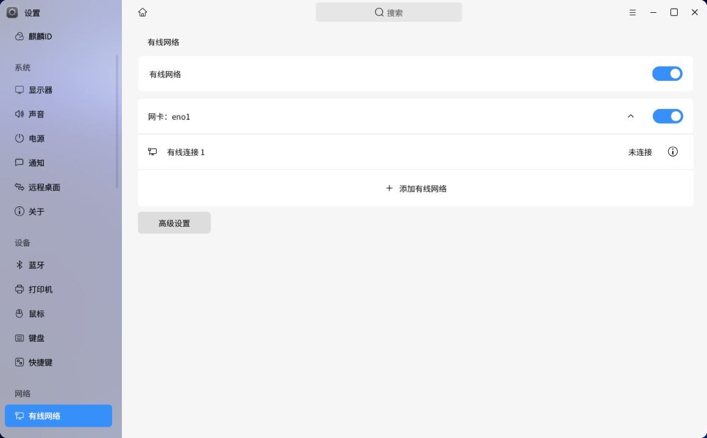

### 无线局域网

提供无线网络的显示、连接或断开，可以对无线功能进行开关管理。

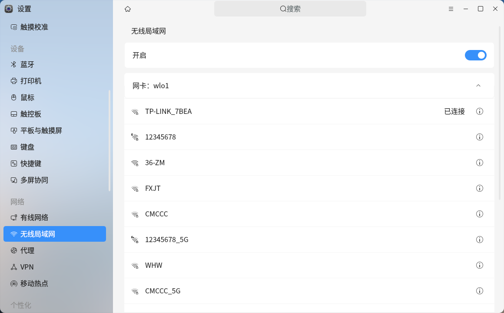

### 代 理

可设置系统代理以及APT代理

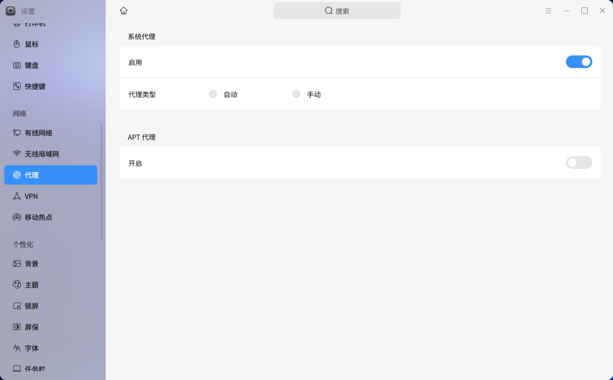

- 系统代理可选择自动代理和手动代理，手动代理包括HTTP，HTTPS，SOCKET，FTP代理
- 开启APT代理，通过设置的代理服务器可在软件商店进行应用程序的下载和更新

### VPN

打开外部VPN设置程序

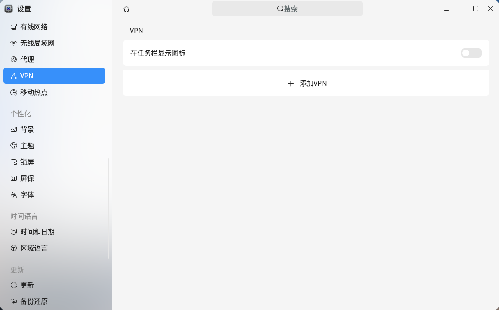

### 移动热点

使用本机作为无线网络提供方，其他设备连接后可以进行上网操作。

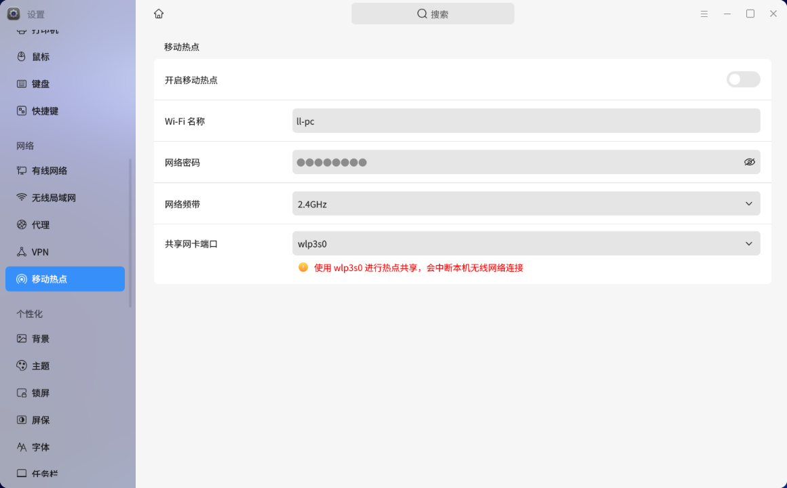

 

## 个性化

个性化设置提供了背景、主题、锁屏、屏保、字体五个模块。

### 背 景

针对桌面背景，提供两种背景形式的选择：颜色、图片，并提供六种显示方式选择：填充、平铺、居中、拉伸、适应、跨区。

### 主 题

主题包括主题模式、窗口外观、图标主题、光标主题、窗口特效和相关设置。

- 主题模式：

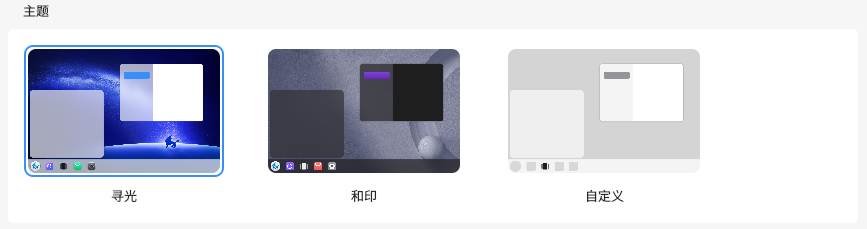

- 窗口外观：

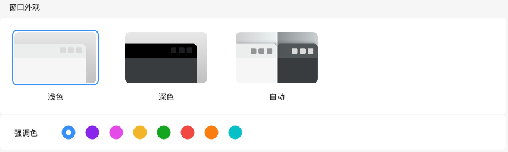

- 图标主题和光标主题（wayland环境不支持光标主题）：

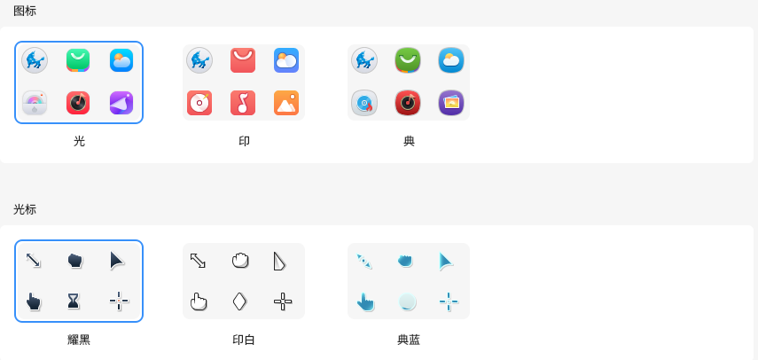

- 窗口特效（部分机型不支持）：

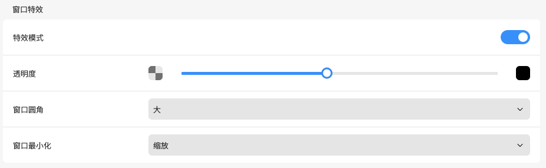

- 相关设置：

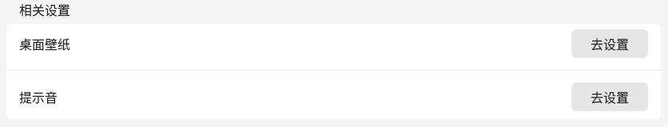

### 锁 屏

选择在登录界面显示的背景图片。

### 屏 保

设置屏保程序、等待时间。

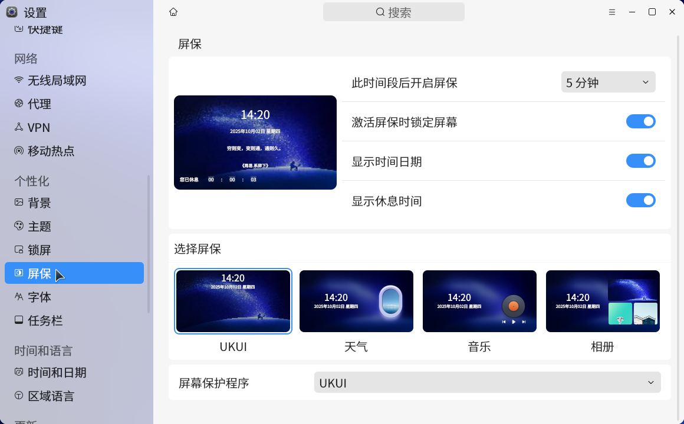

### 字 体

对字体、大小、等宽进行常规设置，包括调整字体大小、安装字体、搜索字体、卸载字体、应用字体、查看字体详情等。

点击“恢复默认设置”按钮将所有字体设置还原为系统默认状态。

### 任务栏

对任务栏、始终显示在任务栏上的图标以及显示在托盘系统图标进行设置。

- 在任务栏设置中，可以对是否合并任务栏上的图标、任务栏的大小、位置、任务栏是否自动隐藏和任务栏是否锁定进行设置。

- 在始终显示在任务栏上的图标设置中，可以通过操作子项目的开关按钮进行设置。

- 在显示在托盘的系统图标设置中，可以通过操作电源、声音、网络、蓝牙等子项目的开关按钮进行设置。

 

## 时间语言

包括时间日期和区域语言两个模块

### 时间和日期

- 自动同步时间：与互联网上的NTP服务器时间同步
- 手动设置时间：手动设置时间和年月日

- 更改时区：如图所示，根据个人需求进行选择

### 区域语言

主界面如图所示:

- 语言格式：自定义日历、一周第一天、日期、时间、语言格式示例
- 系统语言：系统窗口、菜单及网页的显示语言，首选推荐语言为简体中文
- 点击“添加”，可添加其他地区语言作为备选

 

### 更 新
“更新”模块可以检测系统是否有可用更新并进行更新的相关设置。  
“系统更新”显示当前系统更新状态和上次检测更新时间，点击“检查更新”，会自动访问麒麟更新管理平台获取更新内容。  
“更新设置”可以设置是否自动下载更新、在有可更新内容时收到通知、是否回退到上一个版本、查看更新历史、配置高级设置等。  
在“自动下载更新”配置中可以设置自动检测更新周期、自动下载更新时间段。  
在“更新历史”中可以搜索和查看更新详情。  
在“高级选项”中可以自定义高级设置，如服务端地址、下载限速、开启下载限速后会在下次下载时进行限速等。

#### 升级和回退
安装完成进入系统后，可以通过升级功能获取最新的可用更新，保证系统运行最新版本，获取更好的使用效果。如果用户想要回退使用旧版本，用户可以使用“回退到上一个版本”功能。  
升级功能分为在线升级和离线升级，以满足不同的使用场景。

##### 在线升级
点击打开“开始”菜单栏，点击设置，进入设置界面。

选择更新组件，进入更新检查阶段。

更新组件会自动进行优先升级，保证更新功能运行在最新状态。优先升级完成后，“设置-更新”界面会自动重启。  
重新运行更新组件，获取可升级的系统更新。

点击全部更新，升级过程会首先进行相关更新包的下载，下载完成后，会提示用户重启进行安装。

点击重启之后，进入开机界面，展示安装进度。

安装完成，电脑重启进入登录界面，输入账号密码，进入桌面。稍等片刻，右上角弹窗提示更新成功。

进入“设置-更新”界面，点击“更新历史”，更新历史记录中可以搜索和查看更新详情。

#### 离线升级
在特殊场景下，我们可以采用离线升级的方式进行离线升级。  
使用离线升级，需要联系产品部门获取离线升级包。

获取离线升级包后，双击并安装离线升级包。

后续操作与在线升级相同。

#### 异常回退

通过更新组件进行备份及更新会保存升级前的系统状态。当安装失败时，版本会自动进行回退操作。当安装成功且用户想使用升级前版本时，可进行“回退上一个版本”操作。  
备份升级后，打开设置-更新，会存在“回退上一版本”这一选项。

点击“开始”，会有弹窗提示还原前确保重要文件已备份到其他存储设备，点击“继续回退”，进入系统还原界面。

完成还原，系统重启进入登录界面。

### 备 份
“备份还原”模块可以创建系统、数据的备份，还原历史备份。点击“开始备份”或“开始还原”会自动打开备份还原工具，您可以进行系统备份、系统还原、数据备份、数据还原等操作。详细操作介绍请见手册中备份还原工具部分内容。

 

## 安 全

### 安全中心
设置界面中加入了安全中心入口。点击不同模块的“查看详情”按钮，可以直接进入安全中心软件对应模块界面。

 

## 应 用

应用包括默认应用和开机启动

### 开机启动
列表中显示当前系统已存在的开机启动软件。

点击“添加”，可添加开机启动应用。

### 默认应用
默认应用可以修改图中几种类型的默认打开应用：

 

## 搜 索

### 全局搜索

通过设置提高搜索效率。

 

## 通 用

### 系统启动

Grub 验证：可开启或关闭 Grub 验证，以及 Grub 验证密码设置。

开启时设置 Grub 验证密码，开启后可重置密码。

Grub 启动延时：设置 Grub 启动延时可调整引导菜单等待时间（SW与Mips架构暂不支持）。

默认启动的系统：设置 Grub 默认启动项可调整你希望运行的默认操作系统（SW与Mips架构暂不支持）。

Wayland的双系统及多系统不支持以上功能。

 

### 辅助功能

放大镜：放大屏幕内容。

色彩滤镜：使用色彩滤镜使屏幕上的颜色更易于查看和区分。

屏幕朗读：语音朗读屏幕上的内容。按Super+Alt+S快速启动或关闭屏幕朗读。提供屏幕朗读音量、语速自定义设置。

### AI模块管理

AI模块管理，显示AI子系统的简介、版本信息。

模型配置，显示模型分类和介绍，点击配置可以查看已添加模型的详细信息，支持以下功能：新增模型、删除模型、编辑模型、启用或禁用模型、设置模型的使用优先级等。

## 常见问题
#### 点击开始菜单上的设置按钮，无反应
 在键盘上按下 Ctrl + Alt + T 组合键打开命令行终端，输入“ukui-control-center”后按下Enter，查看错误输出。

#### 版本问题
- 如何查看系统版本？
     可右键状态栏空白区域，选择关于麒麟查看系统版本。
- 如何查看服务序列号？
     可右键任务栏空白区域，选择关于麒麟查看服务序列号。
- 如何区别哪个光盘是对应哪个版本的系统？
     挂载光盘后打开挂载目录下的LICENSE或.kyinfo文件，可查看版本相关信息。
- 在麒麟软件官网上申请的试用版本使用期限是多久？
     在麒麟软件官网上申请的试用版本可以一直使用，但是不享受售后服务。
- 怎么查看内核版本？
     可右键任务栏空白区域，选择关于麒麟查看系统内核版本。
- Openkylin桌面操作系统不同大版本之间有什么区别？
     不同大版本之间会有内核或者其他的层面的不同，具体可咨询商务或者参考官网对不同版本的系统介绍。
- 电脑装了Windows 10和Openkylin桌面操作系统双系统数据盘可以共用吗？
     可以共用。
#### 显示问题
- Ctrl+alt+T无法打开终端怎么办？
     通过开始菜单打开终端，执行ukui-settings-daemon，看是否会报错。
- 开始菜单无法打开了怎么办？
     可通过删除./face文件解决，打开终端执行指令：sudo rm -f ~/.face。
- 在哪里关闭锁屏并且设置锁屏时间？
     打开开始菜单-设置-个性化-锁屏来设置锁屏时间。

 
