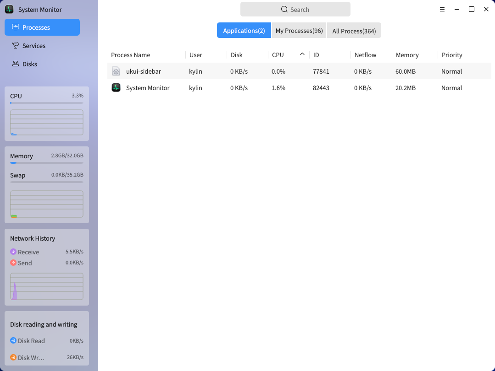
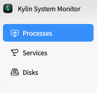
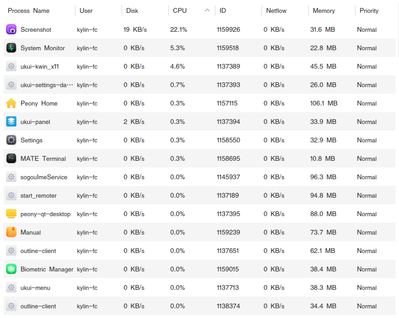
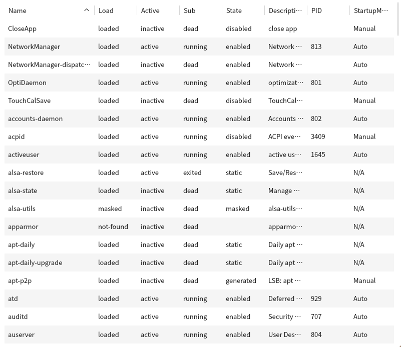
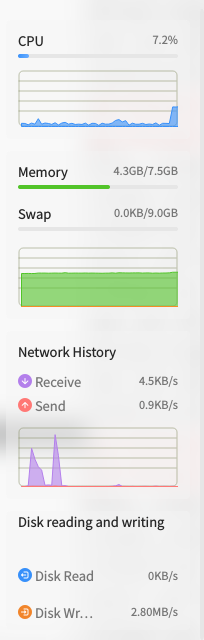
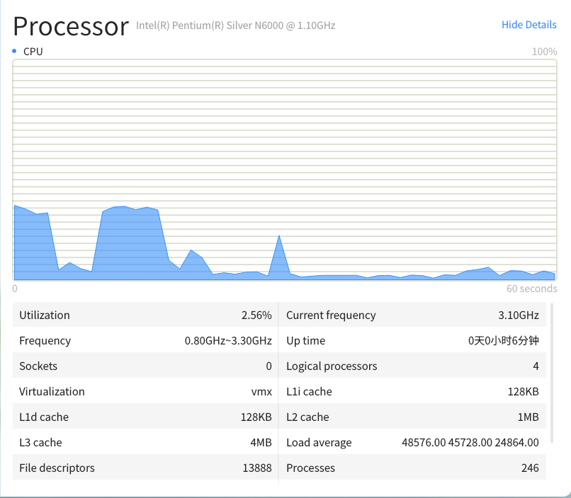
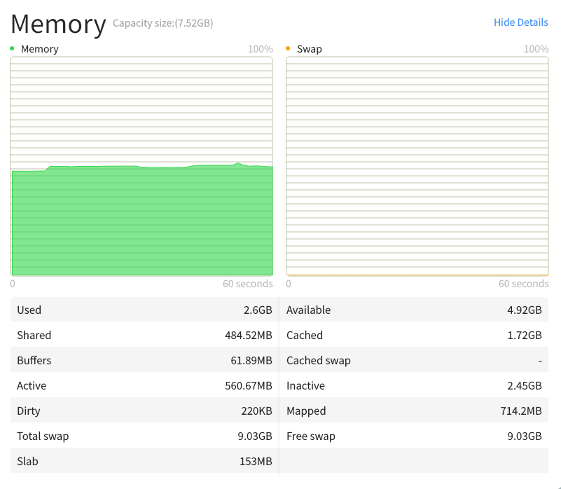
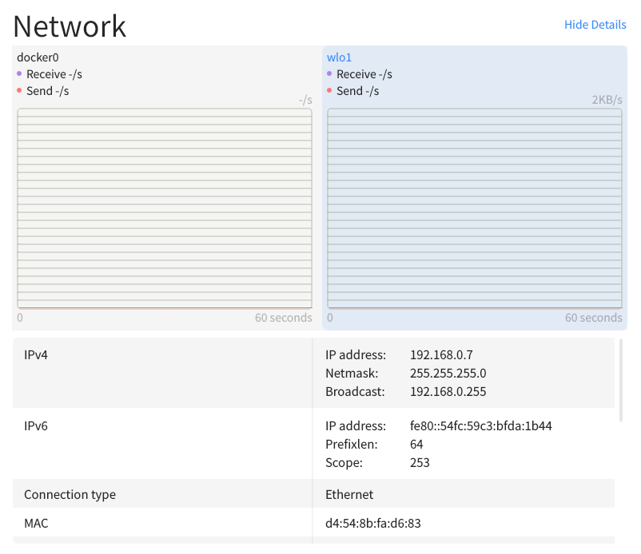
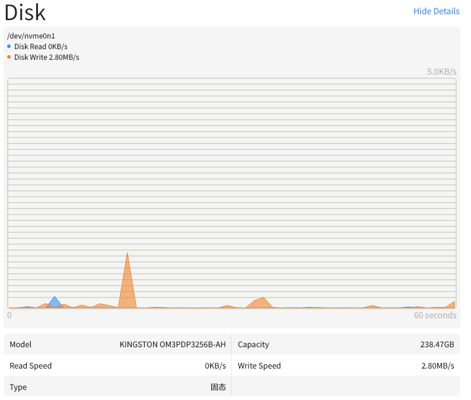
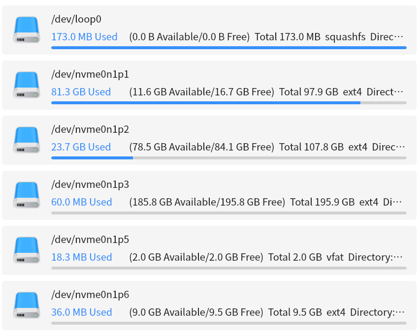

# System Monitor
## Overview
System Monitor is a professional application for monitoring system processes, system resources and file systems on openKylin. Through its concise and clear interface, it can intuitively display system-related information that users want to find.

 

## Side Bar/Title Bar
The side bar/title bar provides interface switching and search box search functions.

- Users can switch processes、service or disk interfaces according to their needs.

- Users can select the startup user and process category to switch the process, current user or all users, or whether the process is application.You can also view the total number of corresponding processes.

 

## Processes
Display the process list and perform specified operations on the process.

Statistics show all started processes, and show their specific core information such as id, name, starting user CPU occupancy, memory, priority, disk IO rate and network flow consumption etc. And can execute functions such as killing, ending the process or change the process priority.

 

## Services
Display service list and perform specified operations on services.

Statistics show all started services and show their specific core information, such as name, load, running status, activity, status, description, PID, startup method, and refresh the service.

 

## Resources
Monitoring shows CPU, memory and swap space and system network traffic information.

### CPU History
The dynamic line graph counts the historical CPU usage, and the upper right label displays real-time CPU usage data, click to show CPU details.By default, the overall utilization rate is displayed, and by right clicking on the line chart area, the display logic processor can be switched.

### Memory and Swap Space History
The dynamic line graph counts the total historical occupation of the running memory and swap space of the system, and the label on the upper right shows the real-time occupation-Dosage and total amount, click to show memory details.

### Net History
Dynamic line chart statistics system receives and sends historical data of traffic, the upper right shows real-time network receiving and network sending rate, click to show Network details.

### Disk History

Dynamic line chart statistics system reads and writes historical data on speed, with tables displaying disk model, capacity, disk read speed, disk write speed, and disk type. Click the sidebar to view the disk details page.

 

## Disk
Count the list of mounted system partitions and the specific information of each partition.

- Monitor the number of partitions mounted to the system in real time and display them in a list.
- Display the mounted partition, mount path, partitions type, partitions capacity, partitions free space and remaining space, etc.