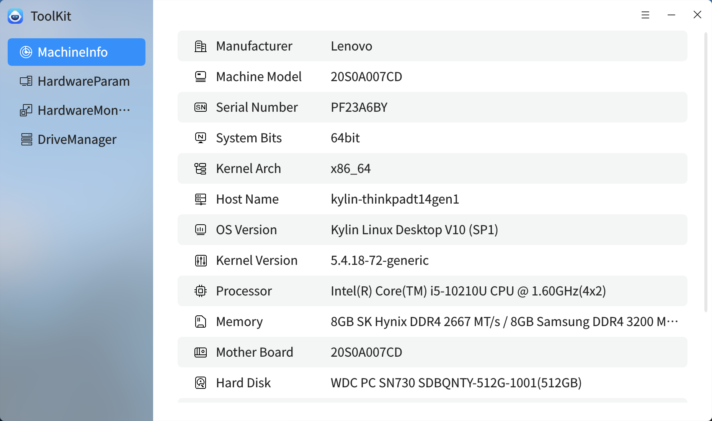
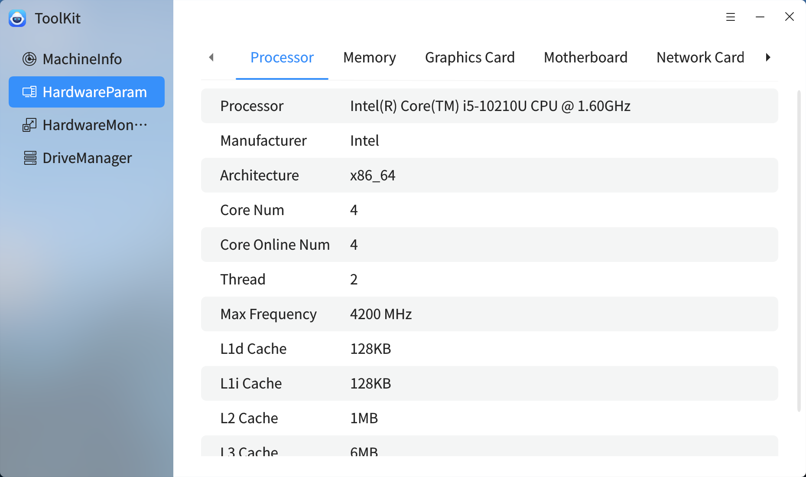
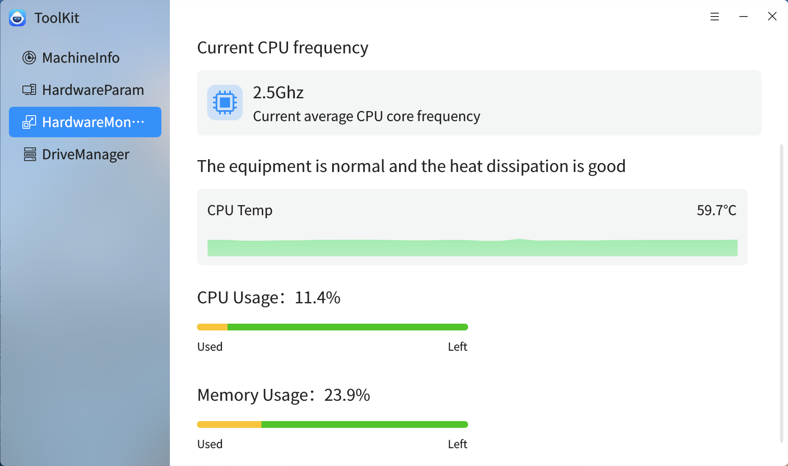
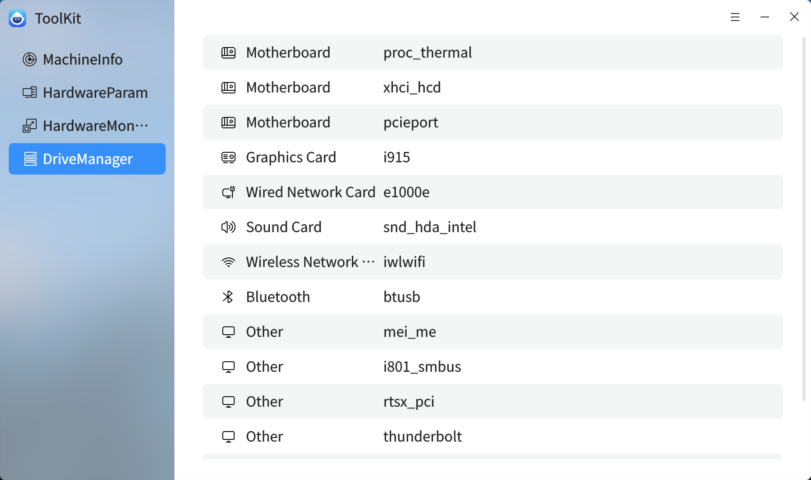

# Toolkit

The toolkit provides the functions of machine information, hardware parameters, hardware monitoring and drive management.
 

## Complete machine information
The whole machine information interface can view the basic information and hardware information of the machine, including processor, motherboard, hard disk, network card, video card, sound card, etc.

 

## Hardware parameters
The hardware parameter interface allows you to view the details of the processor, memory, video card, motherboard, network card, hard disk, display, sound card, keyboard, mouse, optical drive, and Bluetooth.

 

## Hardware monitoring
In the hardware monitoring interface, the device detection interface can view the hardware device temperature and utilization rate in real time.

 

## Drive management
Drive management can view various driver information in the computer for later driver update.

 