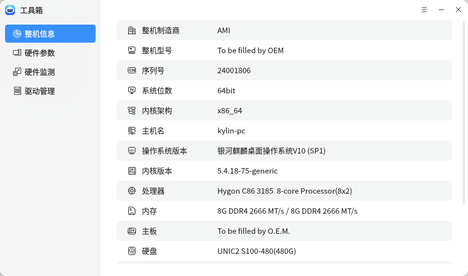
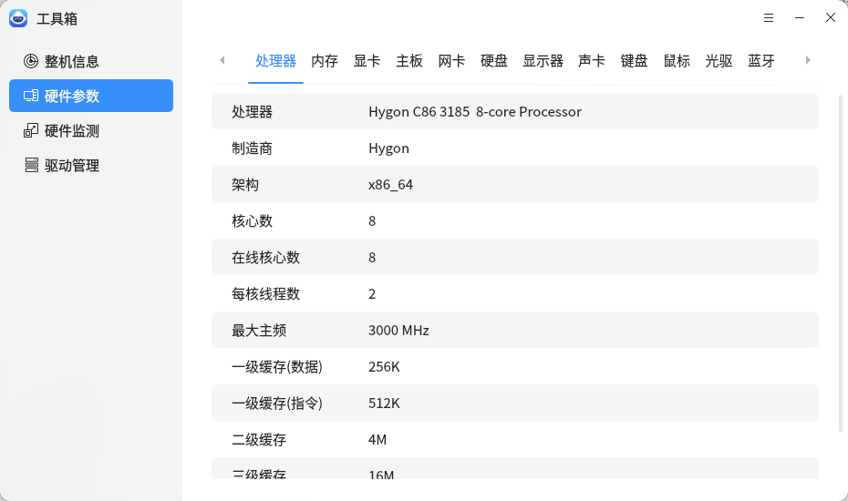
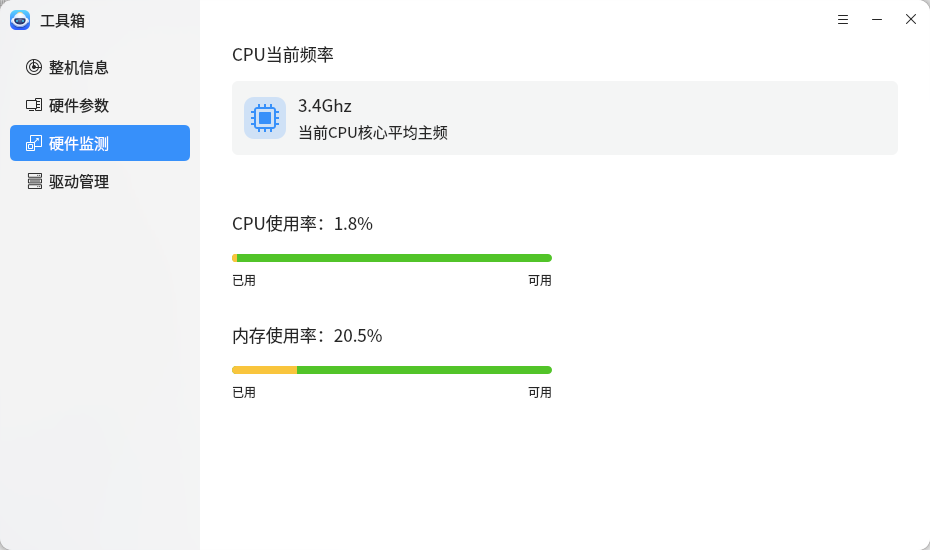
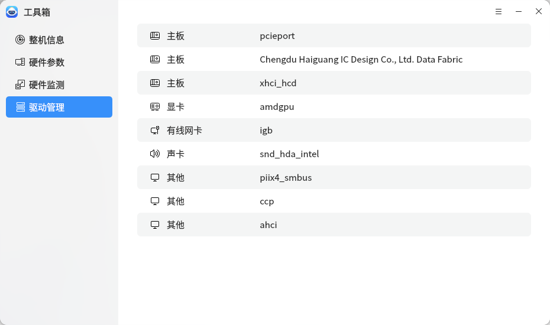

# 工具箱

工具箱提供了整机信息，硬件参数，硬件监测、驱动管理的功能。
 

## 整机信息

整机信息界面可查看本机基本信息和本机硬件信息，包括处理器、主板、硬盘、网卡、显卡、声卡等。

 

## 硬件参数

硬件参数界面可查看本机处理器、内存、显卡、主板、网卡、硬盘、显示器、声卡、键盘、鼠标、光驱、蓝牙的详细信息。

 

## 硬件监测

硬件监测界面中，设备检测界面可实时查看硬件设备温度和使用率

 

## 驱动管理
驱动管理可查看计算机中的各个驱动信息，便于后期更新驱动程序。

 

