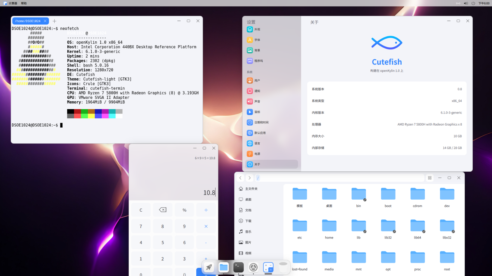

## Cutefish SIG 

可爱鱼桌面环境是由国人开发的一款简洁、美观、实用的桌面系统

## 工作目标

负责移植Cutefish桌面环境及其组件，目前已经完成桌面移植工作，完成了对x86，ARM，RISC-V三个架构的适配工作

## SIG成员

### SIG Owner

DSOE1024

### SIG Maintainers

XXTXTOP

## SIG维护包列表

目前一共维护23个软件包

### 桌面核心包

#### Cutefish Core

介绍：Cutefish 桌面核心组件，包括系统后端和启动会话等

仓库：https://gitee.com/openkylin/cutefish-core

#### Cutefish Fishui

介绍：FishUI 是一个基于QQC2（Qt Quick Controls 2）的GUI库，每个Cutefish应用程序都使用它

仓库：https://gitee.com/openkylin/cutefish-fishui

#### Cutefish libcutefish

介绍：Cutefish 系统库

仓库：https://gitee.com/openkylin/cutefish-libcutefish

#### Cutefish Qt Plugins

介绍：CutefishOS的Qt应用风格插件库

仓库：https://gitee.com/openkylin/cutefish-qt-plugins

#### Cutefish launcher

介绍：Cutefish 的全屏应用程序启动器

仓库：https://gitee.com/openkylin/cutefish-launcher

#### Cutefish statusbar

介绍：Cutefish 桌面顶部的状态栏，显示系统的当前状态，例如时间、系统托盘等

仓库：https://gitee.com/openkylin/cutefish-statusbar

#### Cutefish dock

介绍：Cutefish 桌面应用程序扩展坞

仓库：https://gitee.com/openkylin/cutefish-dock

#### Cutefish Daemon

介绍：Cutefish 桌面后端

仓库：https://gitee.com/openkylin/cutefish-daemon

#### Cutefish Gtk Themes

介绍：Cutefish GTK 主题

仓库：https://gitee.com/openkylin/cutefish-gtk-themes

#### Cutefish SDDM Theme

介绍：Cutefish 的 SDDM 主题

仓库：https://gitee.com/openkylin/cutefish-sddm-theme

#### Cutefish Cursor Themes

介绍：Cutefish 光标主题

仓库：https://gitee.com/openkylin/cutefish-cursor-themes

#### Cutefish icons

介绍：Cutefish默认图标主题，基于Vinceliuice的whitesur

仓库：https://gitee.com/openkylin/cutefish-icons

#### Cutefish Screen locker

介绍：Cutefish 锁屏程序

仓库：https://gitee.com/openkylin/cutefish-screenlocker

### 桌面前端应用

#### Cutefish Terminal

介绍：Cutefish 终端

仓库：https://gitee.com/openkylin/cutefish-terminal

#### Cutefish File Manager

介绍：Cutefish 文件管理器

仓库：https://gitee.com/openkylin/cutefish-filemanager

#### Cutefish Calculator

介绍：Cutefish 计算器

仓库：https://gitee.com/openkylin/cutefish-calculator

#### Cutefish Settings

介绍：Cutefish 桌面系统设置应用程序

仓库：https://gitee.com/openkylin/cutefish-settings

#### Cutefish debinstaller

介绍：Cutefish 软件包安装器

仓库：https://gitee.com/openkylin/cutefish-debinstaller

#### Cutefish TextEditor

介绍：Cutefish 软件包安装器

仓库：https://gitee.com/openkylin/cutefish-texteditor

#### Cutefish Video Player

介绍：Cutefish 视频播放器

仓库：https://gitee.com/openkylin/cutefish-videoplayer

### 其他

#### Cutefish AppMotor

介绍：优化启动可爱鱼应用程序速度

仓库：https://gitee.com/openkylin/cutefish-appmotor

#### Cutefish Kwin Plugins

介绍：Cutefish kwin插件（目前软件包和UKUI有冲突）

仓库：https://gitee.com/openkylin/cutefish-kwin-plugins

#### Cutefish Docs

介绍：Cutefish 文档（不推荐）

仓库：https://gitee.com/openkylin/cutefish-docs

## 致谢

StarFive赛昉科技提供RISC-V板卡和技术支持

CoolPi和Eason提供ARM板卡支持

