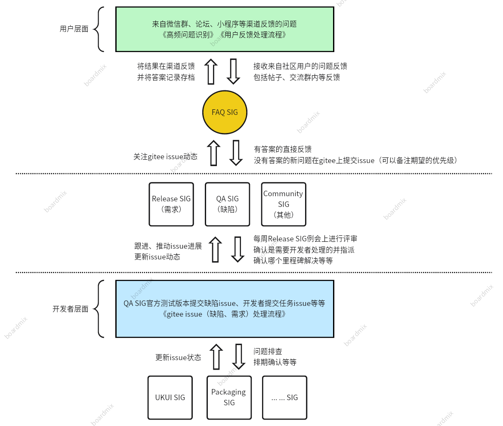

# FAQ SIG

## 简介

FAQ SIG（FAQ特别兴趣小组）负责帮助社区用户解决问题，推动建设openKylin社区问题解决工作流，同时推动建立社区知识库。

## 工作目标

收集各渠道开发者、爱好者等用户反馈的问题，并建立相关标准化流程推动问题解答或解决，同时，在这一过程中不断为 openKylin 社区积累FAQ知识库，搭建社区FAQ平台。

1. 建立和完善社区问题收集、推动解决、结果反馈标准化流程。

2. 与Docs SIG合作开展文档征集活动搭建社区知识库，形成标准化问题答疑以及操作手册。

3. 引导用户主动使用社区已搭建的平台提出和解决问题。

4. 与各个SIG组的开发工作保持密切合作并参与到issue管理，进行issue指派和里程碑讨论。

5. 论坛问题反馈板块问题收集和答疑。

6. 开发搭建社区FAQ平台

## 维护仓库列表

### SIG规范&章程
[SIG规范章程](https://gitee.com/openkylin/faq-specification)

[SIG文档](https://gitee.com/openkylin/faq-docs)

### 需求汇总

[应用商店上架需求](https://gitee.com/openkylin/listing-requirements)

### FAQ平台-文渊阁问

[FAQ平台后端](https://gitee.com/openkylin/faq-platform-backend)

[FAQ平台桌面应用](https://gitee.com/openkylin/faq-platform-app)

[FAQ平台爬虫工具](https://gitee.com/openkylin/faq-platform-spide)

### FAQ工具

[FAQYH](https://gitee.com/openkylin/faqyh)

## 活动

[社区文档征集活动](https://www.openkylin.top/community/docs_collection.html)

## SIG成员

### Owner

- [DSOE1024](https://gitee.com/DSOE1024)

### Maintainers

- [zhangtianxiong](https://gitee.com/kiber)
- [江同学](https://gitee.com/JiangZLY)
- [沧海人间](https://gitee.com/the-sea-and-the-world)
- [冯世龙](https://gitee.com/fensl)
- [果冻Swiftie](https://gitee.com/jelly-swiftie)
- [陌生人](https://gitee.com/moshengrenx)
- [魏云博](https://gitee.com/wei-yunbo)
- [康哈哈](https://gitee.com/kang_yan_hong)
- [trackme](https://gitee.com/trackme)

### Contributor

- [gitlinux](https://gitee.com/gitealinux)

## 工作流程

## SIG邮件列表

faq@lists.openkylin.top