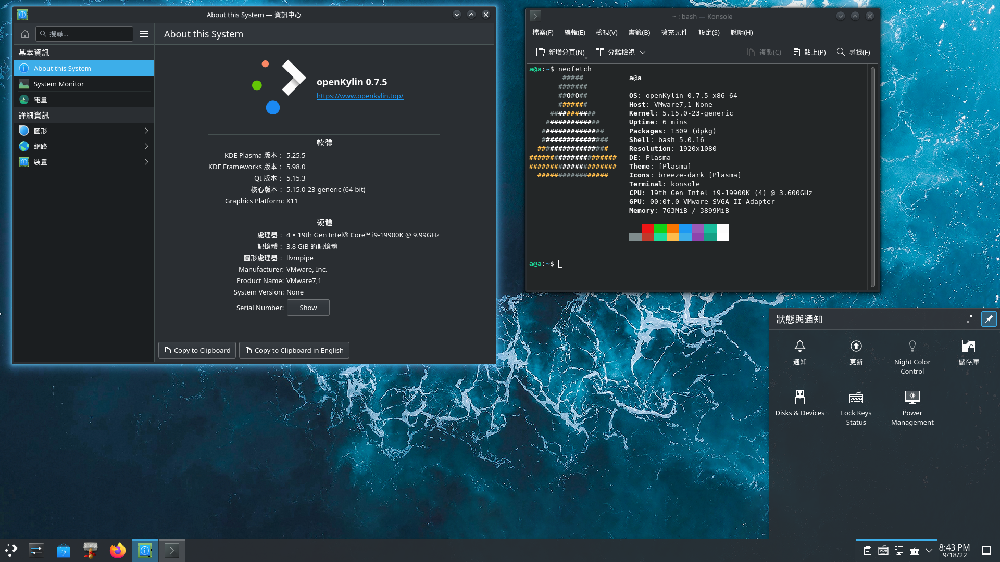

# KDE兴趣小组（SIG）

KDE(K Desktop Environment) SIG小组致力于KDE桌面环境相关软件包的规划、维护和升级工作。

选用当年的 TLS 版本，2022年是 KDE Plasma 5.24.X

## 工作目标

- 现阶段只是代码搬运工和打包工，以后将会：
- 负责 KDE 相关软件包的规划、维护和升级
- 及时响应用户反馈，解决相关问题

- KDE SIG文档仓 https://gitee.com/openkylin/kde-management

## repository

### KDE Plasma Desktop and standard set of applications
- kde-standard

### base applications from the official KDE release (metapackage) 
#### KDE基本应用
- dolphin(文件管理器): https://gitee.com/openkylin/dolphin
- kdialog(对话框显示单元): https://gitee.com/openkylin/kdialog
- keditbookmarks(书签编辑单元): https://gitee.com/openkylin/keditbookmarks
- kfind(文件搜索单元): https://gitee.com/openkylin/kfind
- konsole(终端模拟器): https://gitee.com/openkylin/konsole
- kwrite(文本编辑器): https://gitee.com/openkylin/kate
- khelpcenter(KDE documentation viewer): https://gitee.com/openkylin/khelpcenter
- kio-extras(Extra functionality for kioslaves): https://gitee.com/openkylin/
- skanlite(图像扫描程序): https://gitee.com/openkylin/skanlite

### KDE Plasma Desktop and minimal set of applications
- kde-plasma-desktop
- plasma-desktop(Plasma 桌面环境): https://gitee.com/openkylin/plasma-desktop
- plasma-workspace(Plasma 工作空间): https://gitee.com/openkylin/plasma-workspace
- sddm显示管理器: https://gitee.com/openkylin/sddm
- kwin窗口管理器: https://gitee.com/openkylin/kwin

### KDE Plasma 组件
- kdecoration(library to create window decorations): https://gitee.com/openkylin/kdecoration
- libkscreen(library for screen management): https://gitee.com/openkylin/libkscreen
- libksysguard(library for system monitoring): https://gitee.com/openkylin/libksysguard
- breeze(Default Plasma theme): https://gitee.com/openkylin/breeze
- breeze-gtk(GTK theme built to match KDE's Breeze): https://gitee.com/openkylin/breeze-gtk
- layer-shell-qt(use the Wayland wl-layer-shell protocol): https://gitee.com/openkylin/layer-shell-qt
- kscreenlocker(Secure lock screen): https://gitee.com/openkylin/kscreenlocker
- oxygen(Oxygen desktop theme): https://gitee.com/openkylin/oxygen
- oxygen-sounds(Sounds for the Oxygen desktop theme): https://gitee.com/openkylin/oxygen-sounds
- kinfocenter(system information viewer): https://gitee.com/openkylin/kinfocenter
- plasma-disks(Monitor S.M.A.R.T. capable devices for imminent failure in Plasma): https://gitee.com/openkylin/plasma-disks
- bluedevil(KDE Bluetooth stack): https://gitee.com/openkylin/bluedevil
- kde-gtk-config(KDE configuration module for GTK+ 2.x and GTK+ 3.x styles): https://gitee.com/openkylin/: https://gitee.com/openkylin/kde-gtk-config
- khotkeys(configure input actions settings): https://gitee.com/openkylin/khotkeys
- kmenuedit(XDG menu editor): https://gitee.com/openkylin/kmenuedit
- kscreen(KDE monitor hotplug and screen handling): https://gitee.com/openkylin/kscreen
- kwallet-pam(KWallet (Kf5) integration with PAM): https://gitee.com/openkylin/kwallet-pam
- kwayland-integration(kwayland runtime integration plugins): https://gitee.com/openkylin/kwayland-integration
- kwrited(Read and write console output to X): https://gitee.com/openkylin/kwrited
- milou(Dedicated search plasmoid): https://gitee.com/openkylin/milou
- plasma-nm(Plasma network connections management): https://gitee.com/openkylin/plasma-nm
- plasma-workspace-wallpapers(Wallpapers for Plasma 5): https://gitee.com/openkylin/plasma-workspace-wallpapers
- polkit-kde-agent(KDE dialogs for PolicyKit): https://gitee.com/openkylin/polkit-kde-agent-1
- powerdevil(Global power saver settings.): https://gitee.com/openkylin/powerdevil
- kdeplasma-addons(additional for Plasma 5): https://gitee.com/openkylin/kdeplasma-addons
- ksshaskpass(interactively prompt users for a passphrase for ssh-add): https://gitee.com/openkylin/ksshaskpass
- plasma-sdk(IDE tailored for development of Plasma components): https://gitee.com/openkylin/plasma-sdk
- sddm-kcm(KCM module for SDDM): https://gitee.com/openkylin/sddm-kcm
- breeze-grub(Breeze theme for GRUB 2): https://gitee.com/openkylin/breeze-grub
- kactivitymanagerd(System service to manage user's activities): https://gitee.com/openkylin/kactivitymanagerd
- plasma-integration(Qt Platform Theme integration plugins for KDE Plasma): https://gitee.com/openkylin/plasma-integration
- plasma-tests: https://gitee.com/openkylin/plasma-tests
- plymouth-kcm(KCM for Plymouth): https://gitee.com/openkylin/plymouth-kcm
- xdg-desktop-portal-kde(backend implementation for xdg-desktop-portal using Qt): https://gitee.com/openkylin/ xdg-desktop-portal-kde
- drkonqi(Crash handler for Qt applications): https://gitee.com/openkylin/drkonqi
- plasma-vault(Plasma applet and services for creating encrypted vaults): https://gitee.com/openkylin/plasma-vault
- plasma-browser-integration(Chromium, Google Chrome, Firefox integration for Plasma): https://gitee.com/openkylin/plasma-browser-integration
- kde-cli-tools(tools to use KDE services from the command line): https://gitee.com/openkylin/kde-cli-tools
- systemsettings(System Settings interface): https://gitee.com/openkylin/systemsettings
- plasma-discover(Discover software management suite): https://gitee.com/openkylin/plasma-discover
- plasma-thunderbolt(Plasma addons for managing Thunderbolt devices): https://gitee.com/openkylin/plasma-thunderbolt
- plasma-nano(Plasma shell for embedded devices): https://gitee.com/openkylin/plasma-nano
- plasma-mobile: https://gitee.com/openkylin/plasma-mobile
- plasma-firewall(Plasma configuration module for firewalls): https://gitee.com/openkylin/plasma-firewall
- plasma-systemmonitor(System monitor for the Plasma desktop): https://gitee.com/openkylin/plasma-systemmonitor
- qqc2-breeze-style(Breeze inspired QQC2 Style): https://gitee.com/openkylin/qqc2-breeze-style(
- ksystemstats(plugin based system monitoring daemon): https://gitee.com/openkylin/ksystemstats

### KDE 程序框架 (KDE Frameworks)
#### Tier 1
- plasma-framework(plasma程序框架): https://gitee.com/openkylin/plasma-framework
- attica(Open Collaboration Services API): https://gitee.com/openkylin/attica-kf5
- bluez-qt(BluezQt): https://gitee.com/openkylin/bluez-qt
- breeze-icons(Breeze icon theme): https://gitee.com/openkylin/breeze-icons
- extra-cmake-modules(Extra Cmake Modules): https://gitee.com/openkylin/
- kapidox(Scripts and data for building API documentation (dox) in a standard format and style): https://gitee.com/openkylin/kapidox
- karchive(File compression): https://gitee.com/openkylin/karchive
- kcalendarcore(The KDE calendar access library): https://gitee.com/openkylin/kcalcore
- kcodecs(Text encoding): https://gitee.com/openkylin/kcodecs
- kconfig(Configuration system): https://gitee.com/openkylin/kconfig
- kcoreaddons(Addons to QtCore): https://gitee.com/openkylin/kcoreaddons
- kdbusaddons(Addons to QtDBus): https://gitee.com/openkylin/kdbusaddons
- kdnssd(Abstraction to system DNSSD features): https://gitee.com/openkylin/kdnssd-kf5
- kguiaddons(Addons to QtGui): https://gitee.com/openkylin/kguiaddons
- kholidays(Holiday calculation library): https://gitee.com/openkylin/kholidays
- ki18n(Advanced internationalization framework): https://gitee.com/openkylin/ki18n
- kidletime(Monitoring user activity): https://gitee.com/openkylin/kidletime
- kirigami2(QtQuick plugins to build user interfaces based on the KDE human interface guidelines): https://gitee.com/openkylin/kirigami2
- kitemmodels(Models for Qt Model/View system): https://gitee.com/openkylin/kitemmodels
- kitemviews(Widget addons for Qt Model/View): https://gitee.com/openkylin/kitemviews
- kplotting(Lightweight plotting framework): https://gitee.com/openkylin/kplotting
- kquickcharts(A QtQuick module providing high-performance charts.): https://gitee.com/openkylin/kquickcharts
- syntax-highlighting(Syntax Highlighting): https://gitee.com/openkylin/ksyntax-highlighting
- kuserfeedback(User feedback framework): https://gitee.com/openkylin/kuserfeedback
- kwayland(Qt-style API to interact with the wayland-client and wayland-server API): https://gitee.com/openkylin/kwayland
- kwidgetsaddons(Addons to QtWidgets): https://gitee.com/openkylin/kwidgetsaddons
- kwindowsystem(Access to the windowing system): https://gitee.com/openkylin/kwindowsystem
- modemmanager-qt(Qt wrapper for ModemManager API): https://gitee.com/openkylin/
- networkmanager-qt(Qt wrapper for NetworkManager API): https://gitee.com/openkylin/networkmanager-qt
- oxygen-icons5(Oxygen icon theme): https://gitee.com/openkylin/oxygen-icons5
- prison(Barcode abstraction layer providing uniform access to generation of barcodes): https://gitee.com/openkylin/prison-kf5
- qqc2-desktop-style(QtQuickControls 2 style that integrates with the desktop): https://gitee.com/openkylin/qqc2-desktop-style
- solid(Hardware integration and detection): https://gitee.com/openkylin/solid
- sonnet(Support for spellchecking): https://gitee.com/openkylin/sonnet
- threadweaver(High-level multithreading framework): https://gitee.com/openkylin/threadweaver

#### Tier 2
- kactivities(Runtime and library to organize the user work in separate activities): https://gitee.com/openkylin/kactivities-kf5
- kactivities-stats: https://gitee.com/openkylin/kactivities-stats
- kauth(Abstraction to system policy and authentication features): https://gitee.com/openkylin/kauth
- kcompletion(Text completion helpers and widgets): https://gitee.com/openkylin/kcompletion
- kcontacts(Support for vCard contacts): https://gitee.com/openkylin/kcontacts
- kcrash(Support for application crash analysis and bug report from apps): https://gitee.com/openkylin/kcrash
- kdoctools(Documentation generation from docbook): https://gitee.com/openkylin/kdoctools
- kfilemetadata(A file metadata and text extraction library): https://gitee.com/openkylin/kfilemetadata-kf5
- kimageformats(Image format plugins for Qt): https://gitee.com/openkylin/kimageformats
- kjobwidgets(Widgets for tracking KJob instances): https://gitee.com/openkylin/kjobwidgets
- knotifications(Abstraction for system notifications): https://gitee.com/openkylin/knotifications
- kpackage(Library to load and install packages of non binary files as they were a plugin): https://gitee.com/openkylin/kpackage
- kpeople(Provides access to all contacts and the people who hold them): https://gitee.com/openkylin/kpeople
- kpty(Pty abstraction): https://gitee.com/openkylin/kpty
- kunitconversion(Support for unit conversion): https://gitee.com/openkylin/kunitconversion
- syndication(An RSS/Atom parser library): https://gitee.com/openkylin/syndication
#### Tier 3
- baloo(Baloo is a file indexing and searching framework): https://gitee.com/openkylin/baloo-kf5
- kbookmarks(Support for bookmarks and the XBEL format): https://gitee.com/openkylin/kbookmarks
- kcmutils(Utilities for working with KCModules): https://gitee.com/openkylin/kcmutils
- kconfigwidgets(Widgets for configuration dialogs): https://gitee.com/openkylin/kconfigwidgets
- kdav(An DAV protocol implementation with KJobs): https://gitee.com/openkylin/kdav
- kdeclarative(Provides integration of QML and KDE Frameworks): https://gitee.com/openkylin/kdeclarative
- kded(Extensible daemon for providing system level services): https://gitee.com/openkylin/kded
- kdesu(Integration with su for elevated privileges): https://gitee.com/openkylin/kdesu
- kemoticons(Support for emoticons and emoticons themes): https://gitee.com/openkylin/kemoticons
- kglobalaccel(Add support for global workspace shortcuts): https://gitee.com/openkylin/kglobalaccel
- kiconthemes(Support for icon themes): https://gitee.com/openkylin/kiconthemes
- kinit(Process launcher to speed up launching KDE applications): https://gitee.com/openkylin/kinit
- kio(Resource and network access abstraction): https://gitee.com/openkylin/kio
- knewstuff(Support for downloading application assets from the network): https://gitee.com/openkylin/
- knotifyconfig(Configuration system for KNotify): https://gitee.com/openkylin/knotifyconfig
- kparts(Document centric plugin system): https://gitee.com/openkylin/kparts
- krunner(Parallelized query system): https://gitee.com/openkylin/krunner
- kservice(Advanced plugin and service introspection): https://gitee.com/openkylin/kservice
- ktexteditor(Advanced embeddable text editor): https://gitee.com/openkylin/ktexteditor
- ktextwidgets(Advanced text editing widgets): https://gitee.com/openkylin/ktextwidgets
- kwallet(Secure and unified container for user passwords): https://gitee.com/openkylin/kwallet-kf5
- kxmlgui(User configurable main windows): https://gitee.com/openkylin/kxmlgui
- purpose(Offers available actions for a specific purpose): https://gitee.com/openkylin/purpose

#### Tier 4
- frameworkintegration(Workspace and cross-framework integration plugins): https://gitee.com/openkylin/frameworkintegration

#### Porting Aids
- kdelibs4support(Porting aid from KDELibs4): https://gitee.com/openkylin/kdelibs4support
- kdesignerplugin(Tool to generate custom widget plugins for Qt Designer/Creator): https://gitee.com/openkylin/kdesignerplugin
- kdewebkit(KDE Integration for QtWebKit): https://gitee.com/openkylin/kdewebkit
- khtml(KHTML APIs): https://gitee.com/openkylin/khtml
- kjs(Support for JS scripting in applications): https://gitee.com/openkylin/kjs
- kjsembed(Embedded JS): https://gitee.com/openkylin/kjsembed
- kmediaplayer(Plugin interface for media player features): https://gitee.com/openkylin/kmediaplayer
- kross(Multi-language application scripting): https://gitee.com/openkylin/kross
- kxmlrpcclient(Interaction with XMLRPC services): https://gitee.com/openkylin/kxmlrpcclient

### KDE 应用程序
#### KDE 系统管理
- kde-config-cron(program scheduler frontend): https://gitee.com/openkylin/kde-config-cron
- ksystemlog(系统日志查看器): https://gitee.com/openkylin/ksystemlog
- muon(软件包管理工具): https://gitee.com/openkylin/muon

#### KDE 游戏
- bovo(五子棋游戏): https://gitee.com/openkylin/bovo
- kapman(吃豆人克隆游戏): https://gitee.com/openkylin/kapman
- katomic(类似推箱子的逻辑游戏): https://gitee.com/openkylin/katomic
- kblocks(俄罗斯方块游戏): https://gitee.com/openkylin/kblocks
- kbounce(弹球游戏): https://gitee.com/openkylin/kbounce
- kdiamond(三子连线棋游戏): https://gitee.com/openkylin/kdiamond
- kfourinline(四子连珠游戏): https://gitee.com/openkylin/kfourinline
- kigo(围棋游戏): https://gitee.com/openkylin/kigo
- klickety(色块消去游戏): https://gitee.com/openkylin/klickety
- kmahjongg(麻将纸牌): https://gitee.com/openkylin/kmahjongg
- kmines(扫雷游戏): https://gitee.com/openkylin/kmines
- knights(国际象棋游戏): https://gitee.com/openkylin/knights
- kolf(迷你高尔夫): https://gitee.com/openkylin/knights
- kpat(纸牌): https://gitee.com/openkylin/kpat
- kreversi(黑白棋游戏): https://gitee.com/openkylin/kreversi
- kshisen(类似连连看的麻将游戏): https://gitee.com/openkylin/kshisen
- ksudoku(数独游戏): https://gitee.com/openkylin/ksudoku
- kubrick(三维魔方游戏): https://gitee.com/openkylin/kubrick
- palapeli(拼图游戏): https://gitee.com/openkylin/palapeli
- picmi(逻辑游戏): https://gitee.com/openkylin/picmi
- kajongg(中国麻将): https://gitee.com/openkylin/kajongg

#### KDE 图形
- gwenview(图像查看器): https://gitee.com/openkylin/gwenview
- kamera(digital camera support): https://gitee.com/openkylin/kamera
- kde-spectacle(屏幕截图工具): https://gitee.com/openkylin/kde-spectacle
- kgamma5(monitor calibration panel for KDE): https://gitee.com/openkylin/kgamma5
- kolourpaint(画图程序): https://gitee.com/openkylin/kolourpaint
- okular(文档查看器): https://gitee.com/openkylin/okular
- kdegraphics-mobipocket(mobipocket thumbnail plugin): https://gitee.com/openkylin/kdegraphics-mobipocket
- krita (数字绘画): https://gitee.com/openkylin/krita

#### KDE 多媒体
- dragonplayer(视频播放器): https://gitee.com/openkylin/dragonplayer
- elisa(音乐播放器): https://gitee.com/openkylin/elisa
- juk(音乐播放器): https://gitee.com/openkylin/juk
- kde-config-cddb(CDDB retrieval configuration ): https://gitee.com/openkylin/kde-config-cddb
- plasma-pa(Plasma 5 Volume controller): https://gitee.com/openkylin/plasma-pa
- k3b(磁盘刻录): https://gitee.com/openkylin/k3b
- kdenlive(视频编辑工具): https://gitee.com/openkylin/kdenlive
- kawve(声音编辑器): https://gitee.com/openkylin/kawve

#### KDE pim
- kmail(电子邮件客户端): https://gitee.com/openkylin/kmail
- knotes(弹出便笺): https://gitee.com/openkylin/knotes
- korganizer(个人日程安排工具): https://gitee.com/openkylin/korganizer

#### KDE 实用程序
- ark(KDE 压缩包文件管理工具): https://gitee.com/openkylin/ark
- kcalc(科学计算器): https://gitee.com/openkylin/kcalc
- kwalletmanager(KDE 密码库管理工具): https://gitee.com/openkylin/kwalletmanager
- sweeper(系统清理工具): https://gitee.com/openkylin/sweeper

#### KDE 辅助工具
- kmag(屏幕放大镜): https://gitee.com/openkylin/kmag
- kontrast(颜色对比度检查工具): https://gitee.com/openkylin/kontrast

#### KDE SDK
- kate(高级文本编辑器): https://gitee.com/openkylin/kate

### 其他依赖库
- libkexiv2: https://gitee.com/openkylin/libkf5kexiv2
- libkdcraw: https://gitee.com/openkylin/libkdcraw
- libmusicbrainz: https://gitee.com/openkylin/libmusicbrainz
- discover: https://gitee.com/openkylin/discover

#### kdenlive依赖
- gavl
- frei0r-plugins
- mlt
- mediainfo

#### muon 依赖
- debconf-kde
- apt-xapian-index
- xapian-bindings

#### krita 依赖
- libheif
- opencolorio
- libmypaint
- kseexpr
- xsimd
- xtl
- vc

### KDE 程序框架依赖
- phonon
- phonon-backend-gstreamer
- phonon-backend-vlc
- libaccounts-qt
- qca-qt5
- qrencode
- packagekit-qt
- appstream
- zxing-cpp
- sassc
- libqalculate
### kwin 依赖
- libxcvt
- kwayland-server
### KDE 应用程序依赖
- kaccounts-integration
- baloo-widgets
- editorconfig-core
- neon27
- libkf5kipi
- kimageannotator
- libxmlb
- libkcompactdisc
- libkdegames
- libkdepim
- libkeduvocdocument
- libkgapi
- libkleo
- libkmahjongg
- libkomparediff2
- ksanecore
- libksane
- libksieve
- libktorrent
- mailcommon
- mailimporter
- messagelib
- libzip
- ebook-tools
- qt-gstreamer
- qtdatavis3d-everywhere-src
- qtdeclarative-opensource-src
- qtgamepad-everywhere-src
- qtgraphicaleffects-opensource-src
- qtnetworkauth-everywhere-src
- qtquickcontrols-opensource-src
- qtquickcontrols2-opensource-src
- qtremoteobjects-everywhere-src
- qtscxml-everywhere-src
- qtserialbus-everywhere-src
- qttools-opensource-src
- qtwebchannel-opensource-src
- plasma-wayland-protocols
- libqaccessibilityclient
- kcolorpicker
- kmime
- kdsoap
- akonadi-search
- chmlib
- gpsd
- libdmtx
- mobile-broadband-provider-info
- openconnect
- oath-toolkit
- stoken
- ieee-data
- id3lib3.8.3
- snowball
- snowball-data
- libaccounts-glib
- libkaccouts2
- kaccounts-integration
- signond
- scim
- catdoc
- exiv2
- squashfuse
- libtomcrypt
- libtommath
- gst-plugins-base1.0
- gst-plugins-bad1.0
- gst-plugins-good1.0
- tpm2-tss
- libebur128
- movit
- sox
- rttr
- opensp
- libkdegames
- libkmahjongg
- gnuchess
- stockfish
- freecell-solver
- tpm-udev
- xmlsec1
- libde265
- ladspa-sdk
- fluidsynth
- mjpegtools
- libmodplug
- libnice
- gssdp
- gupnp
- gupnp-igd
- libofa
- soundtouch
- spandsp
- libusrsctp
- vo-aacenc
- vo-amrwbenc
- wildmidi
- zbar
- imagemagick
- libmad
- audiofile
- tinyxml2
- encfs
- krdc
- krfb
- ghostwriter
- kruler
- kronometer
- krusader
- kcharselect
- kalendar
- akonadi-calendar
- akonadi-calendar-tools
- akonadi-contacts
- akonadi-import-wizard
- akonadi-mime
- akonadi-notes
- akonadi-search
- akonadiconsole
- kdepim-runtime
- kdepim-addons
- kget
- grantleetheme
- eventviews
- kdiagram
- gpgme1.0
- libsrtp2
- libinstpatch
- timgm6mb-soundfont
- gstreamer1.0-pipewire
- svgpart
- qtkeychain
- kldap
- kmbox
- akonadi
- grantlee5
- kteatime
- artikulate
- blinken
- kalzium
- chemical-mime-data
- avogadrolibs
- eigen3
- glew
- spglib
- cclib
- kbruch
- kgeography
- kiten
- kig
- kmplot
- klettres
- ktouch
- kturtle
- marble
- shapelib
- ruby-ronn
- parley
- libkeduvocdocument
- rocs
- kwordquiz
- numpy
- minuet
- freepats
- fluid-soundfont
- timidity
- kdenetwork-filesharing
- kimagemapeditor

## SIG成员
### Owner
- [rtlhq](mailto:nobelxyz@163.com)

### Maintainers
- [rtlhq](https://gitee.com/rtlhq)

### Committers

## 邮件列表
kde@lists.openkylin.top
