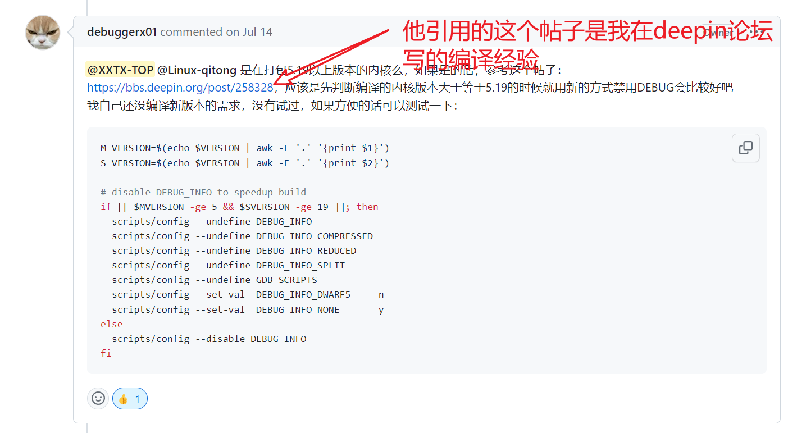

# openKylin KernelBuilder

openKylin 社区是在开源、自愿、平等和协作的基础上，由基础软硬件企业、非营利性组织、社团组织、高等院校、科研机构和个人开发者共同创立的一个开源社区，致力于通过开源、开放的社区合作，构建桌面操作系统开源社区，推动Linux开源技术及其软硬件生态繁荣发展。

## KernelBuilder

本SIG组设立目的为，自动为openKylin构建deb包的Linux内核，便于分发及使用，脱离Ubuntu或Debian的等上游分发内核进行自主构建。

**目前正在持续的更新中，因为还没实现我的终极目的。**

本项目fork自：[debuggerx01/kernel_deb_builder (github.com)](https://github.com/debuggerx01/kernel_deb_builder) 

日常使用Linux的过程中，可能经常因为系统的内核不够新导致一些新的硬件无法被驱动、或者是想尝试一下新版内核中的一些特性、比如部分risc-v的驱动在新内核中才被添加进去，及其他的一些原因需要使用到比较新的内核，所以此项目就研究了一下如何主动从kernel.org获取到最新的内核并打包成可以安装的deb。

原作者在之前的PR中表示之前他还没有编译新版本的需求 ，所以此项目就接手于开始自动获取和编译最近的内核了。

请不要质疑为什么需要最新的内核、此项目只是一个学习性的项目、用于学习内核编译打包的过程，如果你通过此项目学习到了如何打包内核deb或者其他包格式、目的就达到了。每个人的硬件都不一样、请各取所需。

此外我永远认为、**最好的内核永远是别人持续维护的内核**，比如这些主流发行版维护的内核。我自己用的内核都做不到一次不漏的给它打最新的补丁。

---

### 组织规划：

- 协助kernel对内核进行构件分发。（kernel组主要负责的是对内核代码的编制，更新；KernelBuilder SIG主要是进行构建分发）

- 针对不同架构发行版进行内核的构建。（多平台构建，不局限于X86）

- 新架构的内核构件工具移植。（如：构件在M2芯片上构件OK内核。）（利用现有项目二次开发）

- 跟进git fakeroot build-essential ncurses-dev xz-utils libssl-dev bc flex libelf-dev bison等工具的维护。加强内核构件效率。

- 建设kernel分发apt源，成立单独的内核源，对内核进行分发。 （周期较长，资金投入大。）

  | 组件        | 官网                                                         |
  | ----------- | ------------------------------------------------------------ |
  | wget        | [Wget - GNU Project - Free Software Foundation](https://www.gnu.org/software/wget/) |
  | xz-utils    | [XZ Utils (tukaani.org)](https://tukaani.org/xz/)            |
  | make        | [Make - GNU Project - Free Software Foundation](https://www.gnu.org/software/make/) |
  | gcc         | [GCC, the GNU Compiler Collection - GNU Project](https://gcc.gnu.org/) |
  | flex        | [westes/flex: The Fast Lexical Analyzer - scanner generator for lexing in C and C++ (github.com)](https://github.com/westes/flex) |
  | bison       | [Bison - GNU Project - Free Software Foundation](https://www.gnu.org/software/bison/) |
  | dpkg-dev    | [Dpkg — Debian Package Manager](https://www.dpkg.org/)       |
  | bc          | [bc - GNU Project - Free Software Foundation](https://www.gnu.org/software/bc/) |
  | rsync       | [rsync (samba.org)](https://rsync.samba.org/)                |
  | kmod        |                                                              |
  | cpio        | [Cpio - GNU Project - Free Software Foundation](https://www.gnu.org/software/cpio/) |
  | libssl-dev  | [openssl/openssl: TLS/SSL and crypto library (github.com)](https://github.com/openssl/openssl) |
  | git         | [Git - Downloading Package (git-scm.com)](https://git-scm.com/download/win) |
  | lsb         | [LSB Specifications (linuxfoundation.org)](https://refspecs.linuxfoundation.org/lsb.shtml) |
  | vim         | [welcome home : vim online](https://www.vim.org/)            |
  | libelf-dev  |                                                              |
  | python3-pip | [pip · PyPI](https://pypi.org/project/pip/)                  |
  | python3-tk  | [tkinter — Python interface to Tcl/Tk — Python 3.11.4 documentation](https://docs.python.org/3/library/tkinter.html) |
  | debhelper   | [debhelper(7) — debhelper — Debian jessie — Debian Manpages](https://manpages.debian.org/jessie/debhelper/debhelper.7.en.html) |

  ### 工作流程： 

  流程大概是：
  一、自动化处理流程，二十四小时检测Linux内核官网有没有发布新版本的内核，发布新版本的内核就和之前一个版本进行对比，新的化，就自动开始编译并打包。
  二、手动触发流程，我手动点击获取按钮、如果检测到内核比我本机的内核新，那么就自动开始编译，编译完成后自动进行下载、安装、重启。PS：本机特指我用来测试的机器和虚拟机。

  三、预计通过由openkylin-rootfs生成的openkylin-docker预制内核编译环境，来进行内核的编译，提升内核编译相关性。

  后续待实现流程：定制化编译、多架构编译、测试完成后一件进行签名并发布至apt源，并更新内核说明，供大家进行下载测试。

## 贡献补丁指南

如果您想对openKylin KernelBuilder 项目贡献补丁，请参考以下指南。

- 提交[issue](https://gitee.com/openkylin/community/issues/new)描述。 在issue中尽可能的描述清楚，issue可以是bug，也可以是特性，一个issue可以对应多个补丁。
  - 该问题的触发条件、重现步骤、以及报错信息等。
  - 测试环境，如平台、CPU、操作系统等等，越详细越好。
  - 如果在其他内核上是否也有类似问题，也可以进行说明。
  - 如果有对应的脚本或者工具也请描述清楚。

## 补丁合入指南

哪些补丁可以合入，请参考以下指南。

- 问题修复以及CVE安全漏洞补丁
- 性能优化补丁
- 功能增强补丁
- 主线的bug修复补丁、优化补丁或其他有用的特性
- 新设备适配补丁。

## 开发者指南

开发者可以做哪些事情呢，请参考以下指南。

- 修复[issue](https://gitee.com/openkylin/community/issues)上面反馈的问题。
- CVE补丁提交。
- 新设备适配。
- kernel帮助文档修订。

## 测试者指南

我们也欢迎测试介入，请参考以下指南。

- 在您的设备上搭建测试环境进行测试，如果发现bug，请[在这里](https://gitee.com/openkylin/community/issues/new) 提交。
- 可以在本地搭建CI环境，对发现的问题进行提交。
- 在本地部署功能、性能、稳定性测试环境。
- 构建专项调试、测试环境。
- 在不同的设备、环境、场景上进行测试验证。
- 测试脚本、测试工具贡献请联系邮件列表

## 补丁提交指南

### 补丁提交建议

为了您提交的补丁能够尽快被合并，有以下建议：

1. 将大的更改拆分为更小的、耦合度、复杂度更低的提交，一个补丁只做一件事，便于更快的审查和迭代。
2. 尽可能的在提交时说明为什么要提交这个补丁，并在代码中酌情注释。
3. 保持代码、测试、评论、文档、日志等风格与现有风格一致。
4. 提交的代码应该是经过测试验证的。

## SIG成员

### Owner

- XXTXTOP

### Maintainers

- chenchongbiao
- Linux-qitong
- XXTXTOP
- SmartDay 
- DSOE1024 
- fensl 
- rtlhq 

## SIG维护包列表

- kernel-builder
- openkylin-rootfs
- openkylin-wsl
- openkylin-docker
- distcc 
- gcc-13
- vf2-ok-kernel

### 相关工程

openkylin-wsl ：https://gitee.com/openkylin/openkylin-wsl

openkylin-rootfs： https://gitee.com/XXTXTOP/openkylin-rootfs

openkylin-docker： https://gitee.com/openkylin/openkylin-docker