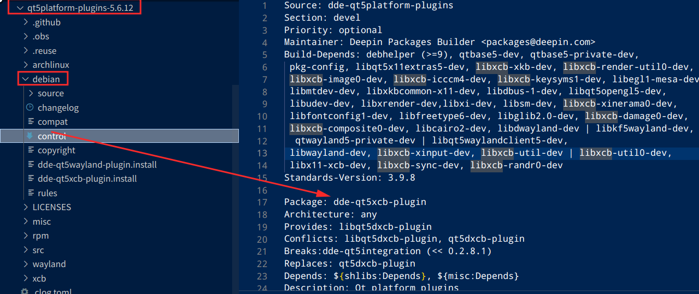

# openkylin DDE打包文档

## 更换 ci 源头

打包需要使用ci源，在软件发布后可以先在ci源中查看到，验证是否打包成功了，如果存在依赖关系等依赖构建完发布再进行新包的上传，否则缺少依赖上传了代码，也无法构建出可用的软件包。

在 /etc/apt/sources.list 文件中，将原本的软件源都注销，更换为下列软件源。

```bash
sudo vim /etc/apt/sources.list
```

```bash
deb http://archive.build.openkylin.top/openkylin yangtze main
deb http://archive.build.openkylin.top/OTHER/Internal-mirror/repack5/baseok0.fix yangtze main 
deb http://archive.build.openkylin.top/OTHER/Internal-mirror/stage0 yangtze main
deb http://archive.build.openkylin.top/openkylin yangtze-security main
deb http://archive.build.openkylin.top/openkylin yangtze-updates main
deb http://archive.build.openkylin.top/openkylin yangtze-proposed main
```

```bash
sudo apt update && sudo apt upgrade
```

更新软件和升级软件

## 需要的软件包

```
sudo apt install -y devscripts git-buildpackage pristine-tar
```

查看 v23 桌面环境下软件包的版本

以 qt5platform-plugins 仓库为例，一份源码，可能打出多个软件包，可以打开源码下，debian目录下找到control记录



的dde-qt5xcb-plugin 在 package_version.txt 文件中查看软件包的版本，可以查看到是5.6.12，如果已经安装好deepin v23系统的话，可以使用

```bash
apt policy dde-qt5xcb-plugin
```

来查看桌面环境下运行的软件版本。

## 下载源码

在 Github 的 [linuxdeepin](github.com/linuxdeepin/) 组织下找到对应的源码仓库，通过 https://github.com/linuxdeepin/源码仓库名/tags 的格式，那这个则是 https://github.com/linuxdeepin/qt5platform-plugins/tags，找到前面差找到的版本好，下载对应版本的压缩包。

```bash
wget https://github.com/linuxdeepin/qt5platform-plugins/archive/refs/tags/5.6.12.tar.gz
```

```bash
tar -zxvf 5.6.12.tar.gz
```

## 删除一些文件

```
rm -rf .github .obs
```

删除 deepin 的 Github 相关以及 OBS构建相关的文件

## 编辑debian目录模板文件

* 查看并修改debian/changelog文件，修改对应的版本号，版本信息描述等

先在源码目录通过 `dch -m "Build for openkylin"` 指令生成新的 changelog 这是对源码包修改做的记录。按照最终打出来的包是个5.6.12 的版本，这里changelog 记录的是5.6.11一个小问题，待后续验证，最终 deepin 运行下显示5.6.12 以这个为准

```
qt5integration (5.6.12-ok1) yangtze; urgency=medium

  * Build for openkylin

 -- Deepin Packages Builder <packages@deepin.com>  Sun, 23 Jul 2023 18:24:06 +0800

```

将版本号添加-ok1后缀，当前发行版本yangtze。下面的 Deepin Packages Builder <packages@deepin.com> 修改成自己的维护者名称以及邮箱。

ps: 注意最后一行保留空行。

## 打包当前上游软件包，生成规范化格式文件

```bash
dpkg-buildpackage -S -nc --no-sign
```

## 对源码进行构建

```bash
sudo apt build-dep .
```

在尝试推送仓库前，先进行软件包构建，进入源码目录使用上面的指令进行依赖安装，如果依赖满足会自动进行安装，如果依赖不满足先对不满足的依赖进行打包。

```bash
dpkg-buildpackage -us -uc -b
```

不要忘记清除，防止污染源码

```bash
dh clean
```
对软件包进行构建，会在上级目录下生成deb文件，如果构建成了，可不进行安装，等后续构建服务打包成功，从软件源进行安装。

## 将构建出的debian化源码包，反向构建到git仓库

### 导入源码到指定分支git仓库

返回上级dsc文件所在的位置。

```bash
gbp import-dsc --pristine-tar --debian-branch=openkylin/yangtze --upstream-branch=upstream dde-qt5platform-plugins_5.6.12.dsc qt5platform-plugins
```

其中：

--pristine-tar

记录原始orig tar 包的数据，避免重新用 gbp 打包后 tar 包内容发生变化。 pristine tar 分支（ Git
存储库中使用的默认分支名称是 pristine tar ）包含必要的附加信息，以从上游分支重新创建原始tarball 。
要使用此功能，您需要安装 pristine-tar 软件包。

--debian-branch=

指定打包分支名称，openkylin/yangtze 当前openkylin的版本系列。debian
branch Git 存储库中使用的默认分支名称是 master ）保存当前的开发工作。 这是通常用来发布版本的分支，并且新的上游版本会合并到该分支上。

--upstream branch=

指定上游分支名称，需为upstream。

--qt5platform-plugins_5.6.12.dsc=

通过源码生成的dsc文件。

--qt5platform-plugins=

生成的目标目录

### 新建打包分支

```
# 进入源码构建目录
cd qt5platform-plugins
# 创建quilt的分支，用于正式打包
git branch packaging/openkylin/yangtze
```

```
git remote add origin git@gitee.com:openkylin/qt5integration.git
git push --tags
git push --all
```

这里的git@gitee.com:openkylin/debhello.git，请修改为自己fork后仓库的地址，再到对应的仓库页面进行pull request，提交pr。

## 参考

[openKylin打包实践操作指南](https://gitee.com/openkylin/community/blob/master/sig/packaging/%E6%89%93%E5%8C%85%E5%AE%9E%E8%B7%B5%E6%93%8D%E4%BD%9C%E6%8C%87%E5%8D%97.md)

[openKylin源码包git工作流](https://docs.openkylin.top/zh/%E7%A4%BE%E5%8C%BA%E5%BC%80%E5%8F%91%E6%8C%87%E5%8D%97/openKylin%E6%BA%90%E7%A0%81%E5%8C%85git%E5%B7%A5%E4%BD%9C%E6%B5%81)

[DDE 桌面环境的软件包进行分类并分别介绍](https://wiki.deepin.org/zh/软件包分类与简介)
