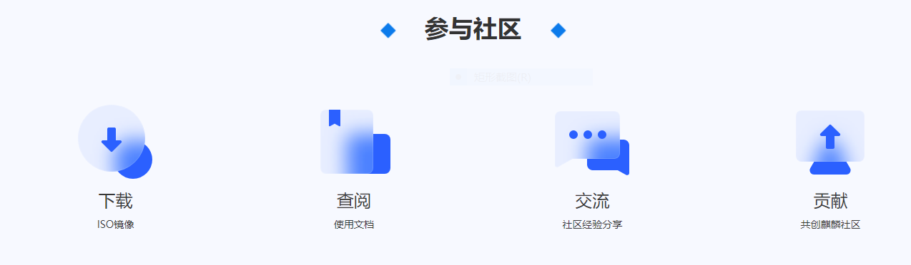

## openKylin测试参与指南
   
 
  
欢迎来到openKylin社区，欢迎业界所有开发者参与贡献，发现系统任意功能问题均可以为openKylin提交相应issue，社区质量保障需要各位共同参与。

### 参与须知

1. 前提条件

	在提交issue进行贡献前，请注册Gitee账号，先签署CLA。

	[openKylin官网网址](http://www.openkylin.top)

2. 什么情况可以提交issue？

	在任何一个新版本、新软件或者新功能上线后，如果发现系统任意功能问题、设计缺陷问题、UI显示问题、易用性问题或者性能/稳定性问题等，均可以为openKylin提交相应issue。

---

### 操作步骤

1. 登录openKylin官方网址

    [openKylin官网网址](http://www.openkylin.top)

2. 在“参与社区”板块找到“贡献”模块并点击进入

3. 在“参与社区”板块点击“社区贡献”，点击“提交/解决issue”

.png)

4. 跳转到Gitee的openKylin项目中后，点击“仓库”

.png)

5. 找到想要提交issue的对应组件并点击，进入组件分支下
.png)

6. 点击“issue”后，点击右侧“新建issue”登录Gitee账号后开始新建issue
.png)

7. 若是系统级问题，或无法确认想要提交issue的对应组件，可在“仓库”中搜索“QA”进入对应分支，在此分支下提交issue

---

### 创建issue

1. 在“新建issue”页面，将issue类型设置为“缺陷”，并简要写明此缺陷标题

.png)

2. 在详细内容中根据框架及要求依次写明标题描述、环境信息、问题复现步骤、预期结果、实际结果、附加信息。
可使用工具箱软件进行主要信息收集。如涉及软硬件适配，务必写明适配软硬件名称或型号；如有网络条件差，使用虚拟机等前置操作或特殊环境，也请进行说明。问题现象可以上传照片或视频。

3. 输入验证码后点击“创建”，创建完成后显示刚刚提交的issue，可以进行编辑/删除等操作

.png)

4. 再次点击“issue”可回到列表查看提交的问题

 

---

### 验证issue

1. 提交issue待openKylin维护人员修复完成并修改issue状态后，可到Gitee个人通知中心或者openKylin项目中查看

2. 提交issue人员对该问题在指定版本复验，若验证成功则修改issue状态为“已验收”，验证失败则修改为“已拒绝”。待issue修改并验收后完成该问题闭环。

.png)

3. 除验证自己提交的issue完成闭环外，也可以在各个组件分支下查看其它issue，确认系统某问题是否已修复完成。
 