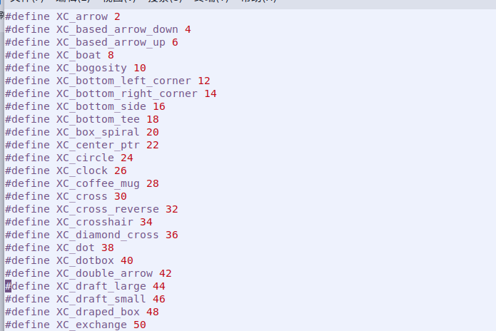

# 光标主题

  光标主题读取的不是单纯的.png图片，是经过配置后的鼠标文件，直接使用相册工具无法打开，目前使用gimp可以看见鼠标文件。也无法直接用gimp绘制鼠标文件，目前只有一种办法制作鼠标文件。  
  首先获取到所有光标名称，系统对应光标名称在/usr/include/X11/cursorfont.h文件下,如图：  

  

  名称后的数字是光标的序号，除去前缀 “XC`_`” 后就是光标的名称了。获取到光标名称后就是根据光标特性绘制对应的光标图片。由于鼠标文件分为静态和动态，静态是由一张图片的多种尺寸组成（例如48x48、32x32、24x24，共三张即可）,动态同样是按照多种尺寸组成，但还需要按照帧数排列进行逐帧的图片制做，目前只有两种光标是动态光标（watch、left_ptr_watch）。  

  当对应图片绘制完成后，开始生成对应的光标文件，首先制作xxx.conf文件,文件内容格式为：

   - (size) (xhot) (yhot) (filename) (ms-delay)

　其中，(size)处写鼠标的大小（像素），(xhot)(yhot)鼠标的有效区域以及偏移量，(filename)图片名，(ms-delay)动态鼠标使用，每帧图片的间隔时间。

　制作.conf后，通过命令制作成系统可读取的光标文件。生成命令：

   - xcursorgen xxxx.conf xxxx

  当光标文件制作完成后，当然就是如何应用到麒麟系统中。这就需要用到配置文件cursor.theme和index.theme,这两个文件将分别设置默认光标主题以及该光标主题的信息。同时还需修改X的光标设置。其使用的是/etc/alternatives/x-cursor-theme文件，此文件为软链接，使用update-alternatives机制更改。可用以下命令手动选择光标主题：

  - update-alternatives --config x-cursor-theme
  
  也可以自动配置光标主题：使用alternatives机制/usr/share/icons/xxxx/cursor.theme安装主题：

  - update-alternatives --install x-cursor-theme 
  - x-cursor-theme /usr/share/icons/xxxx/cursor.theme 150
  
  由于x-cursor-theme使用了自动配置方式，而优先级150为最高级别，所以xxx.theme已自动设置为默认配置了，可用以命令查询：
  
  - update-alternatives --display x-cursor-theme
  
  若为手动模式，需将其设为自动模式：
  
  - update-alternatives --auto x-cursor-theme
  
  即可完成光标设置。

