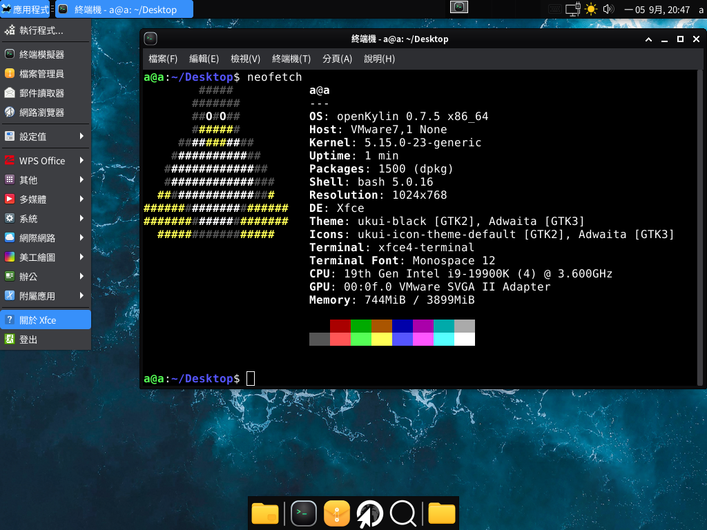

# Xfce 兴趣小组（SIG）

Xfce(Xfce Desktop Environment) SIG小组致力于Xfce桌面环境相关软件包的规划、维护和升级工作。

## 工作目标

- 现阶段只是代码搬运工，以后将会：
- 负责 Xfce 相关软件包的规划、维护和升级
- 及时响应用户反馈，解决相关问题

## repository
- openKylin Xfce 说明文档仓 : https://gitee.com/openkylin/xfce-management

## 维护包列表
### 用于快速安装的空包
- xfce4
- xfce4-goodies

### Xfce Desktop 基础构成
- libxfce4util - Utility functions library for Xfce4 
- xfconf - utilities for managing settings in Xfce 
- libxfce4ui - 	widget library for Xfce
- exo - extensions for Xfce
- garcon - freedesktop.org compliant menu implementation for Xfce 
- thunar - File Manager for Xfce 
- thunar-volman - Thunar extension for volumes management 
- tumbler - D-Bus thumbnailing service 
- xfce4-panel - panel for Xfce4 desktop environment 
- xfce4-power-manager - power manager for Xfce desktop 
- xfce4-settings - graphical application for managing Xfce settings 
- xfdesktop - xfce desktop background, icons and root menu manager 
- xfwm4 - window manager of the Xfce project 
- xfce4-session - Xfce4 Session Manager
- libxfce4windowing - Wayland utility functions library for Xfce4

### Xfce Applications 
- xfce4-appfinder - Application finder for the Xfce4 Desktop Environment 
- parole
- xfce4-terminal - Xfce terminal emulator 
- xfburn - CD-burner application for Xfce Desktop Environment 
- ristretto - lightweight picture-viewer for the Xfce desktop environment 
- orage - Calendar for Xfce Desktop Environment 
- mousepad - simple Xfce oriented text editor 
- catfish
- gigolo
- xfce4-dict
- xfce4-notifyd
- xfce4-panel-profiles
- xfce4-pulseaudio-plugin - Xfce4 panel plugin to control pulseaudio 
- xfce4-screenshooter - screenshots utility for Xfce 
- xfce4-taskmanager - process manager for the Xfce4 Desktop Environment 
- xfce4-dev-tools - Script to help building Xfce from git 
- xfce4-genmon-plugin
- xfce4-cpugraph-plugin
- xfce4-wavelan-plugin
- xfce4-battery-plugin - battery monitor plugin for the Xfce4 panel 
- xfce4-eyes-plugin
- xfce4-clipman-plugin - clipboard history utility 
- xfce4-datetime-plugin - date and time plugin for the Xfce4 panel 
- xfce4-places-plugin
- xfce4-whiskermenu-plugin - Alternate menu plugin for the Xfce desktop environment 
- xfce4-xkb-plugin
- xfce4-mailwatch-plugin
- xfce4-sensors-plugin
- xfce4-weather-plugin
- xfce4-diskperf-plugin
- xfce4-screensaver
- xfce4-cpufreq-plugin
- xfce4-systemload-plugin
- xfce4-netload-plugin
- xfce4-mpc-plugin
- xfce4-verve-plugin
- xfce4-timer-plugin
- xfce4-notes-plugin - Notes application for the Xfce4 desktop 
- xfce4-mount-plugin
- xfce4-indicator-plugin - plugin to display information from applications in the Xfce4 panel 
- xfce4-statusnotifier-plugin
- xfce4-smartbookmark-plugin
- xfce4-fsguard-plugin
- thunar-archive-plugin
- thunar-media-tags-plugin
- thunar-vcs-plugin
- thunar-shares-plugin
- thunarx-python

### Other Applications 
- xarchiver - GTK+ frontend for most used compression formats

### Xfce4 Recommended
- polkit-gnome
- libgsf
- libgepub
- libopenraw
- cogl
- clutter-1.0
- clutter-gtk
- gts
- vala
- gtksourceview4
- gspell
- ayatana-ido
- keybinder-3.0
- libutempter
- libxpresent
- gtk-layer-shell

## SIG成员
### Owner
- rtlhq（nobelxyz@163.com）

### Maintainers
- rtlhq

### Committers
- rtlhq

## 邮件列表
xfce@lists.openkylin.top
