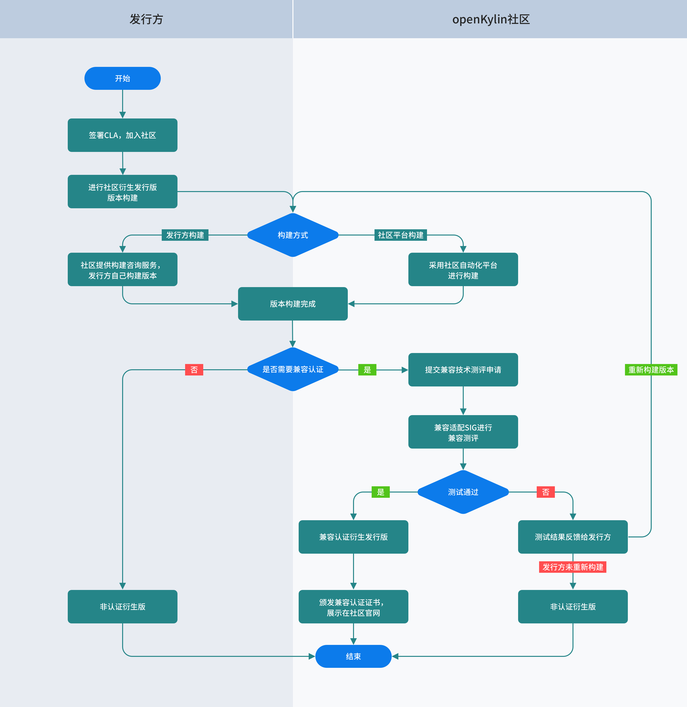

# openKylin衍生发行版发行指南

openKylin社区作为一个开放、协作、创新的平台，欢迎业界广大组织或开发者基于openKylin社区发行版衍生不同场景下的衍生版本，打造全场景的openKylin生态。
## 衍生发行版发行流程

## 衍生发行版兼容认证步骤

- [ **注册** ] 注册Gitee账号，获取GiteeID
- [ **签署CLA** ] 组织签署组织CLA，个人签署个人CLA。(https://cla.openkylin.top/cla/default/index)
- [ **了解兼容测评指标** ] https://gitee.com/openkylin/kylin-package-compatibility-toolkit
- [ **提交兼容测评申请** ] 发行方以issue的方式在compatibility SIG仓库下提交技术测评申请，提交内容包括衍生版本名称、衍生版本架构、基于社区发行版版本、OS下载链接、联系方式等信息。compatibility SIG组成员收到申请后进行技术测评，测评结果会以评论的方式反馈给发行方，提交地址：（https://gitee.com/openkylin/kylin-package-compatibility-toolkit）
- [ **测评结果公布** ] 衍生发行版兼容技术测评通过后社区会向发行方邮箱发送兼容认证证书，同时跟发行方确认是否在社区官网兼容认证页面展示该衍生发行版。（https://www.openkylin.top/support/os_fork_intro.html）

## 兼容技术测评规则

- 衍生发行版兼容性判定：内核兼容性X0.4+核心库兼容性X0.4+软件包范围X0.2>=80%，小于80%时需要重新构建后再次提交测评。
- 可自行采用社区提供的OS兼容测试工具进行自测（附链接），通过后再提交相关申请。

### 兼容技术测试报告

- 如发行方已自主完成兼容技术测评，请在提交兼容技术测评申请时，测试报告作为附件一并上传，方便衍生版发行版兼容测试团队结合相关指标进行复核测试。
- 测试报告内容模板下载，请务必保证填写信息的准确性。
