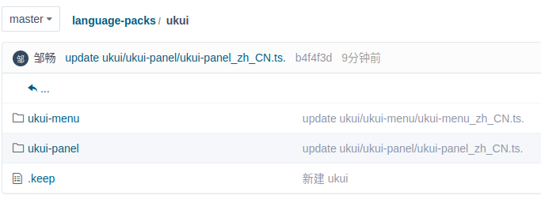
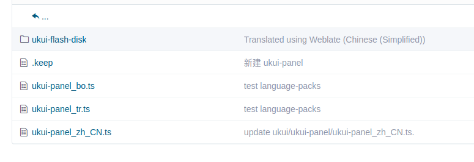
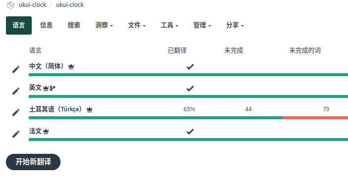
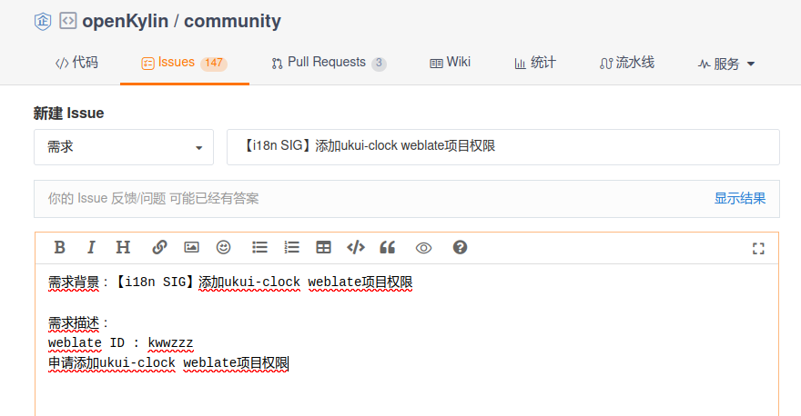
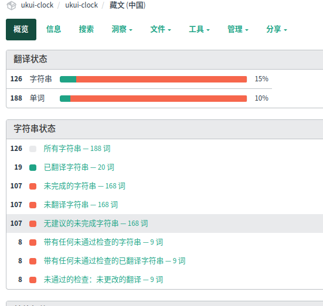
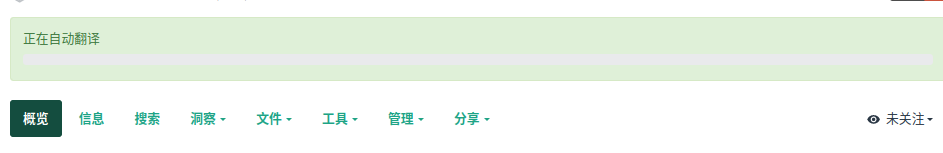
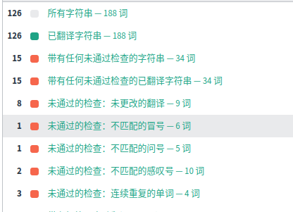
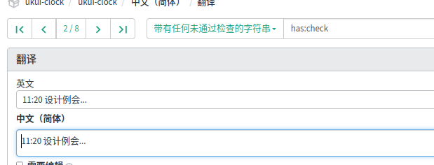

## openKylin i18n SIG 组参与指导

### 概述
本文档用于帮助社区用户参与到 openKylin 多语言模块相关工作，帮助社区用户了解 openKylin 多语言机制等。

### openKylin 多语言实现机制
首先简单了解 locales 包，locales 包用于提供本地化（Localization）和国际化（Internationalization）的支持。它包含了用于翻译和本地化应用程序界面的语言和区域设置信息。系统中的 /etc/locale.gen 文件由该包提供。
/etc/locale.gen 文件用于配置系统支持的语言环境设置，包括启用和禁用不同的语言和区域设置。  
  
openKylin 系统安装时会对该文件进行修改，补充对应多语言字段；而在安装完成系统后，如果需要安装新的语言包，也会对该文件进行修改，同样的，也是补充对应多语言字段。  
  
在设置完语言环境后，系统会去固定目录中寻找组件、应用的翻译文件。首先会去 /usr/share/locale 寻找，如果应用程序找到了匹配用户首选语言的翻译文件，它将首先使用这些文；如果在 /usr/share/locale 中没有找到匹配的翻译文件，应用程序将继续搜索 /usr/share/locale-langpack 目录；如果找不到匹配的翻译文件，应用程序将继续回退并尝试默认的语言文件。  
  
在 openKylin 中，目前实现多语言首先是通过系统安装增加系统可支持语言环境变量以及默认安装系统语言，也就是修改 /etc/locale.gen 文件；控制面板会读取 /etc/locale.gen 并进行已有语言切换，无法进行安装，控制面板不会去修改 /etc/locale.gen 文件；新增语言都带有一个对应语言包来修改 /etc/locale.gen ，且这个语言包会带有部分基础组件多语言 ；最后通过组件/应用自带的翻译文件以及多语言软件包提供的翻译文件，支持系统多语言；  
  
### 如何参与
首先请先注册 [gitee](https://gitee.com) 和 [weblate](https://weblate.openkylin.top/) 账户。  
除了各组件各自项目仓库中有翻译文件存放，还有一个代码仓库 [kylinos-i18n/language-packs](https://gitee.com/kylinos-i18n/language-packs) ，用于统一存放各组件的翻译文件;         
由于 [kylinos-i18n/language-packs](https://gitee.com/kylinos-i18n/language-packs) 此项目不能给所有人管理员权限，因此需要各组件项目负责人通过 fork https://gitee.com/kylinos-i18n/language-packs 后按照以下规则对对应项目的最新翻译文件提PR。  
在 [kylinos-i18n/language-packs](https://gitee.com/kylinos-i18n/language-packs) 仓库中 ukui 目录中子目录为各组件应用项目名，如下图所示:

在对应的文件夹中存放的是对应组件应用的翻译文件，如下图所示，当前应用的翻译文件直接放当前的一级目录上，如还有插件翻译文件则再创建对应的文件夹中放对应的翻译文件。  

#### weblate
首先先了解下 weblate 平台，地址 https://weblate.openkylin.top/projects/ weblate 是一个基于 Web、与版本控制紧密集成的翻译工具。它拥有简洁清爽的用户界面，跨部件翻译同步、质量检查以及自动链接到源文件等功能。openKylin 社区开发者会上传或更新最新的翻译文件（ts或者po）通过提PR形式更新到 [kylinos-i18n/language-packs](https://gitee.com/kylinos-i18n/language-packs) 仓库中，翻译就会自动同步到 weblate，同时在 weblate 上进行翻译添加、更改、校验等操作后，也会自动同步到 [kylinos-i18n/language-packs](https://gitee.com/kylinos-i18n/language-packs) 仓库。  
  
#### 贡献流程
首先确认需要修改的应用组件的翻译文件是否存放在 [kylinos-i18n/language-packs](https://gitee.com/kylinos-i18n/language-packs) 仓库中，如果没有在请在对应组件仓库中提交 issue。
  
当项目开发者在完成对应的翻译文件上传并且进行了正确的设置后，会有如下的项目界面显示:  

其次请确认自己是否有对应项目 weblate 中的权限，如果无法对对应 weblate 项目提交修改，请向 [community](https://gitee.com/openkylin/community/) 提交 i18n SIG 相关 issue ：

以 ukui-clock 为例，在这里初步的语言种类是基于自己所传的各翻译文件的情况，以下为添加新语种翻译并自动翻译的步骤：
1.  点击下方的开始新翻译
2.  在搜索框中输入待添加语种
3.  点击开始新翻译等待加载，到达如下界面

4.  在如上界面后点击上方菜单的 工具->自动化翻译, 自动翻译模式选择为 "添加为翻译",搜算筛选器选择"未完成的字符串"（这里如果选择"所有字符串"的话自动化翻译会覆盖原翻译文件的所有翻译，尤其在翻译文件有更新的时候格外注意），自动翻译来源选择机器翻译，然后选择微软的翻译接口，点击应用。之后有如下进度条在界面上方，

等待其完成会提示“自动翻译已完成，xxx 个字符串已更新。”,有时候api会出现繁忙情况，请稍作等待。

在机器翻译完之后，平台会反馈一些翻译有明显问题的翻译显示，红色标记的属于机器已经翻译但是可能存在问题的翻译，这一部分就需要手动处理。同样，也会存在部分字段翻译不准确的情况，这些也需要手动处理。点击‘所有字符串’可以逐个筛查错误翻译，也可以用到上方的搜索来帮助你快速定位字段，请注意每修改一个字段后请点击‘保存并继续’，不点击保存所有修改将会清除。

以上就是 openKylin 多语言参与文档，欢迎各位社区小伙伴积极参与~

