# 桌面版-IDE基础平台
改造自微软Visual Studio Code(VSCode)开源项目 [Code OSS](https://github.com/microsoft/vscode)，仅提供基本图形界面和插件架构，开发功能需要插件配合。桌面版的IDE基础平台是一个electron应用，远程开发版的IDE基础平台是一个Web服务，桌面版和远程开发版界面类似。  
- [用户界面](#用户界面)
- [设置](#设置)
- [编辑功能](#编辑功能)
- [键盘快捷键](#键盘快捷键)
- [命令面板](#命令面板)
- [主题](#主题)
- [切换显示语言](#切换显示语言)

## 用户界面
IDE基础平台为IDE软件的主界面，采用分区布局方式，主要包含标题栏、菜单栏、工具栏、活动栏、侧边栏、面板、编辑区、状态栏等8个区域，详细布局如下图所示。
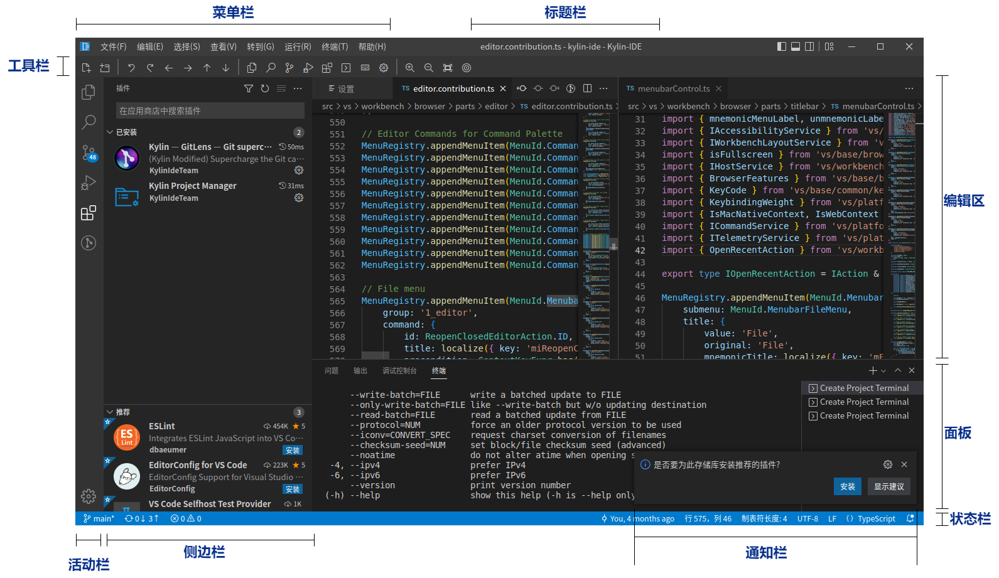

每个界面区域的功能介绍如下表：
| 界面区域 | 功能 |
| :--------: | -------- |
| 标题栏    | 布局在窗口顶部中间，标识软件名称 |
| 菜单栏    | 布局在窗口顶部左侧，显示功能菜单 |
| 工具栏    | 布局在菜单栏之下，显示一些常用工具按钮 |
| 活动栏    | 默认布局在主界面的左侧，显示侧边容器的图标按钮，悬停时提示标题信息 |
| 侧边栏    | 默认隐藏，布局在活动栏的右侧编辑区的左侧，显示侧边栏视图 |
| 编辑区    | 默认布局在中间，占有区域较大，支持代码智能编辑、显示小地图、行号等功能 |
| 面板      | 默认隐藏，布局在编辑器下部，支持问题、输出、终端、调试控制台视图 |
| 状态栏    | 默认布局在底部，显示图标、文本状态信息、通知信息等 |
| 通知      | 显示在界面的右下角，当有通知时显示，含有信息、警告、错误通知 |

> 提示：辅助侧边栏也可用于显示主侧边栏对面的视图。

## 设置

用户可以根据自己的偏好来配置IDE基础平台，包括编辑器、用户界面和功能行为等。通过菜单“文件>首选项>设置”打开设置页面，能够看到对两个作用域的设置：
- 用户设置-全局应用于打开的任何IDE基础平台实例的设置。
- 工作区设置-存储在工作区内的设置，仅在工作区打开时应用。

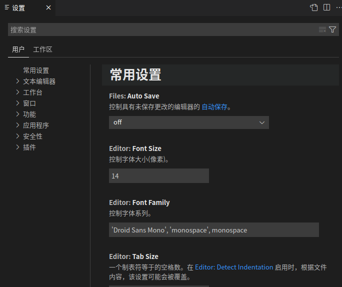

设置页面中的搜索输入框可以搜索设置。当使用搜索栏进行搜索时，不仅会突出显示与条件匹配的设置，还会过滤掉不匹配的设置。更改设置时，IDE基础平台会重新加载对设置所做的更改。例如修改位于左侧的侧边栏位置被更改，而显示在右侧。修改后的设置用蓝线表示，类似于编辑器中修改后的行。

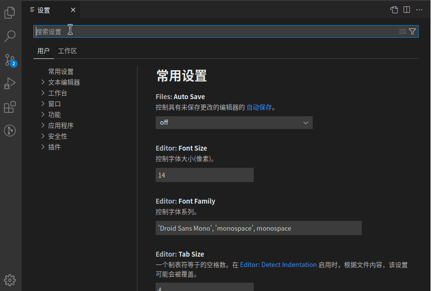

## 编辑功能
IDE基础平台的编辑区首先是一个编辑器，包含了源代码编辑所需的功能。下面介绍编辑器的基础知识：

1. 并行编辑

可以根据需要垂直和水平地并排打开多个编辑器。如果已经打开了一个编辑器，则有多种方法可以将另一个编辑器打开到现有编辑器的一侧：

- 从文件的资源管理器上下文菜单中打开到侧面。
- 单击编辑器右上角的拆分编辑器按钮。
- 将文件拖放到编辑器区域的任何一侧。

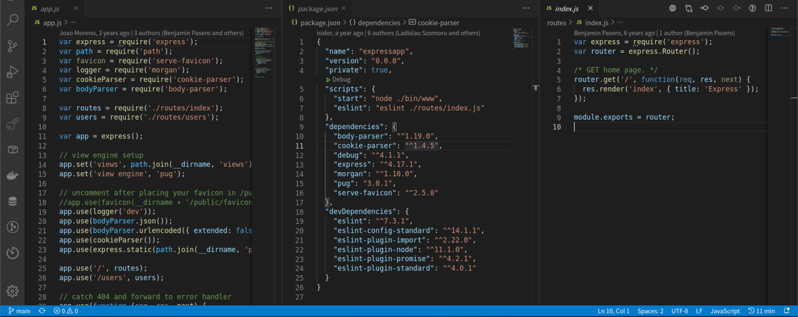

默认情况下，编辑器将打开到活动编辑器的右侧。当打开了多个编辑器时，按住Ctrl键并按1、2或3可在它们之间快速切换；可以调整编辑器大小并重新排序；拖放编辑器标题区域可以重新定位编辑器或调整编辑器大小。

2. 小地图

小地图是对源代码的高度概述，这对于快速导航和代码理解非常有用。文件的小地图显示在编辑器的右侧，单击或拖动阴影区域可以快速跳转到文件的不同部分。

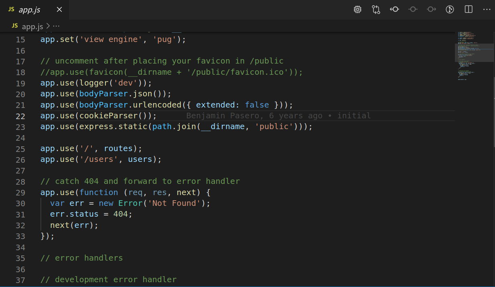

3. 预览模式

在资源管理器中单击或选择文件时，该文件将以预览模式显示，并重复使用现有的选项卡。在快速浏览文件时，如果不希望每个访问过的文件都有自己的选项卡，这将非常有用。当开始编辑文件或使用双击从资源管理器打开文件时，将出现一个专用于该文件的新选项卡。

预览模式由选项卡标题中的斜体指示：

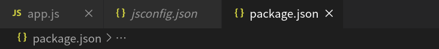

如果不希望使用预览模式，而是始终创建新的Tab选项卡，则可选择编辑器顶部的更多按钮下菜单中的“使编辑器保持打开”，这将每次都会重新打开一个新选项卡。

4. 编辑器组

拆分编辑器时（使用“拆分编辑器”或“在侧边打开”命令），将创建一个新的编辑器区域，该区域可以保存一组项目。可以根据需要并排和水平打开多个编辑器。可以在资源管理器视图顶部的“打开编辑器”部分中清楚地看到这些内容：

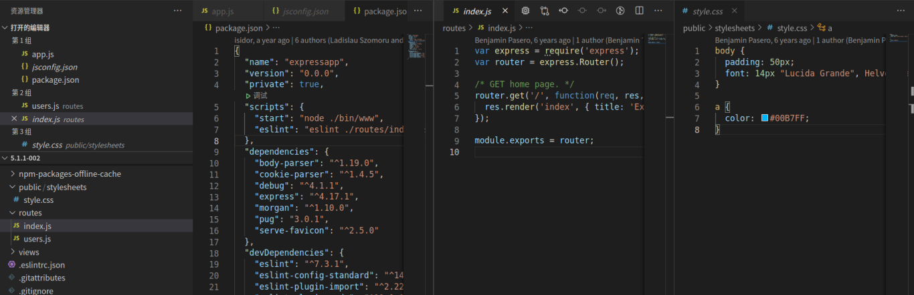

选项卡用于在项目之间快速导航，拖放选项卡则可以重新对它们进行排序。

当打开的项目数超过标题区域所能容纳的项目数时，可以使用“显示打开的编辑器”命令（可通过“...更多”按钮获得）来显示选项卡式项目的下拉列表。

如果不想使用Tabs，可以在设置中设定false值来禁用该功能：
```json
"workbench.editor.showTabs": false
```

5. 列选择

通过“选择>列选择模式”菜单项访问列选择的全局切换。当切换到此模式时，可通过鼠标进行列选择，如下图：

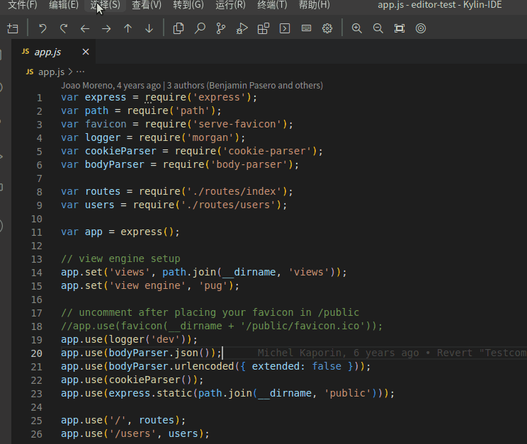

6. 缩进
IDE基础平台允许采用空格或制表位来缩进文本。默认情况下，编辑器中插入空格，并且每个Tab键使用4个空格。可以在设置中对其进行修改：
```json
"editor.insertSpaces": true,    
"editor.tabSize": 4,
```
编辑器会自动检测分析打开的文件，并确定文档中使用的缩进。检测到的设置显示在状态栏的右侧：


单击"状态栏缩进"可显示带有缩进命令的下拉列表，允许更改打开的文件的默认设置或在制表位和空格之间进行转换。

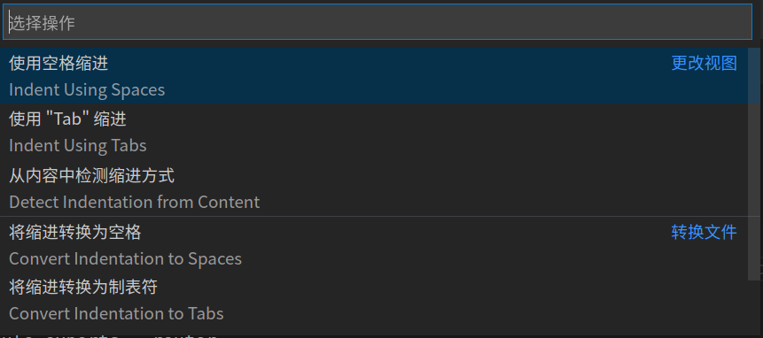

>注意：编辑器的自动检测功能会检查 2、4、6 或 8 个空格的缩进。如果文件使用其它不同数量的空格，则可能无法正确地对缩进进行检测。

7. 文件编码支持

在状态栏中查看文件编码,当单击状态栏中的编码按钮以重新打开或使用其它编码保存活动文件，然后选择一种编码。

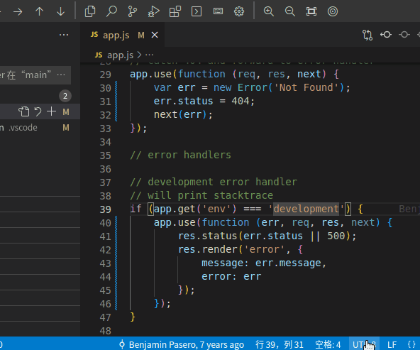

8. 代码导航

- 快速文件导航

    在浏览项目时，通常使用资源管理器在文件之间导航。但是，如果在处理任务时需要在同一组文件之间快速跳转，则使用资源管理器会不太方便。此时可使用IDE基础平台提供的命令。
    
    按住Ctrl＋Tab键可以查看编辑器组中打开的所有文件列表。若要打开其中一个文件，再次使用Tab选择要导航到的文件，然后释放Ctrl将其打开。
    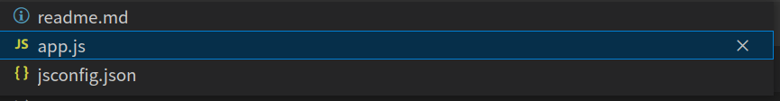

- 面包屑导航
    在编辑器区域上方有一个名为"面包屑"的导航栏，用来显示当前位置，并允许在文件夹、文件和符号之间快速导航。

    使用“查看>显示面包屑导航”切换命令可禁用面包屑导航。

    选择面包屑导航的路径时，可显示一个包含该级别同级的下拉列表，以便快速导航到其它文件夹和文件。

    如果当前文件类型具有对符号(例如函数、变量等)的语言支持，将看到当前符号路径以及同一级别及以下其它符号的下拉列表。
    
    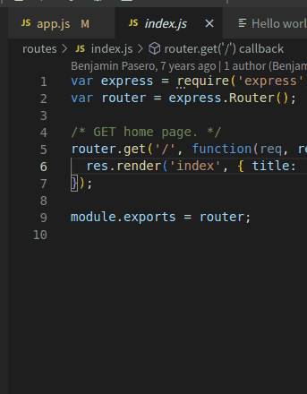

9. 查找替换

IDE基础平台支持在当前打开的文件中快速查找和替换文本。按Ctrl+F在编辑器中打开查找替换小部件，搜索结果将在编辑器的小地图和滚动条中突出显示。

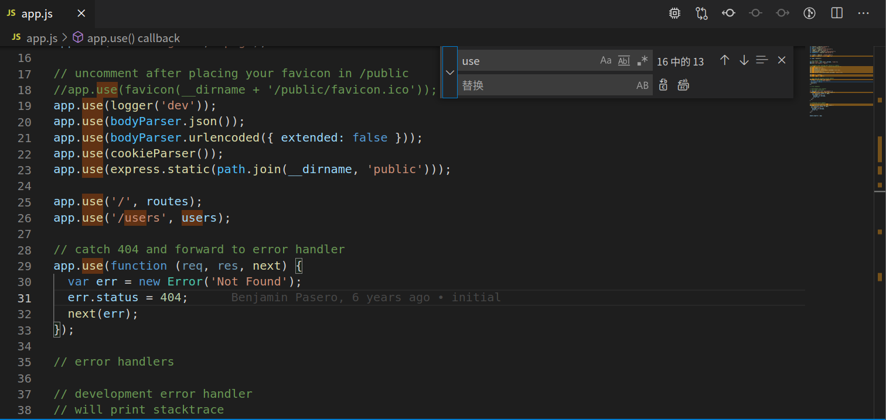

如果当前打开的文件中有多个匹配的结果，则可以按“查找小部件”的向上或者向下箭头按钮，在查找输入框聚焦时导航到上一个或下一个结果。
除了查找和替换为纯文本之外，“查找”还具有三个高级搜索选项：
- 区分大小写
- 全字匹配
- 使用正则表达式

替换输入框支持保留大小写，通过单击“保留大小写”（AB） 按钮将其打开。也可以使用正则表达式的来替换，例如：

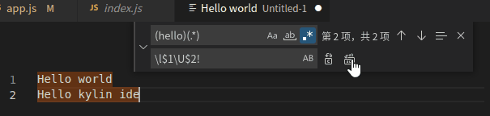

## 键盘快捷键

“键盘快捷键”为IDE基础平台提供简单而丰富的键盘快捷操作。通过菜单栏的“文件”>“首选项”>“键盘快捷方式”下的菜单来查看和修改键盘快捷键。它列出了所有带和不带键绑定的可用命令，可以更改/删除/重置其键绑定；通过顶部的搜索框，可查找命令或键绑定。

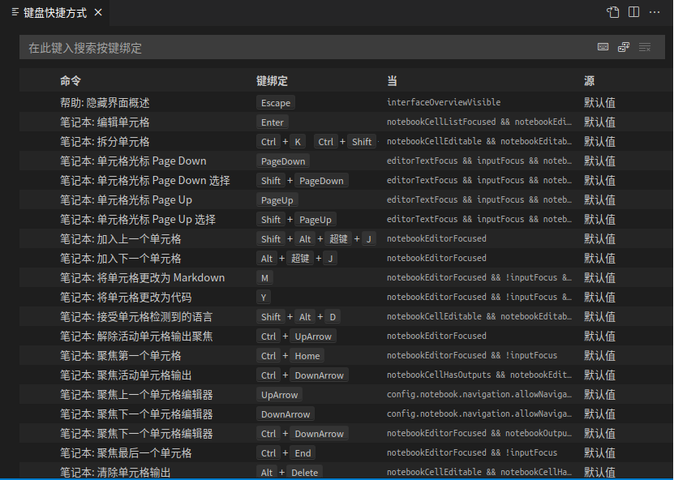

在输入框中输入内容可过滤查询命令，并为查询到的命令添加键值或者修改键值。例如输入“关于”，可查询到关于命令，右键关于命令，可弹出上下文菜单，选择“添加键绑定”，弹出的输入框中键入“Ctrl+F11”按Enter键确认。如果要重置用户修改过的快捷键为默认值，可以右键修改过的快捷键单元格，选择“重置快捷绑定”菜单，则可恢复为默认值。


## 命令面板

命令面板的打开有多种方式，可以从菜单“查看-命令面板”中打开，或者由组合键 Ctrl+Shift+P打开，从这里可以看到IDE基础平台的的所有功能，包括最常见操作的键盘快捷方式。

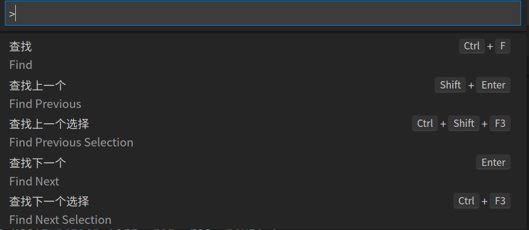

命令面板提供对许多命令的访问。可以执行编辑器命令、打开文件、搜索符号以及查看文件的快速轮廓，所有这些功能都使用相同的交互窗口。以下是一些提示：

- Ctrl+P 通过键入任何文件或符号的名称进行导航
- Ctrl+Tab 循环浏览最后打开的一组文件
- Ctrl+Shift+P打开命令面板
- Ctrl+Shift+O 导航到文件中的特定符号
- Ctrl+G 导航到文件中的特定行

在输入框中键入？可以获取从此处执行的可用命令的帮助列表。

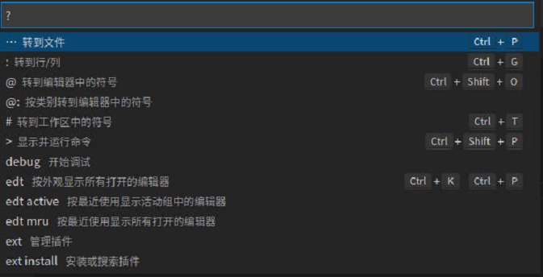

## 主题

颜色主题是指用户界面中的颜色，可以根据个人偏好进行选择。从菜单“文件-首选项-颜色主题”打开颜色主题选择列表，如下图：

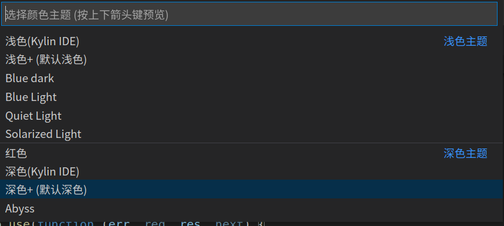

选择所需的主题，然后按Enter键，之后界面的颜色就被切换了，如下图：

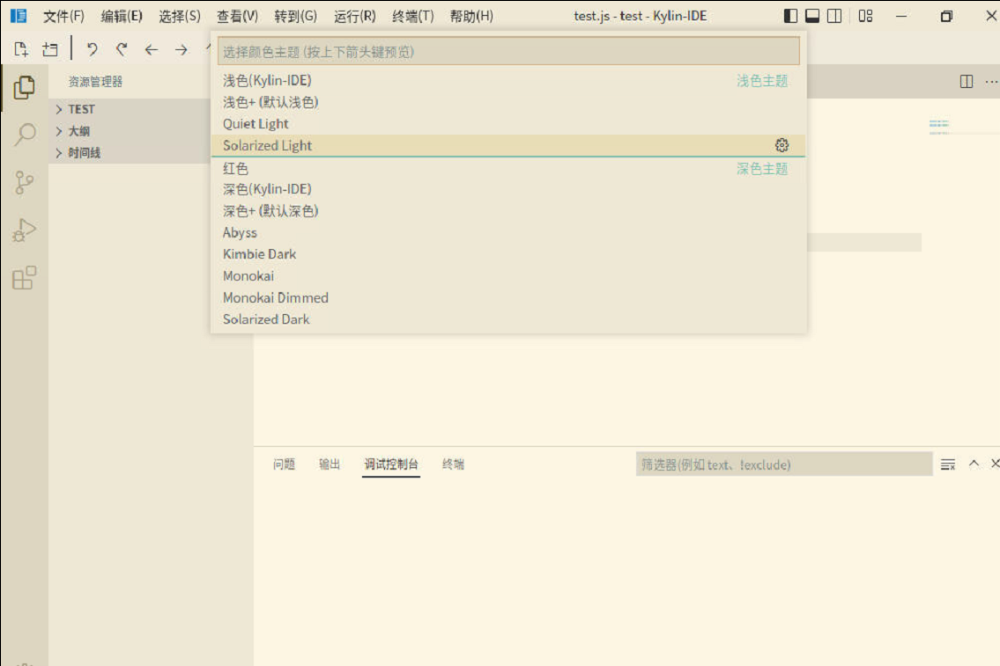

## 切换显示语言

默认情况下，IDE基础平台支持中英文显示，在命令面板的输入框中键入"display"以筛选和显示"配置显示语言"命令。

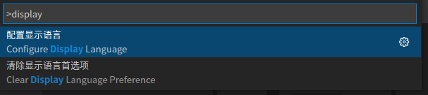

点击“配置显示语言”，弹出选择语言列表，如下图：

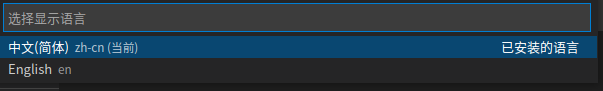

当选择要切换的语言后，会弹窗确认重启IDE基础平台窗口，点击重启会重新启动IDE基础平台窗口。