# Qt开发
## 索引
- [概述](#概述)
- [安装](#安装)
  - [安装插件](#安装插件)
  - [安装依赖软件](#安装依赖软件)
- [CMake项目](#cmake项目)
  - [项目创建](#项目创建)
  - [项目导入](#项目导入)
  - [添加新文件](#添加新文件)
  - [编辑资源文件](#编辑资源文件)
  - [编辑代码](#编辑代码)
  - [构建（生成）](#构建生成)
  - [调试和运行](#调试和运行)
- [QMake项目](#qmake项目)
  - [QMake项目打开项目](#qmake项目打开项目)
  - [QMake项目编辑资源文件](#qmake项目编辑资源文件)
  - [QMake项目编辑代码](#qmake项目编辑代码)
  - [QMake项目构建（生成）](#qmake项目构建生成)
  - [QMake项目调试和运行](#qmake项目调试和运行)
- [UI设计](#ui设计)
- [查看Qt帮助文档](#查看qt帮助文档)

## 概述
支持CMake、QMake类型Qt项目自动配置，qrc 文件编辑，Shift+F1 跳转 Qt 文档；配合C/C++插件组可支持Qt（C++）编码开发。主要插件：
- [Qt Support](https://open-vsx.org/extension/KylinIdeTeam/qt-support): cmake类型Qt项目自动配置
- [QMake Support](https://open-vsx.org/extension/KylinIdeTeam/qmake-tools): qmake类型Qt项目自动配置

## 安装
### 安装插件
- 在插件搜索框中检索Qt Support插件和QMake Support插件，点击安装
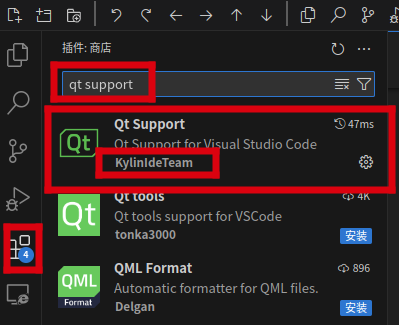

### 安装依赖软件
- 插件需要安装依赖软件后才能正常工作
- 安装clangd（Kylin Clangd代码编辑插件依赖，x86、arm以外架构需要安装，x86、arm架构已内置到插件中）
  * 命令举例：`apt install clangd`或`yum install clang-tools-extra`
  * 建议尽量安装较新版本，功能更强。目前系统默认安装clangd-10，可以手动安装更新版本，例如`sudo apt install clangd-11`
- 安装编译构建工具
  * 命令举例：`apt install build-essential cmake ninja-build`或`yum install gcc gcc-c++ cmake ninja-build`
- 安装gdb（调试插件依赖）
  * 命令举例：`apt install gdb`或`yum install gdb`
- 安装Qt
  * 命令举例：`apt install qt5-default qt5-qmake qttools5-dev-tools`或`yum install qt5-qtbase-devel qt5-qttools-devel`
- 若使用Qt文档查看功能，需安装对应版本Qt文档，例如：`apt install qt5-doc qt5-doc-html`或`yum install qt5-doc qt5-doc-html`

## CMake项目
### 项目创建
仅描述会产生疑问的地方。
- 后续会和现有项目创建功能整合，目前CMake类型Qt项目创建为独立功能  
- 布局
  * CMake Tools(fork)和QMake Tools的视图布局可以拖动到IDE基础平台右侧，更方便操作
    - 以CMake Tools为例，鼠标左键点住左侧CMake Tools活动栏图标不松，拖动到右侧
      * 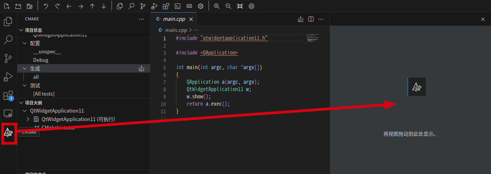
    - 右上角的布局切换按钮可以控制右侧工具视图的显示和隐藏
      * 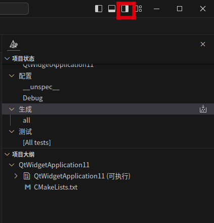
- 入口
  * 未打开任何文件夹、工程时，选择“创建Qt项目”（注意目前仅支持CMake类型的项目）  
    - 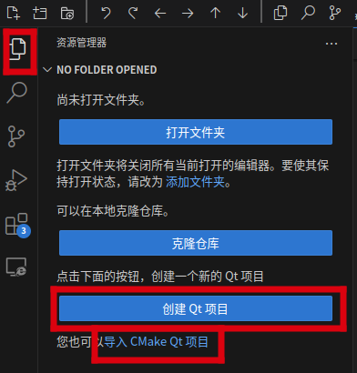
  * 或在资源管理器视图下（最左侧活动栏第一个图标）右键，在右键菜单中选择“创建Qt项目”
  * 或直接打开Qt项目文件夹
- Qt版本选择
  * 在创建项目的配置中，有一个步骤是选择Qt安装目录，Qt Support插件启动时，会自动扫描系统中安装在默认位置的Qt，如果您安装的Qt没有在此处显示，请点击查找本机安装的Qt，例如：选择路径`/home/<user>/Qt`。
    - 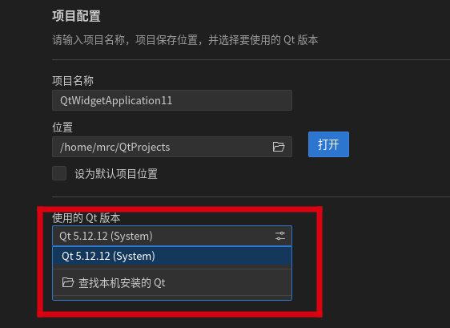
- 编辑支持一处需要注意的地方
  * 以QtWidget Application为例，在创建好项目并打开该项目后，在资源管理器视图中点击“qtwidgetapplication.cpp”，会发现有些代码下面标了红色波浪线，这是由于ui头文件并未生成导致的。
    - 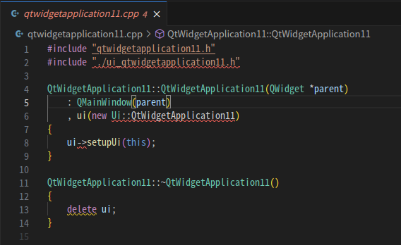
  * 解决方法
    - 执行“生成”操作，可在build目录下生成对应头文件
        - 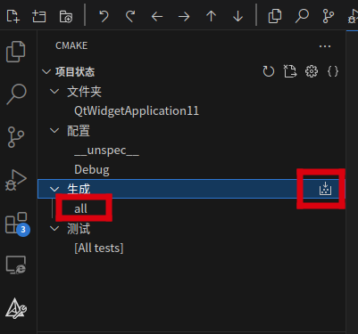
    - 请关闭该代码文件，再重新打开，此时代码已无红色波浪线，代表语法解析正常
      * 目前需要重新打开代码文件以触发对该代码文件的重新分析。若依赖软件clangd版本为11或更高则不需重新打开代码文件
- 若弹出Clangd插件提示“compile_commands.json上的Clangd配置文件已更改。要重新启动吗？”，请选择“Yes”或“Yes, always”
  * compile_commands.json是clangd的编译命令配置文件，指导clangd代码文件如何编译。代码编辑需要正确的compile_commands.json配置文件
  * 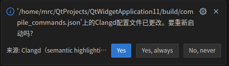
- 项目创建后，打开项目时会生成CMake配置，出现图中提示是正常现象，请忽略
  * 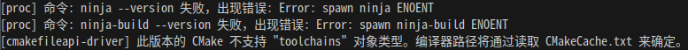
  * 出现原因
    - CMake Tools默认会使用ninja作为构建系统，如果系统上不存在ninja命令，会出现该日志。此时，cmake会使用Makefile构建系统，程序仍然可以正常构建。在Kylin系统上可以通过安装ninja-build包，来使用ninja构建系统
    - “此版本的 CMake 不支持‘toolchains’对象类型”，是由于CMake版本较低，可忽略该提示

### 项目导入
- 注意，目前仅支持CMake项目导入
- 未打开项目时，在资源管理器视图（最左侧活动栏第一个图标）选择“导入 Cmake Qt项目”
- 已打开项目时，在资源管理器视图下（最左侧活动栏第一个图标），鼠标右键，在弹出的菜单中选择为“导入Qt项目”，然后根据提示操作即可
- 或直接通过“文件”菜单的“打开文件夹”子菜单打开项目文件夹

### 添加新文件
- 在资源管理器视图下（最左侧活动栏第一个图标），鼠标右键，在弹出的菜单中选择为“Qt项目添加新文件”，然后根据提示操作即可。添加新文件后将自动更改CMakeLists.txt或提示用户更改
  * 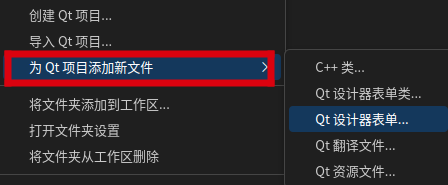

### 编辑资源文件
- 在资源管理器视图下（最左侧活动栏第一个图标），鼠标左键单击qrc文件，会弹出qrc文件编辑器，根据提示操作即可
  * 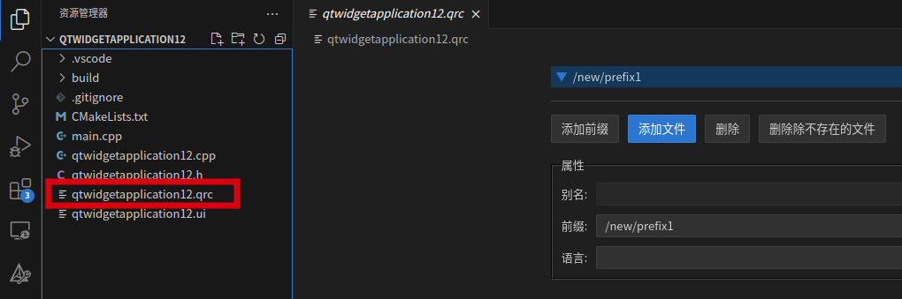

### 编辑代码
- 代码高亮：可以看到代码不同字段有不同着色
- 代码跳转：在函数、方法、变量上使用ctrl键+鼠标左键，能够跳转到函数、方法、变量定义或引用处。在头文件名称上使用ctrl键+鼠标左键能够跳转到头文件处
  * 代码跳转后希望回到上一次浏览的代码位置，可以点击上方工具栏的左右方向按钮
- 代码补全：编码时输入前几个字母，会显示可能的补全列表
- 代码窥视图：将鼠标移动到符号上，会显示符号的信息
- 语法检查：检测到的语法问题会在相关代码下方标注波浪线，鼠标放置于波浪线上方的代码上时会提示语法问题

### 构建(生成)
- 不需要配置task.json和launch.json文件。使用了和task.json、launch.json配置方式不同的机制，通过CMake Tools菜单操作即可
- CMake Tools侧边栏视图如下所示
  * 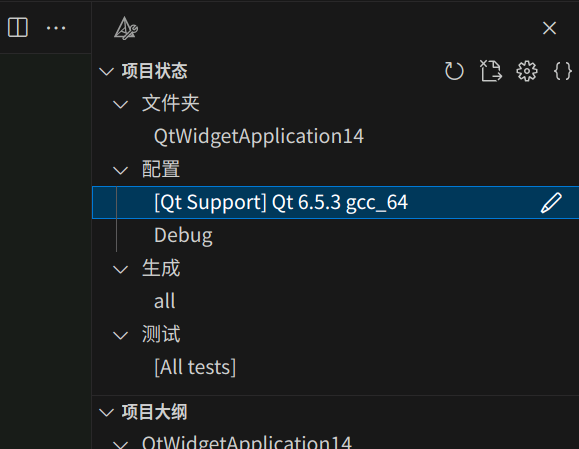
  * 能够操作的菜单条目，当鼠标置于其上时，会在条目尾部显示可执行的按钮
  * 【配置】菜单
    - 执行配置，生成配置文件
    - 设置编译构建工具, 此处请选择以`[Qt Support]`开头的工具包，如果系统上安装了多个Qt版本，还可以在此处切换Qt版本
    - 设置编译构建类型，例如：Debug、Release等
  * 【生成】菜单
    - 执行生成，构建生成目标程序文件
    - 设置生成目标，当CMakeLists.txt中配置了多个目标时，可选择生成的目标
  * 【测试】菜单
    - 通过CTest命令运行CMake测试
- CMake Tools底部状态栏视图如下所示
  * 
  * 图中从左向右介绍
    - 构建类型配置
    - 构建工具配置
    - 生成
    - 调试
    - 运行

### 调试和运行
- 不需要配置launch.json，使用了与launch.json配置方式不同的机制
  * 不要使用F5快捷键和“运行”菜单中的“启动调试”子菜单
  * 不要使用主菜单栏下方的工具栏中的调试按钮
  * 不要使用左侧活动栏中的调试按钮
- 请使用CMake Tools项目概览视图中的调试、运行按钮执行调试动作

## QMake项目
与CMake Tools工具类似，可以调整QMake Tools工具视图布局，可以拖动到IDE基础平台右侧，以方便操作
### QMake项目打开项目
- 通过“文件”菜单，“打开文件夹”打开已有的QMake项目即可

### QMake项目编辑资源文件
- 参考CMake项目的[编辑资源文件](#编辑资源文件)

### QMake项目编辑代码
- 参考CMake项目的[编辑代码](#编辑代码)

### QMake项目构建（生成）
- 不要配置task.json和launch.json文件，通过QMake Tools菜单操作即可
- 【构建】菜单
  * 执行构建（生成）操作
  * 可以设置构建目标

### QMake项目调试和运行
- 不需要配置launch.json，使用了与launch.json配置方式不同的机制
  * 不要使用F5快捷键和“运行”菜单中的“启动调试”子菜单
  * 不要使用主菜单栏下方的工具栏中的调试按钮
  * 不要使用左侧活动栏中的调试按钮
- 【调试】菜单
  * 执行调试，设置调试参数
  * 配置调试目标
- 【启动】菜单
  * 运行目标程序
  * 设置运行目标

## UI设计
- 需安装Qt Designer，调用Qt Designer完成UI设计
  * 在资源管理器视图中鼠标双击ui文件，在编辑器中打开ui文件
  * 在编辑器中右键，选择“在Qt设计器中打开”，调用Qt Designer打开ui文件

## 查看Qt帮助文档
当鼠标光标位于某一个Qt 库中的符号处时，按下 `Shift + F1` 快捷键，将会在编辑器旁边显示该符号的帮助文档，如下如所示。使用此功能前需安装对应版本Qt文档，例如：`apt install qt5-doc qt5-doc-html`或`yum install qt5-doc qt5-doc-html`。注意，此功能目前不支持远程开发方式，仅桌面版Kylin-IDE能够正常使用。
 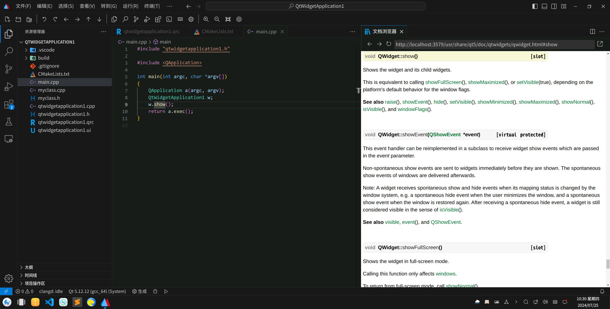