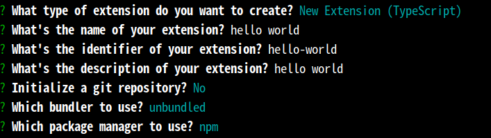

# 插件开发
- 插件api继承了Code-OSS，本部分给出插件开发的简单例子，详细开发方法可以参考VSCode文档。本文会逐渐向最佳实践方向补充
- 需要特殊说明的是package.json文件中engines字段中的vscode版本（用engines.vscode表示）
    + 此字段很重要，影响到插件的兼容性，和IDE基础平台的版本相关
      - engines.vscode的值，表示插件使用api的最低版本
      - kylin-ide版本 < 1.1.0；kylin-code < 0.3.0；kylin-ide-server(远程开发服务端) < 1.1.2 基于Code-OSS 1.68.0（插件api版本是这个版本）
      - kylin-ide版本 >= 1.1.0；kylin-code >= 0.3.0；kylin-ide-server(远程开发服务端) >= 1.1.2 基于Code-OSS 1.85.2（插件api版本是这个版本）
      - kylin-ide版本 >= 2.0.0，基于Code-OSS 1.102.2（插件api版本是这个版本）
      - 故如果需要兼容早期版本，engines.vscode应填写1.68.0或^1.68.0（^ 是一个版本范围符号，表示允许安装该版本的最新小版本（minor version）和补丁版本（patch version），但不允许安装下一个大版本（major version），^1.68.0表示：>=1.68.0 <2.0.0）
      - 如果仅考虑兼容目前的版本，engines.vscode应填写1.85.2或^1.85.2
      - 如果插件需要考虑申威等社区不特别活跃的架构，engines.vscode应尽量向低版本填写，最好填写1.68.0或^1.68.0，因为特殊架构上可能因缺少编译依赖只能构建低版本kylin-ide(至少基于1.68.0的kylin-ide能够支持申威架构)

## 环境准备
  - 安装IDE基础平台kylin-ide(或者在openKylin上安装kylin-code)
  - 安装nodejs
    + 版本选择
      1. 尽量使用nodejs lts版本，推荐使用18或20
      2. 如果使用了开源代码，需要检查开源代码构建需要的nodejs版本范围
    + [安装方法参见nodejs环境配置](./JavaScript开发.md#nodejs环境配置)。可以采用nodejs环境配置中方法2(从官网或国内镜像网站下载安装nodejs)或者方法3(nvm安装nodejs)来安装nodejs
  - nodejs软件包管理工具npm、yarn
    + npm 为nodejs的包管理器，通常安装nodejs时，npm也会安装到环境中
      - 配置npm源为国内镜像网站，比如淘宝镜像网站
      - 打开终端，输入命令`npm config set registry https://registry.npmmirror.com`
      - 输入命令`npm config get registry`，查看npm源是否配置成功
    + yarn同样为nodejs的包管理器，通过npm安装
      - 安装配置完成npm后，在终端输入命令`npm install -g yarn`，安装yarn
      - 输入命令`yarn -v`，查看yarn版本是否安装成功
      - 配置yarn源为国内镜像网站，比如淘宝镜像网站
      - 打开终端，输入命令`yarn config set registry https://registry.npmmirror.com`
      - 输入命令`yarn config get registry`，查看yarn源是否配置成功
  - 安装脚手架yo和代码生成器generate-code
    + 打开终端，输入命令`npm install -g yo generate-code`
  - 安装vsce插件打包工具
    + 打开终端，输入命令`npm install -g vsce`，安装vsce

## 快速开始
### 1.创建hello-world 插件
  - 打开终端，输入命令`yo code`，创建插件项目。根据提示输入插件名称、插件ID、插件描述等信息，如图所示
### 2.编辑插件
  - 打开插件项目，终端执行`kylin-ide hello-world`
  - hello-world插件主要文件介绍
    - .vscode文件夹：插件配置文件夹
      - launch.json：调试配置文件
      - tasks.json：运行配置文件
    - package.json：插件配置文件
    - src/extension.ts：插件入口源码文件
    - tsconfig.json：tsconfig.json文件是TypeScript的配置文件，用于配置TypeScript的编译选项。
  - 修改插件package.json文件中engines字段中的vscode版本（见文档开头的说明）

  #### 2.1 package.json介绍
  package.json文件是插件的配置文件，用于描述插件的基本信息、依赖、命令等。
  - name：插件名称
  - displayName：插件展示名称
  - description：插件描述
  - version：插件版本
  - publisher：插件发布者
  - engines.vscode：插件支持的vscode最小版本。
  - main:编译后的插件入口文件
  - package.json示例
    ```json
    {
      "name": "hello-world", //插件名称
      "displayName": "hello-world",//插件展示名称
      "description": "hello-world",//插件描述
      "version": "0.0.1",//插件版本
      "publisher": "kylin",//插件发布者
      "engines": {
        "vscode": "^1.68.0"//插件支持的api版本,兼容1.68.0及以上版本
      },
       "categories": [ // 插件分类
      "Other"
      ],
     "activationEvents": [],//插件激活事件
      "main": "./out/extension.js",//插件编译后的入口文件
      "contributes": { 
       "commands": [ //注册命令
        {
        "command": "hello-world.helloWorld",
        "title": "Hello World"
        }
      ]
     },
     "scripts": {
      "vscode:prepublish": "npm run compile",
      "compile": "tsc -p ./",
      "watch": "tsc -watch -p ./",
      "pretest": "npm run compile && npm run lint",
      "lint": "eslint src --ext ts",
      "test": "vscode-test"
      },
     "devDependencies": { //开发依赖
      "@types/vscode": "^1.68.0", //与engine.vscode版本一致
      "@types/mocha": "^10.0.7",
      "@types/node": "20.x",
      "@typescript-eslint/eslint-plugin": "^7.14.1",
      "@typescript-eslint/parser": "^7.11.0",
      "eslint": "^8.57.0",
      "typescript": "^5.4.5",
      "@vscode/test-cli": "^0.0.9",
      "@vscode/test-electron": "^2.4.0"
      }
    }
    ```
  #### 2.2 src/extension.ts介绍
  src/extension.ts文件是插件的入口文件，用于注册插件命令、监听插件事件等。
  - activate函数：插件激活时执行的函数
  - deactivate函数：插件停用时执行的函数

### 3.编译插件
  可以使用npm或者yarn来编译插件，以npm为例：
  - 打开终端，进入插件项目目录
  - 执行命令`npm install`，解析package.json中devDependencies内容,安装插件依赖
  - 执行命令`npm run compile`，编译插件，插件的源码会被编译成JavaScript代码，存储在out文件夹中。
  - 或者点击终端 ->运行任务->npm:watch，实时编译插件。监听插件源码，当源码发生变化，自动编译，npm:watch任务本质是执行`npm run watch`命令。在.vscode/tasks.json文件中定义了npm:watch任务。      
  `npm run [keywords]` 是执行package.json中scripts中定义的命令，比如`npm run compile`就是执行package.json中scripts中定义的compile命令。
    
 tasks.json内容：
  ```json
 {
	"version": "2.0.0",
	"tasks": [
		{
			"type": "npm",//任务类型，由内置插件提供，不要更改
			"script": "watch",//对应package.json中scripts中定义的watch命令
			"problemMatcher": "$tsc-watch",
			"isBackground": true,
			"presentation": {
				"reveal": "never"
			},
			"group": {
				"kind": "build",
				"isDefault": true
			}
		}
	]
}
  ```

### 4.调试插件
  IDE基础平台内置了对typeScript和JavaScript的调试支持，插件开发使用typescript或者JavaScript语言，所以可以直接进行调试，无需额外安装其他插件。调试插件需要创建调试配置文件launch.json，launch.json文件被存储在.vscode文件夹内。使用yo code创建的插件，默认已经创建了launch.json文件，无需手动创建。
  launch.json文件内容如下：
  ```json
  {
	"version": "0.2.0",
	"configurations": [
		{
			"name": "Run Extension", //调试任务名称
			"type": "extensionHost",//调试类型
			"request": "launch",
			"args": [
				"--extensionDevelopmentPath=${workspaceFolder}"
			],
			"outFiles": [
				"${workspaceFolder}/out/**/*.js"
			],
			"preLaunchTask": "${defaultBuildTask}"
		}
	]
  }
```
  - 在src/extension.ts源码文件添加断点
  - 点击菜单中运行->启动调试，调试插件
### 5.插件打包
  插件打包是将编译后的插件打包成vsix文件
  - 执行命令`vsce package`，打包插件
  - 打包完成后，在插件目录下会生成一个.vsix文件，该文件就是插件的安装包。

### 6.插件依赖管理
- 有些插件需要安装系统依赖才能够正常使用。如果将这些依赖打包在插件中，插件体积太过庞大。一种可行的方法是在readme中做说明或在插件使用过程中做提示
- Kylin-IDE或Kylin-Code提供了另外一种机制：插件依赖管理器，能够快速安装插件的操作系统软件依赖
- 要使插件依赖管理器能够正确处理插件依赖，需要在插件打包前在插件代码文件根目录下创建depends.json文件，按照depends.json配置文件的规则对系统软件依赖进行定义
- depends.json文件定义规则见[插件依赖管理](./插件依赖管理.md)章节

## VSCode插件开发相关链接
- https://code.visualstudio.com/api