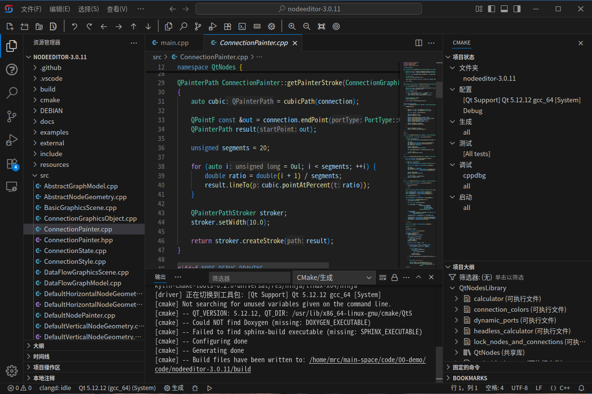
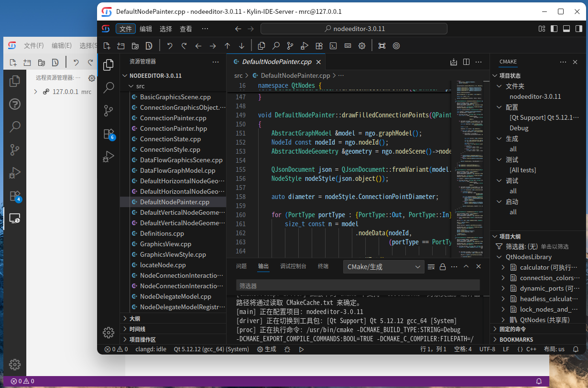
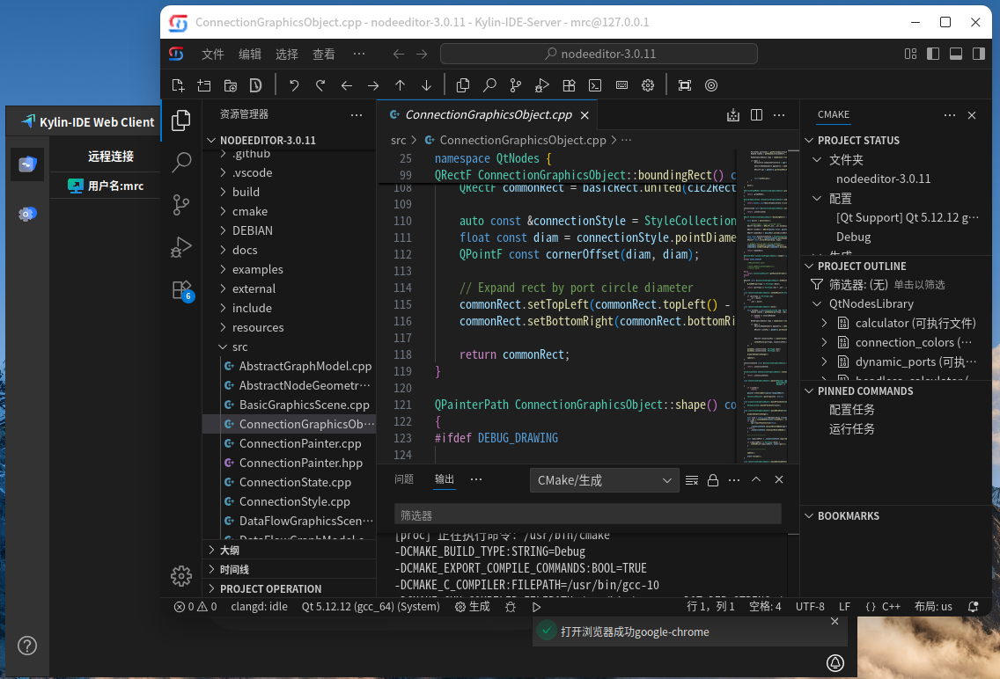

# 目录
- [Kylin-IDE和Kylin-Code](#kylin-ide和kylin-code)
- [三种使用方式，支持跨机器远程开发](#三版本矩阵支持跨机器远程开发)
- [重点优化C/C++开发能力](#重点优化cc开发能力)
  - [C/C++开发支持](#cc开发支持)
  - [Qt（C++）开发支持](#qtc开发支持)
  - [其他编程语言开发支持和AI插件](#其他编程语言开发支持和ai插件)
- [使用方法](#使用方法)
  - [桌面版](#桌面版)
  - [远程开发插件](#远程开发插件)
  - [远程开发WebIDE](#远程开发webide)
- [支持平台](#支持平台)
- [下载链接](#下载链接)

# **Kylin-IDE**和**Kylin-Code**

- 基于 Visual Studio Code 开源项目改造，接入OpenVSX插件市场。支持桌面版、远程开发插件、远程开发 WebIDE 三种形态。主要优化C/C++开发插件，其他编程语言开发支持插件、AI编程插件可在OpenVSX插件市场中检索安装
- Kylin-IDE面向银河麒麟操作系统,Kylin-Code面向openKylin操作系统

# 三种使用方式，支持跨机器远程开发
桌面版、远程开发插件、远程开发 WebIDE 三种形态，支持本地桌面开发、跨机器跨架构远程开发、浏览器作为开发界面等场景。
- **桌面版**
	- Kylin版“vscodium”，接入OpenVSX插件市场，便于在银河麒麟系统上开发
	- 默认接入 OpenVSX 插件市场
	- 支持飞腾、X86；LoongArch等其他架构由远程开发或WebIDE支持
	- 
- **远程开发插件**
	- 类微软 Remote SSH，跨平台远程开发体验近似本地
	- 支持 X86 连接 LoongArch 机器开发
	- 远端支持无图形界面服务器环境
	- 兼容 Kylin-IDE 与 VSCode
	- 
- **远程开发WebIDE**
	- 与一般意义的 Web IDE 概念不同，并不在云端提供一套统一的 Web 服务，而是结合了浏览器访问和 SSH 认证，服务端随用部署的一套软件
	- 无需安装桌面版，客户端小巧
	- 使用灵活，浏览器作为远程开发操作界面
	- 支持跨平台、跨架构远程开发
	- 远端支持无图形界面系统
	- 

# 重点优化C/C++开发能力
重点优化C/C++开发能力，其他编程语言通过OpenVSX插件市场中的插件支持。

## C/C++开发支持
* 提供C/C++插件组，包括编辑、调试、CMake项目自动配置支持等
* 此插件组内插件为非微软协议插件，可以在cursor、qoder等AI IDE中使用
* OpenVSX插件市场下载量10万+
* 主要插件
	- [Extension Pack for C/C++](https://open-vsx.org/extension/KylinIdeTeam/kylin-cpp-pack)
	- [C/C++ Debug](https://open-vsx.org/extension/KylinIdeTeam/cppdebug)
	- [Kylin Clangd](https://open-vsx.org/extension/KylinIdeTeam/kylin-clangd)
	- [CMake IntelliSense](https://open-vsx.org/extension/KylinIdeTeam/cmake-intellisence)
	- [Kylin CMake Workflow](https://open-vsx.org/extension/KylinIdeTeam/kylin-cmake-tools)

## Qt（C++）开发支持
支持CMake、QMake类型Qt项目自动配置，qrc 文件编辑，Shift+F1 跳转 Qt 文档；配合C/C++插件组可支持Qt（C++）编码开发。
* 主要插件
	- [Qt Support](https://open-vsx.org/extension/KylinIdeTeam/qt-support): cmake类型Qt项目自动配置
	- [QMake Support](https://open-vsx.org/extension/KylinIdeTeam/qmake-tools): qmake类型Qt项目自动配置

## 其他编程语言开发支持和AI插件
- 其他编程语言开发支持插件、AI编程插件（例如Cline、Kilo Code等）可通过OpenVSX插件市场检索安装（Kylin-Code目前版本略低，可安装的AI编程插件有限）

# 使用方法
## 桌面版
- 安装IDE基础平台，可在软件商店中搜索安装或通过下载链接下载安装
- 在插件市场中搜索并安装响应的插件
- 安装插件需要的依赖软件
- 开始开发工作
## 远程开发插件
- 安装桌面版
- 在插件市场中搜索remote-dev，安装此插件
- 在远程开发插件页面中配置ssh信息
- 通过配置的ssh信息启动远程开发
	* 自动在远端部署服务端
	* 期间可能需要输入多次ssh密码
- 服务端启动后弹出开发界面
- 在开发界面（远端）安装需要的插件和依赖软件
- 开始开发工作
- 详细见[远程开发插件版章节](./远程开发.md)

## 远程开发WebIDE
- 系统中已安装浏览器
- 安装Kylin-IDE Web Client客户端软件
- 在客户端中配置ssh信息
- 通过配置的ssh信息启动远程开发
	* 自动在远端部署服务端
	* 期间可能需要输入多次ssh密码
- 服务端启动后弹出开发界面
- 在开发界面（远端）安装需要的插件和依赖软件
- 开始开发工作
- 详细见[远程开发WebIDE版章节](./远程开发WebIDE版.md)

# 支持平台
见[支持的平台章节](./支持的平台.md)

# 下载链接
见[下载链接和代码仓库链接章节](./下载链接和代码仓库链接.md)