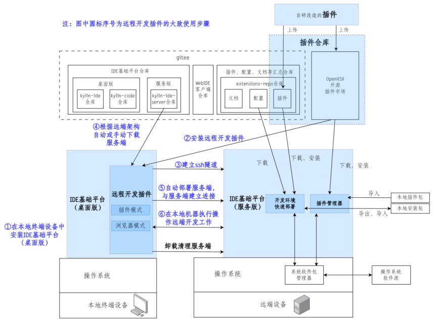
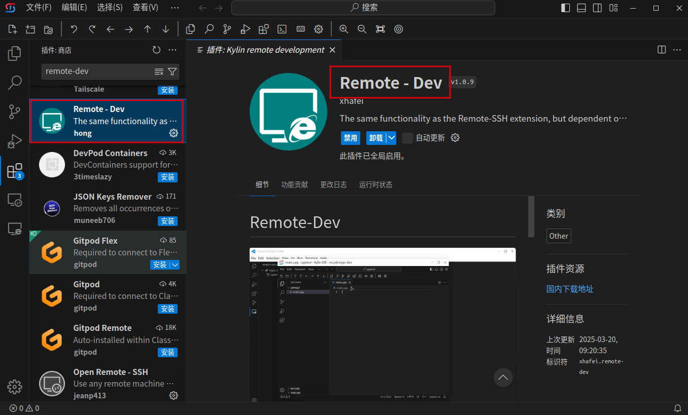
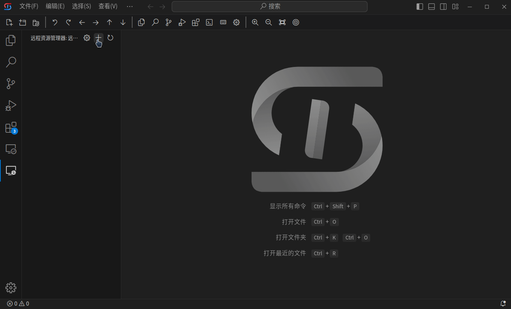
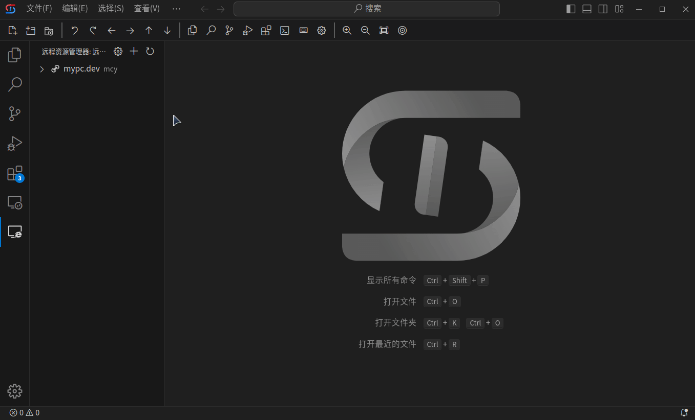
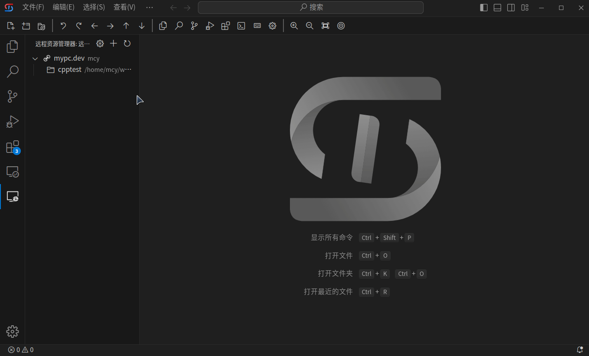
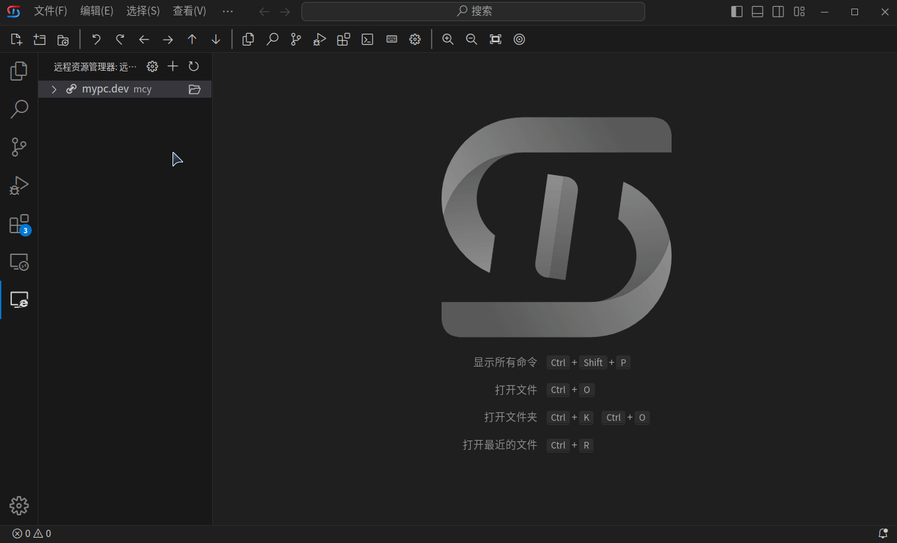
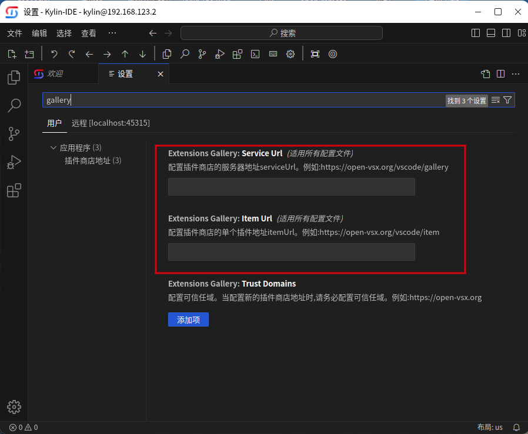
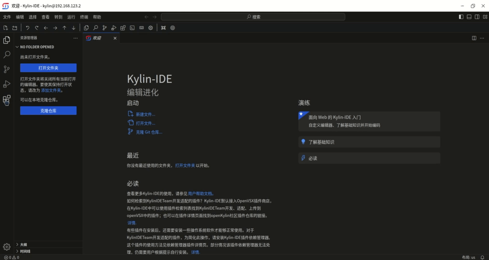
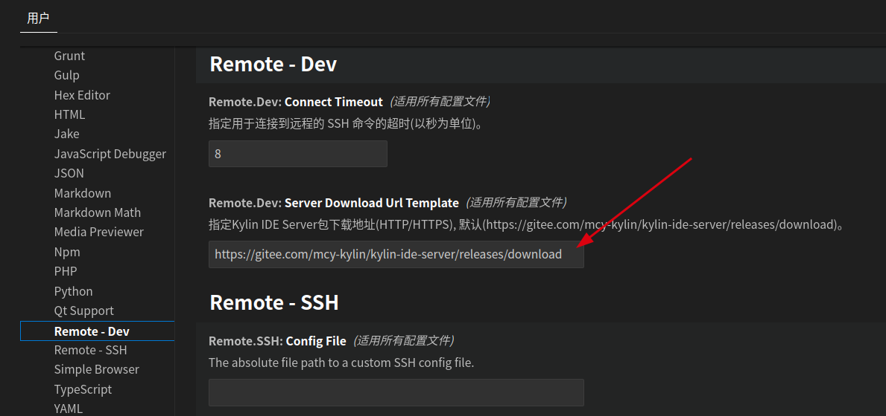
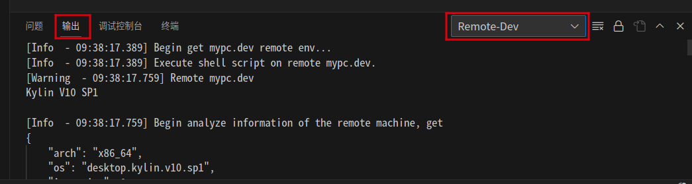

# 远程开发插件版
- [远程开发插件版](#远程开发插件版)
  - [功能概述](#功能概述)
  - [安装使用说明](#安装使用说明)
    - [准备工作](#准备工作)
    - [插件安装](#插件安装)
    - [远程资源管理](#远程资源管理)
    - [连接管理](#连接管理)
    - [远程开发环境使用](#远程开发环境使用)
    - [卸载](#卸载)
    - [修改配置](#修改配置)
    - [例子](#例子)
    - [如何开启X11转发](#如何开启x11转发)
    - [其他问题](#其他问题)

## 功能概述
- 远程开发插件版，提供Remote - Dev插件，类微软Remote SSH（非完全开源），为用户提供跨机器、跨平台远程编辑、远程编译、远程运行、远程调试等功能。插件能够安装在桌面版Kylin-IDE、VSCode、VSCodium中，用法和Remote SSH插件类似
- 用法举例
  * 跨机器、跨平台：在X86、银河麒麟桌面操作系统上安装桌面版Kylin-IDE，在Kylin-IDE中安装Remote - Dev插件，远程开发飞腾或LoongArch机器上的应用
  * 跨系统：在Windows上安装VSCodium，然后安装插件，远程开发银河麒麟操作系统上的软件
  * 无界面系统：银河麒麟服务器操作系统上未安装图形界面的情况，在银河麒麟桌面系统或Windows上安装Kylin-IDE或VSCodium，然后安装Remote - Dev插件，可以使用图形化的界面编辑、调试代码
- 整体结构如下图所示。  
 
- 分为远程开发插件(Remote - Dev)和服务端(kylin-ide-server)
  * Remote - Dev
    - 安装在桌面版Kylin-IDE或VSCode上
    - 根据远程机器架构自动部署服务端，或引导用户手动部署服务端
    - 用户连接远程机器时，在开发机和远程机之间建立ssh隧道，进行ssh登录认证
    - 登录认证后，提供界面访问服务端
    - 获取途径：OpenVSX插件市场，或[extensions-repo仓库](https://gitee.com/openkylin/extensions-repo/tree/master/KylinIDETeam/remote-dev)
  * kylin-ide-server
    - 服务端是IDE基础平台的Web服务版本，改造自开源项目Code-OSS
    - 服务端通常由客户端自动部署，在某些无网络环境下，用户可以手动下载地址对应架构的tar.gz包后放至插件端对应家目录.cache文件夹下。[手动下载地址](https://gitee.com/mcy-kylin/kylin-ide-server/releases)
- 支持的平台：见[支持的平台章节](./支持的平台.md)

## 安装使用说明
### 准备工作
  - 获取远程主机的SSH用户和密码，查看远程主机的架构，是否属于x86_64、loongarch64、aarch64的其中一种，目前远程开发支持以上三种架构
  - 远程开发服务需要开启ssh转发才可访问，检查“远程机”的sshd服务是否正常，保障`/etc/ssh/sshd_config`中`AllowTcpForwarding yes`，`AllowStreamLocalForwarding yes`(若无此配置项默认是yes) `PermitOpen`选项应被注释或指定网段\IP可访问`PermitOpen 192.168.1.0/24:*`并重启sshd服务
  - 检查在客户机是否能够通过ssh连接到远程机
>注：因为远程开发插件需要建立SSH连接，若用户IDE端使用的是麒麟操作系统，请确认'设置'->'网络保护'->'联网控制'开启了Kylin-IDE/KylinCode联网权限
### 插件安装
- 本地客户端机器需要先安装IDE基础平台
- 从插件市场中搜索`Remote - Dev`远程开发插件并安装

  

- 安装完成后，将在左侧活动栏中出现远程开发插件图标，点击图标进入远程资源管理器页面
- 远程开发环境服务端软件包下载
  * 通常情况下，不需要手动部署，由插件根据远程机器平台自动部署(插件版本>=0.1.10已支持自动下载并初始化环境)
  * 在无网络情况下，可以手动下载部署
    - 根据远程机的架构，从gitee中选择对应架构的软件包进行下载(**下载版本 >= v0.1.2**)。[远程开发服务端软件包](https://gitee.com/mcy-kylin/kylin-ide-server/releases/) 
    - 将下载的软件包放在客户机本地环境中用户家目录下的.cache目录下  
   
### 远程资源管理

- 在“远程资源管理器”中提供了查看设置、新建连接、刷新等功能：
- 查看设置:提供配置文件查看功能，点击后将在编辑区打开配置文件。
- 新建连接：提供连接添加功能
  - 点击添加按钮，弹出输入框，根据提示输入远程环境用户名@主机名或IP （该用户名是远程服务端真实存在的用户）
  - 在“远程资源管理器”中显示新增的连接
 
   
  
### 连接管理
- 新窗口打开：
  - 点击连接右边的“新窗口打开”图标
  - 在弹出输入框中，输入远程开发环境密码，将在新的窗口中打开远程开发环境（该密码为此连接在新建连接时输入的用户名对应的密码，用户名和密码是远程服务端真实存在的用户和登录密码）
  - 打开远程开发环境后，打开文件历史记录会显示在远程资源管理器中
  
  - 选择打开远程资源目录时将直接在远程开发环境中打开
  

  - 右键菜单：将鼠标放置在连接上，点击鼠标右键，将弹出右键菜单,包括新窗口打开、删除连接、重命名、删除并清理连接; 鼠标放置在文件夹历史记录上，右键弹出打开文件夹、删除。
  
  - 新窗口打开：效果同上步的新窗口打开图标。
  - 删除连接：将删除当前连接。
  - 重命名：连接名默认显示ip地址，点击“重命名”可以对当前连接进行命名，方便用户记忆。
  - 删除并清理连接：删除连接同时清理后台server。
  - 打开文件夹：打开远程开发环境并打开相应文件夹；
  - 删除：删除此文件夹历史记录。
  
### 远程开发环境使用
  - 通过远程开发插件打开远程开发环境后，其使用方法和Kylin-IDE(KylinCode)编辑器类似。
  - 远程插件市场设置
    - 默认使用OpenVSX插件市场，如果更改插件市场，请在设置中进行修改：点击左下角的设置->在弹出的页面中搜索gallery关键字->在输入框中输入serviceUrl和itemUrl。
      
  
  - 插件安装
    - 打开远程开发环境后，可通过窗口上方标题显示的ip来区分所连接的远程环境与本地环境。
    - 远程开发环境插件的安装方法和Kylin-IDE(KylinCode)相同
    - 插件安装后，在“LOCALHOST:PORT-已安装”中显示远程开发环境已安装的插件
     

  - 多语言开发
    - 提供C、C++、Java、Python、Go、JavaScript语言的代码开发功能，包括代码编辑、编译、调试、运行等功能，具体使用条件和方法请参见对应章节。

### 卸载
  - 服务端卸载
    - 选择对应远程连接右键删除并清理连接
    
  - 客户端卸载
    - 从Kylin-IDE(KylinCode)中卸载远程开发插件，同时删除用户目录下`~/.kylin-ide-remote`目录和`~/.config/kylin-remote-ide`目录
    
  - 注意：卸载操作旨在彻底清除环境中远程开发相关数据，可以用于版本升级或重装等操作，无需在每次使用完后进行卸载操作

### 修改配置
  - 修改server下载地址(外网时默认为gitee)
  


 ### 例子
   - 假设A主机的用户“user1”，想远程到B主机“test”用户进行远程开发，则A主机即为客户端，B主机即为服务端
   - 使用远程开发的准备工作：
     - 登录A主机的“user”用户，启动Kylin-IDE(KylinCode)，并安装将远程插件
     - 检查B主机的sshd服务是否正常，远程开发服务需要开启ssh转发才可访问，检查“远程机”的sshd服务是否正常，保障`/etc/ssh/sshd_config`中`AllowTcpForwarding yes`，`AllowStreamLocalForwarding yes`(若无此配置项默认是yes) `PermitOpen`选项应被注释或指定网段\IP可访问`PermitOpen 192.168.1.0/24:*`并重启sshd服务
     - 提供B主机的用户名“test”和密码“passwd”，检查在A上是否能够使用用户名test通过ssh连接到B
     
   - 新建连接
     - 点击新建连接图标，在输入框中输入“test@B主机ip”,该test为B主机中真实存在的用户
   - 新窗口打开
     - 点击新窗口打开图标，在输入框中输入test用户的密码，该密码为B主机中test用户的ssh登录密码
   - 服务端卸载
     - 选择对应远程连接右键删除并清理连接
   - 客户端卸载
     - 卸载Kylin-IDE/Kylin-Code中的远程开发插件，并删除A主机用户“user1”目录下的.kylin-ide-remote目录
    
### 如何开启X11转发
    远程开发插件支持在Linux平台开启X11转发，进而支持GUI程序相关开发。X11转发功能开启需要服务端与客户端同时配置X11转发功能，如下：
* 目标端sshd服务开启X11转发
```shell
#修改 X11Forwarding 配置项为 yes
sudo vi /etc/ssh/sshd_config
#重启sshd服务
sudo systemctl restart ssh/sshd
```
* 客户端开启ssh转发
```shell
#客户端ssh配置文件位于~/.ssh/config 如下：
Host 192.168.1.101
  HostName 192.168.1.101
  User test
  ForwardX11 yes
  ForwardX11Trusted yes

#添加ForwardX11 yes及ForwardX11Trusted yes
#若无对应IP Host项直接添加对应Host即可，其他ssh相关配置也可在此配置文件直接添加。
```
注：远程开发插件X11转发配置完成后，需等上个ssh连接退出方可立即生效。  

### 其他问题
- **无法连接到远程服务**
  1. 检查“远程机”的sshd服务是否正常，保障`/etc/ssh/sshd_config`中`AllowTcpForwarding yes`，`AllowStreamLocalForwarding yes`(若无此配置项默认是yes) `PermitOpen`选项应被注释或指定网段\IP可访问`PermitOpen 192.168.1.0/24:*`并重启sshd服务。
  2. 查看服务端启动日志
  

  3. 其他问题[反馈](https://gitee.com/mcy-kylin/remote-dev/issues)