# AI工具使用示例
- 索引
    - [新功能开发示例](#新功能开发示例)
    - [已有代码，通过描述改造代码示例](#已有代码通过描述改造代码示例)
    - [代码review示例](#代码review示例)
    - [代码优化示例](#代码优化示例)
    - [单元测试示例](#单元测试示例)
    - [代码补全示例](#代码补全示例)
    - [添加注释示例](#添加注释示例)

  

会不断丰富AI工具的使用示例，大家如有案例也可以反馈给我们。AI工具的功能通常对多种编程语言都起作用，所以不用受例子中编程语言的约束。
  

## 新功能开发示例
第4代技术氛围编程，可以直接根据自然语言生成整个工程，这让程序员可以开发超出自己编程能力之外的程序。也可以先让AI编写出框架然后自己再动手写，毕竟修改代码比重头写更容易些。
VSCode+Cline插件组合（Cline配置好deepseek API KEY）      
例如，我想开发一个记录代办事项功能的Qt程序  
如果希望编写的代码更准确、更符合预期，应该描述更多细节和功能要求  
使用方法：  
- 打开VSCode，打开一个空目录
- 从左侧活动栏按钮打开Cline界面，右下角的Plan、Act模式，选Act（选Plan也可以，意思是先计划再执行）
- 在输入框输入：编写一个Qt程序，记录代办事项
- Cline将会自动开始编写程序，先创建文件、编写代码，再构建代码，运行程序，测试等。有时会以选项的形式向用户询问程序功能细节，例如程序的参数通过命令行传递还是通过读取文件；希望执行命令询问用户是否允许等
- 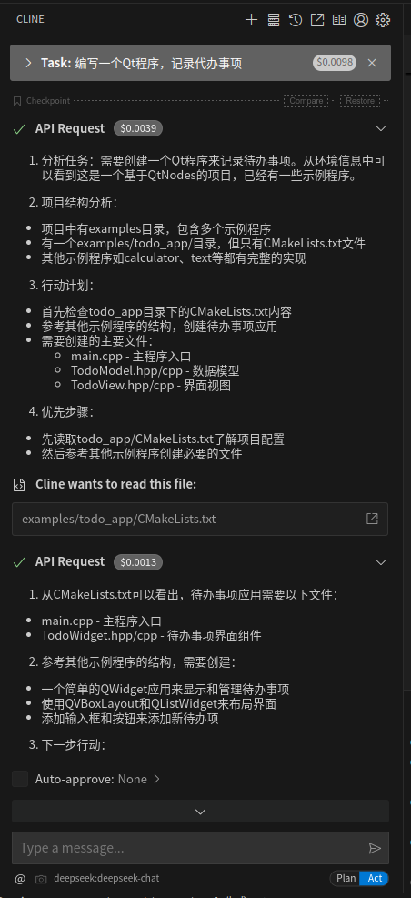

## 已有代码，通过描述改造代码示例
VSCode+continue插件组合（continue配置好deepseek API KEY）    
例如，我在开发一个Qt程序，希望在打开窗口时添加一个慢慢打开的效果
使用方法：  
- VSCode打开代码文件夹，加载代码
- 光标放在设置窗口大小的代码位置
- 键盘输入ctrl + I，进入continue的Edit模式
- 在输入框内输入：让窗口慢慢变大
- 会自动在编辑器内修改代码，修改完成后提示用户是否接受修改。用户可以检查一下代码，选择接受，或者接受后再进行修改
- 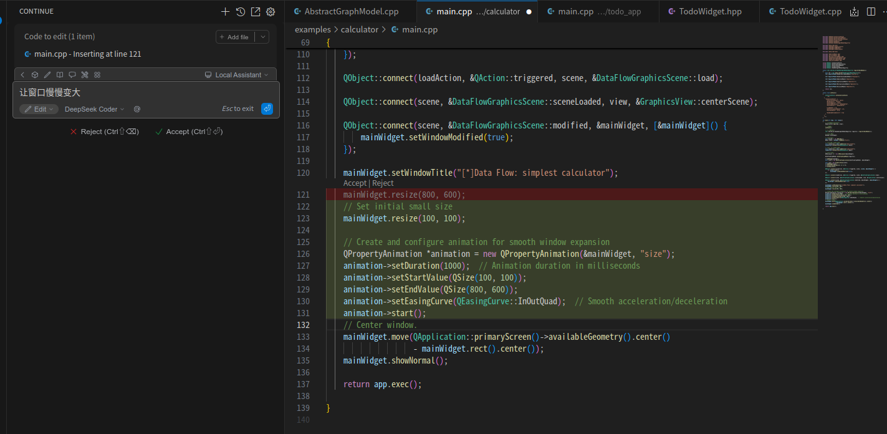

## 代码review示例
VSCode+通义灵码插件组合，review git提交的代码    
使用方法：            
- VSCode打开代码文件夹，加载代码
- 点击通义灵码视图，进入对话模式
- 在对话框点击添加上下文按钮，选择gitCommit提交，如下图所示:            
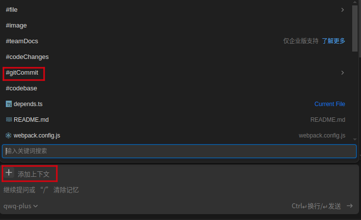
- 在列出项目的所有git commit中，选择你要review的那一笔提交，如下图所示:          
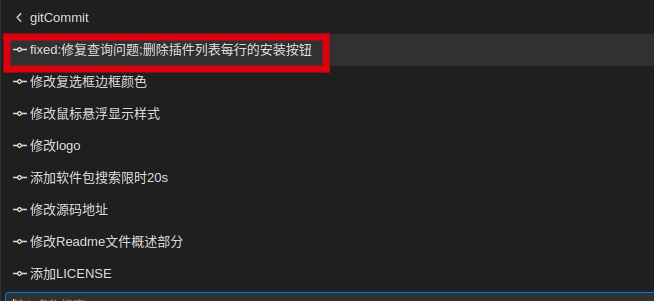
- 然后输入“请对该提交进行review”，如下图所示：     
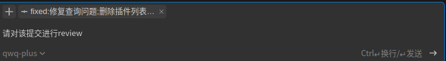
- 插件开始分析代码，并给出review结果，如下图所示：     
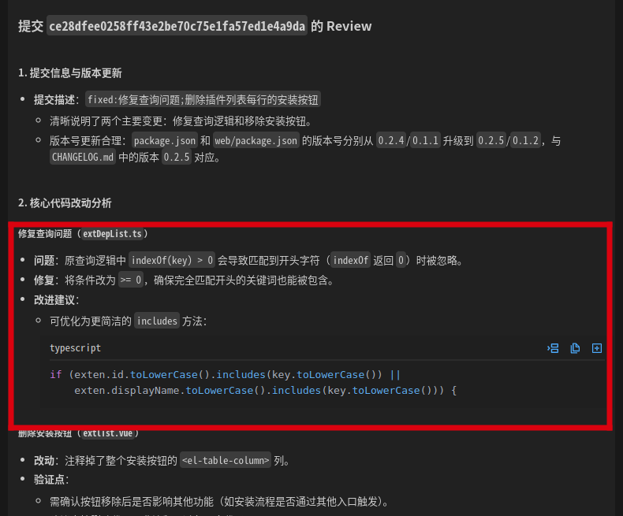

注意： 以上示例使用通义灵码插件的对话模式。

## 代码优化示例
VSCode+通义灵码插件组合，优化代码     
使用方法：            
- VSCode打开代码文件夹，加载代码
- 在编辑区打开需要编辑的代码文件
- 代码中的函数上面会自动添加操作快捷键，点击优化代码快捷键，如下图所示: 

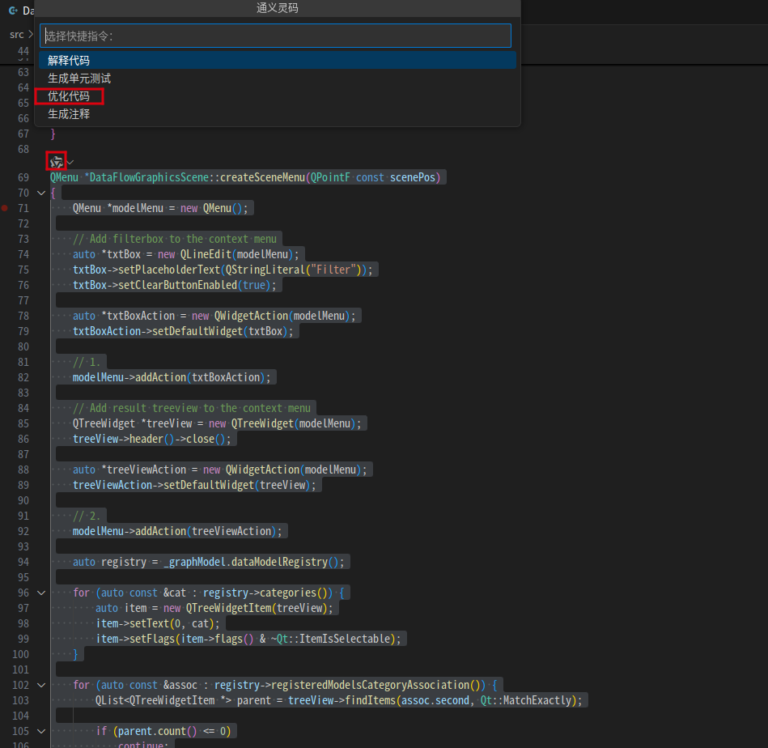
- 在通义灵码插件对话框中展示代码分析及优化后的代码,如下图所示：                       

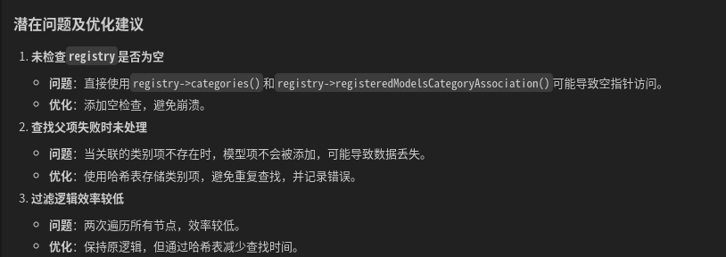    

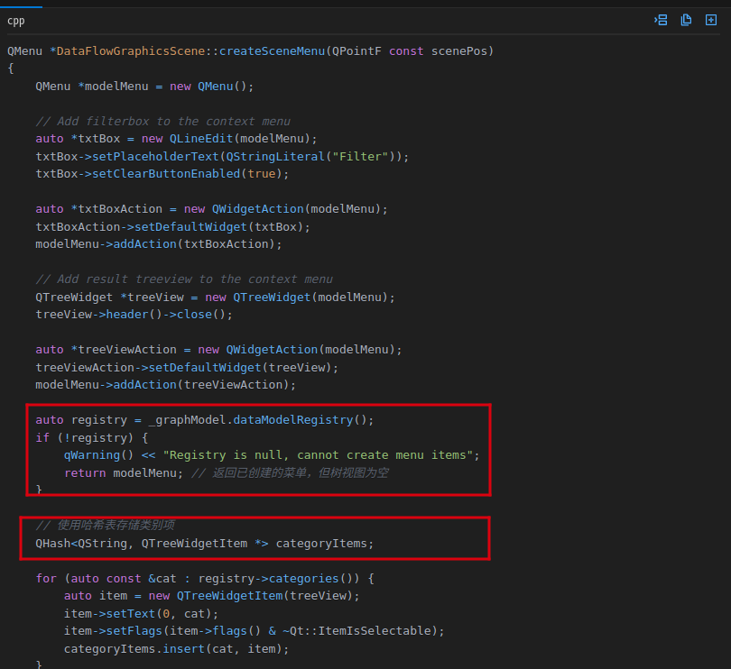

注意： 以上使用通义灵码插件的对话模式，也可以选择AI 程序员模式，此时插件将在文件编辑区展示优化后的代码。

## 单元测试示例
VSCode+CodeGeeX组合，生成单元测试代码
使用方法：            
- VSCode打开代码文件夹，加载代码
- 在编辑区打开需要编辑的代码文件test.ts
- 代码中的函数上面会自动添加操作快捷键，其中包括生成单元测试代码，如下图所示:          
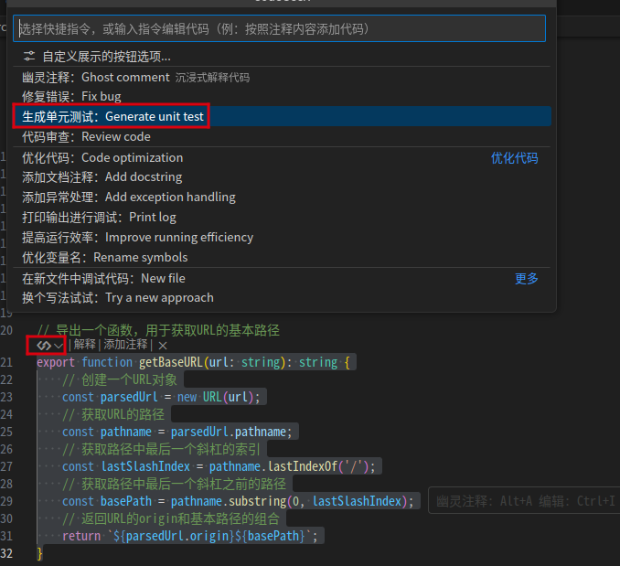
- 点击生成单元测试后，将在CodeGeeX插件对话框中展示生成的单元测试代码,如下图所示：                      
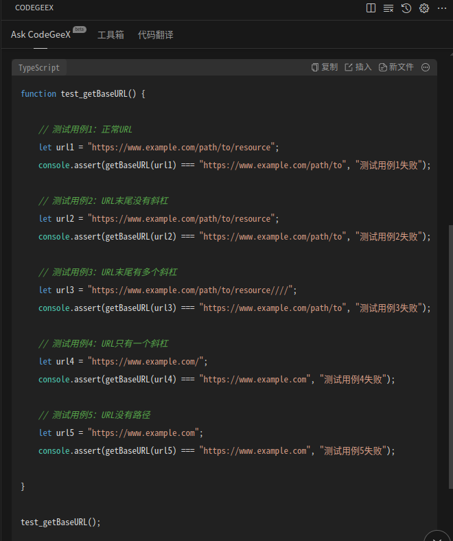
- 点击上图中的新文件，然后“ctrl+s”将生成的单元测试代码保存到文件unitest.ts中
- 然后在unitest.ts中引用getBaseURL，在文件头添加`import { getBaseURL } from "./test";`
- 在终端运行`tsc unittest.ts && tsc unittest.js`
- 输出结果如下所示：        
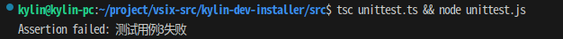   
   

可以通过对话的方式为代码文件中的主要函数生成单元测试代码
 - VSCode打开代码文件加，加载代码
 - 在CodeGeeX的Ask CodeGeeX 对话框输入@file/luac.c 引用文件，然后输入“帮我为文件中主要函数生成单元测试”，如下图所示：
 - 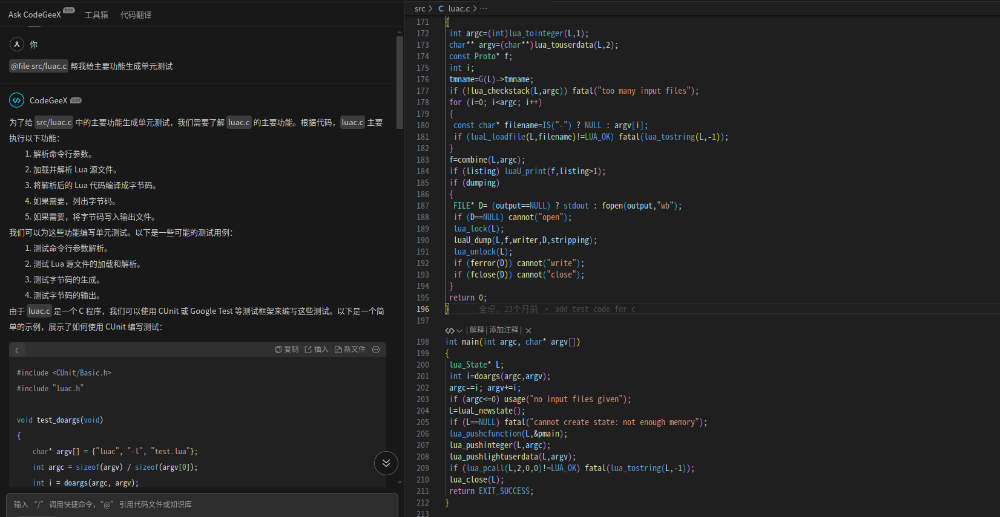

注意：生成的单元测试代码不一定准确，需用户后续自行验证

## 代码补全示例
VSCode+通义灵码组合，使用代码补全功能实现网络能否访问的功能    
使用方法：     
- VSCode打开代码文件夹，加载代码
- 在编辑区打开需要编辑的代码文件test.ts
- 在编辑区输入//检查网络是否联通，敲击回车
- 此时在光标处生成了示例代码，如下所示：          
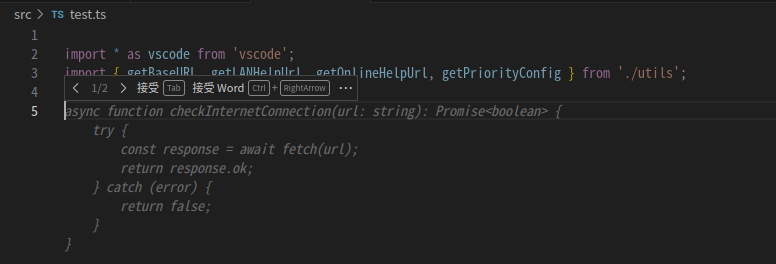
- 点击Tab快捷键，接受生成的代码

## 添加注释示例
VSCode+CodeGeeX组合，使用添加注释功能       
使用方法：            
- VSCode打开代码文件夹，加载代码
- 在编辑区打开需要编辑的代码文件test.ts
- 代码中的函数上面会自动添加操作快捷键，其中包括添加注释快捷键，如下图所示:       
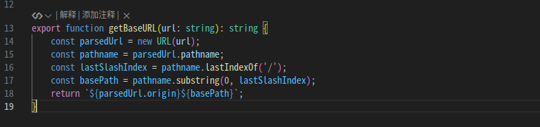
- 点击函数头上面的添加注释，将为该函数添加注释,如下图所示：                 
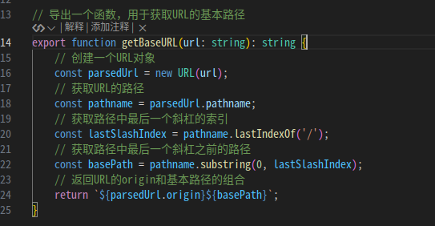
