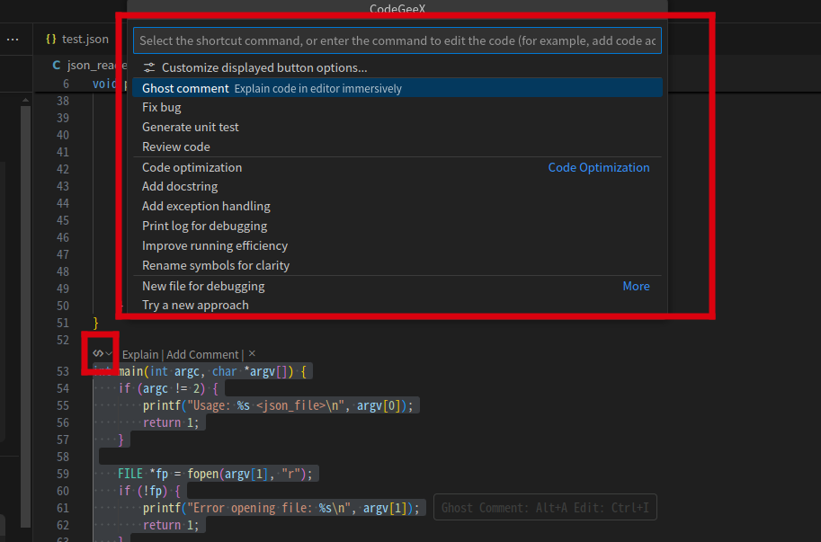
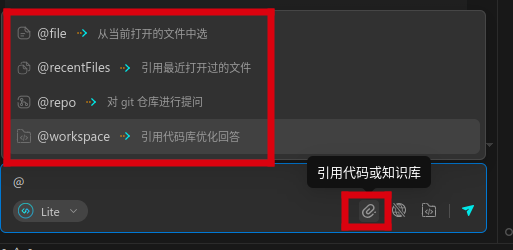
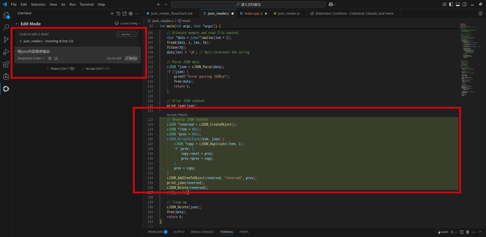
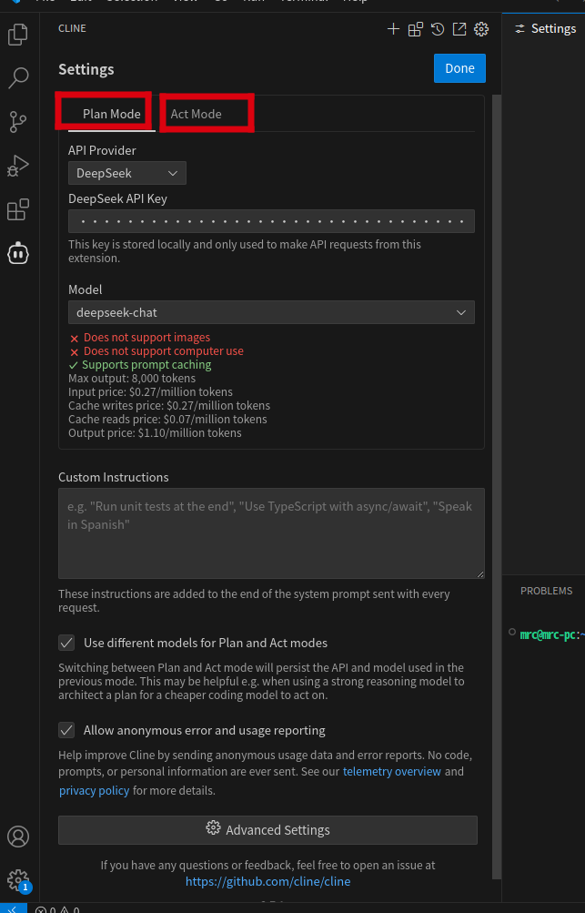
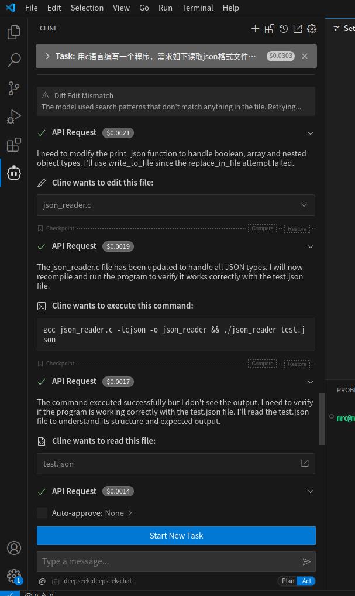

# AI工具推荐

## 索引
- [AI工具分类](#AI工具分类)
- [场景1：处理开源代码且能访问互联网](#场景1处理开源代码且能访问互联网)
- [场景2：处理非开源代码](#场景2处理非开源代码)
- [开发过程使用场景](#开发过程使用场景)
- [使用策略和技巧](#使用策略和技巧)
- [第2代，通义灵码等使用方法](#第2代通义灵码等使用方法)
- [第3代，continue等使用方法](#第3代continue等使用方法)
- [第4代，cline等使用方法](#第4代cline等使用方法)
- [AI工具使用示例](./AI使用示例.md)

## AI工具分类
- 从演进上看我们分了4代技术，4代技术，对模型的使用越来越精细，功能趋向于降低人在编码活动中的参与度
- 4代技术描述见场景1
- 但并不是绝对地说4代技术比3代、2代、1代强（通常是的），要看场景，可以组合用

## 场景1：处理开源代码且能访问互联网
- 第1代：主要以问答形式解决编码、注释、解释、优化等问题
- 第2代（功能良好封装，目前免费；问答、补全、注释、解释、单元测试、优化、引用等功能）
    - 通义灵码（Lingma）
    - CodeGeeX
    - MarsCode（目前功能稍弱）
- 第3代（Edit模式，引入Agent，自然语言描述提编辑需求，直接在编辑器修改代码，用户审核后选择是否接受）
    - continue + deepseek
    - 通义灵码-AI程序员
    - Github Copilot（国外闭源，不特别推荐，但功能较强）
- 第4代（氛围编程模式）：引入Agent，vibe coding（氛围编程），自然语言提需求，工具自动完成创建、编码、构建、测试等流程，过程中让用户做选择，向用户获取执行授权
    - cline + deepseek（cline目前不能安装在Kylin-IDE桌面版中，可以安装在远程开发服务端）
    - cursor（cursor因闭源国外商业产品，不特别推荐，但功能较强）

## 场景2：处理非开源代码
- 考虑代码安全，仅开源代码可以使用外网工具。对模型提问，通常会把相关代码作为上下文传递给模型，代码有泄露风险
- 处理非开源代码，还可以这样使用：在没有代码的外网机器上问答。仅用其问答功能，仅对问题本身作提问，而不要涉及代码，通常比搜索引擎节省时间。不要在工作区打开代码。当成搜索引擎用

## 开发过程使用场景
- 新代码阅读：快速了解代码，解释功能、@workspace功能
- 新功能编写：可以尝试使用cline、continue+deepseek或cursor等。复杂功能可拆解成更小功能块分而治之
- 代码检查，优化建议：特别是关键函数，或通过debug缩小了范围后锁定的目标函数
- 生成单元测试代码：不一定准确，需后续验证
- 问答：最常用，获取信息速度比浏览器快；有编造情况，需辨别
- 补全：编码速度
- 注释：自动添加

## 使用策略和技巧
- **考虑代码安全**，仅开源代码可以使用外网工具或在没有代码的外网机器上问答，仅用其问答功能。对模型提问，通常会把相关代码作为上下文传递给模型，代码有泄露风险
- 当选择较多，可以按此策略做选择：优先使用国内的产品，优先使用国内的模型；优先使用开源的产品
- 技巧需积累总结：AI工具能力有限制，不能解决所有问题。但可以有技巧地用，把解决不了的问题分解成能解决的问题再用AI工具解决
- **辨别编造**：注意，AI工具回答有编造的情况，可做参考，但不能全信，要做判断和实验
- 第2代插件在使用时，有时问答能力不足，回答内容不详细，可以再配合一个稍大的模型做问答补充，例如deepseek或chatgpt中文版插件等

## 第2代，通义灵码等使用方法
- 从插件市场中检索安装插件，安装后重启VSCode或重新加载
    * 当使用Kylin-IDE或接入OpenVSX插件市场时，若插件市场中无插件或版本低，可以通过VSCode Marketplace找到对应插件或通过官网找到插件下载地址，下载vsix文件后本地安装
- 按提示注册登录
- 通常在函数头上有**快捷命令入口**，可以借此为索引快速了解功能
    * 
- **引用**，针对性地引用能够让模型回答地更准确，注意引用功能的使用
    * 
- **输入框命令操作**，“/”，“@”或“#”
    * 通常在对话框中利用特殊符号能够快速操作（相当于加了很多提示词）
    * “/”通常是命令封装，例如/explain 标识解释代码
    * “@”或“#”通常表示引用，例如引用某个代码文件等

## 第3代，continue等使用方法
- 使用continue时，使用local config模式，选择deepseek模型，需要一个deepseek的API KEY
- 申请API KEY方法
    * 登录deepseek官网，注册账号
    * 入口：deepseek官网右上角“API开放平台”
    * 充值，记录API KEY，注意仅能刚申请时看到KEY，注意复制保存
    * 将API KEY填写到continue页面中。注意，continue将API KEY明文保存在了本地，注意不要泄露
- Edit模式
    * Ctrl+I 进入Edit模式，描述自然语言，即可自动编辑代码，通常直接和光标位置关联
    * 

## 第4代，cline等使用方法
- 在设置中，配置deepseek API KEY（申请方法见continue）
    * 
- Plan模式和Act模式
    * Plan：计划
    * Act：执行
    * 通常先Plan好后再Act
    * 自然语言描述，氛围编程，过程中有时会以选项形式让用户做选择，或授权执行命令和操作
- 氛围编程（vibe coding）示意图
    * 

# AI使用示例
为帮助大家更好的利用AI工具，提供了一些AI使用示例，后续会不断丰富，详细参见[AI工具使用示例](./AI使用示例.md)