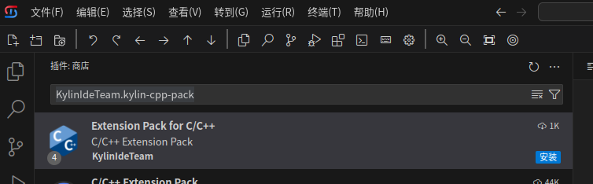
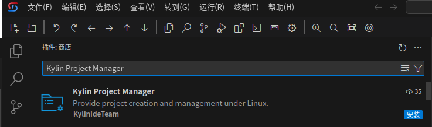

# C/C++开发解决方案
## 准备工作
- 安装VSCode或者Kylin-IDE
- 如果在公司内网，可以配置内网插件商店（见相关文档）。如果可以访问互联网，可以选择不更换
- 安装“解决方案汇总插件”，在插件搜索框中检索KylinIdeTeam.kylin-dev-installer插件，点击安装

## 快速部署
### 安装插件
- 卸载微软的CMake Tools(ms-vscode.cmake-tools)及C/C++(ms-vscode.cpptools)插件，若未安装该插件，请忽略此步骤
- 在插件搜索框中检索KylinIdeTeam.kylin-cpp-pack插件，点击安装，从插件市场中下载安装Extension Pack for C/C++插件组    

- 在插件搜索框中检索Kylin Project Manager插件（项目创建插件），点击安装，从插件市场中下载安装Kylin Project Manager插件      

### 安装系统软件
- 桌面系统   
  `sudo apt install clangd build-essential cmake ninja-build gdb`
- 服务器系统   
  `sudo yum install clang-tools-extra gcc gcc-c++ cmake ninja-build gdb`

## 使用
- 编辑支持需要了解Kylin Clangd插件和系统软件clangd的基本配置方法，具体见如下章节
  * [任意C/C++工程，如何使跳转等编辑功能正常工作（clangd）](./任意C-C++项目如何使跳转等编辑功能正常工作.md)
- 项目的构建、调试、运行配置请参考以下章节
  * [如何配置工程的构建、调试、运行](./如何配置工程的构建-调试-运行.md)
- C/C++ Debug(gdb)插件 和 Kylin Native Debug插件的launch.json具体如何配置，见插件readme
  * 在最左侧点击插件图标，打开插件视图，在列表中找到插件条目，点击插件条目即可查看插件readme         

## 常见问题及解决方法   
### Extension Pack for C/C++插件组包括哪些插件   
- Extension Pack for C/C++插件组包括以下插件：
  - KylinIdeTeam.kylin-cpp-pack
  - kylinideteam.kylin-clangd (版本需大于等于 0.2.13)
  - kylinideteam.kylin-debug (版本需大于等于 0.2.6)
  - kylinideteam.cppdebug
  - kylinideteam.kylin-cmake-tools
  - kylinideteam.cmake-intellisence

### 部分插件功能介绍
- Kylin Project Manager插件，即id为kylinideteam.kylin-project-manager的插件：提供基础项目创建功能，提供项目操作列表以方便执行配置、构建、调试、运行等操作。详见[项目管理](./项目管理.md)
- kylinideteam.kylin-clangd提供编辑支持，为C/C++提供补全、导航和检查等语法功能
- kylinideteam.cppdebug提供调试支持，调试功能体验优于Kylin Native Debug，但仅支持X86和ARM架构
- kylinideteam.kylin-debug提供调试支持：支持架构多，包括X86、ARM、LoongArch等；插件体积小，下载快
-【调试插件选择建议】X86、ARM架构优先使用C/C++ Debug(gdb)插件；其他架构使用Kylin Native Debug插件；资源受限条件下使用Kylin Native Debug插件

### 系统软件依赖介绍
* kylin-clangd插件依赖clangd软件，目前系统默认安装clangd-10，建议尽量安装较新版本，功能更强。可以手动安装更新版本，例如`sudo apt install clangd-11`。若是手动安装clangd-11后，需要在kylin-clangd插件中配置clangd程序路径。
* kylin-clangd插件clangd路径配置
  - 点击左下角齿轮图标，选择“设置”，在搜索框中输入clangd，找到Clangd:Path,然后输入clangd程序路径，然后重新加载窗口。

### 为什么卸载cpp-tools、cmake-tools插件
- 微软cpp-tools插件包含了闭源的language server，KylinIdeTeam.kylin-cpp-pack插件组提供了与C/C++(ms-vscode.cpptools)插件相近的功能
- 微软CMake Tools插件与cpp-tools绑定，对其他调试插件支持不佳；与kylinideteam.kylin-cmake-tools插件会注册相同的视图，导致插件冲突报错
