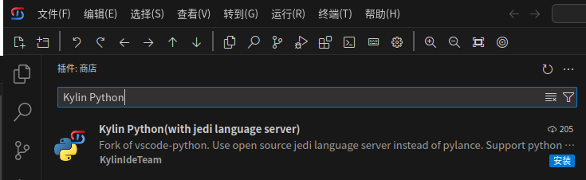

# Python3开发解决方案

## 准备工作
- 安装VSCode或者Kylin-IDE
- 如果在公司内网，可以配置内网插件商店（见相关文档）。如果可以访问互联网，可以选择不更换
- 安装“解决方案汇总插件”，在插件搜索框中检索KylinIdeTeam.kylin-dev-installer插件，点击安装

## 快速部署
### 安装插件
- 卸载微软Python插件
- 在插件搜索框中检索Kylin Python插件，点击安装，从插件市场中下载安装Kylin Python(KylinIDETeam.kylin-python)插件    

- **注意**，如果python插件相互冲突，例如未禁用微软python插件或python2和python3插件冲突，请保留一个或一组python插件，将其他python插件禁用

### 安装系统软件
- 桌面系统   
  `sudo apt install python3 python3-autopep8 python3-pip`
- 服务器系统   
  `sudo yum install python3 python3-pip`

### 安装Python库    
+ 执行`pip install pylint autopep8`

