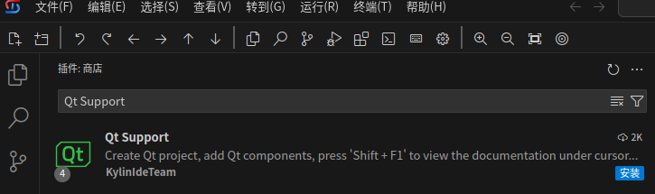

# Qt开发解决方案
## 准备工作
- 安装VSCode或者Kylin-IDE
- 如果在公司内网，可以配置内网插件商店（见相关文档）。如果可以访问互联网，可以选择不更换
- 安装“解决方案汇总插件”，在插件搜索框中检索KylinIdeTeam.kylin-dev-installer插件，点击安装

## 快速部署

### 安装插件
- 卸载微软的cmake-tools、cpp-tools插件，若未安装，请忽略此步骤
- 在插件搜索框中检索Qt Support插件，点击安装，从插件市场中下载安装Qt Support插件组    

- 在插件搜索框中检索Qmake Tools插件，点击安装   
- 在插件搜索框中检索Kylin Project Manager插件，点击安装，从插件市场中下载安装Kylin Project Manager插件     

### 安装系统软件
- 桌面系统   
  `sudo apt install clangd build-essential cmake ninja-build gdb qt5-default qt5-qmake qttools5-dev-tools`
- 服务器系统   
  `sudo yum install clang-tools-extra gcc gcc-c++ cmake ninja-build gdb qt5-qtbase-devel qt5-qttools-devel`

## 快速使用
Qt开发功能由一组插件配合完成。对CMake类型的项目支持较好，对QMake类型的项目提供部分支持。使用方法参见[Qt开发](Qt开发指南.md)。

## 常见问题及解决方法
### Qt Support插件组包括哪些插件
  - kylinideteam.qt-support (版本需大于等于 0.3.4)
  - kylinideteam.qmake-tools
  - kylinideteam.kylin-clangd (版本需大于等于 0.2.13)
  - kylinideteam.kylin-debug (版本需大于等于 0.2.6)
  - kylinideteam.cppdebug
  - kylinideteam.kylin-cmake-tools
  - kylinideteam.cmake-intellisence

### 查看Qt帮助文档
当鼠标光标位于某一个Qt 库中的符号处时，按下 `Shift + F1` 快捷键，将会在编辑器旁边显示该符号的帮助文档，如下如所示。使用此功能前需安装对应版本Qt文档，例如：`apt install qt5-doc qt5-doc-html`或`yum install qt5-doc qt5-doc-html`。注意，此功能目前不支持远程开发方式，仅桌面版Kylin-IDE能够正常使用。
 

 ### 系统软件依赖介绍
- 安装clangd
  * Kylin Clangd插件依赖该软件
  * 建议尽量安装较新版本，功能更强。目前系统默认安装clangd-10，可以手动安装更新版本，例如`sudo apt install clangd-11`。若是手动安装clangd-11后，需要在kylin-clangd插件中配置clangd程序路径。

### kylin-clangd插件clangd路径配置
- 点击左下角齿轮图标，选择“设置”，在搜索框中输入clangd，找到Clangd:Path,然后输入clangd程序路径，然后重新加载窗口。

### 为什么卸载微软cmake-tools、cpp-tools插件
- 微软cpp-tools插件包含了闭源的language server，KylinIdeTeam.kylin-cpp-pack插件组提供了与C/C++(ms-vscode.cpptools)插件相近的功能
- 微软CMake Tools插件与cpp-tools绑定，对其他调试插件支持不佳；与kylinideteam.kylin-cmake-tools插件会注册相同的视图，导致插件冲突报错

