# 远程开发WebIDE版
- [功能概述](#功能概述)
- [使用说明](#使用说明)
  - [远程机SSH配置](#远程机SSH配置)
  - [WebIDE客户端主页面](#WebIDE客户端主页面)
  - [WebIDE客户端设置页面](#WebIDE客户端设置页面)
  - [远程资源管理](#远程资源管理)
  - [提示信息管理](#提示信息管理)
  - [插件安装、多语言开发、调试功能使用](#插件安装多语言开发调试功能使用)
  - [卸载](#卸载)
  - [开启X11转发](#开启x11转发)
## 功能概述
- 远程开发WebIDE版，本文简称WebIDE，与一般意义的Web IDE概念不同，并不在云端提供一套统一的Web服务，而是结合了浏览器访问和SSH认证，服务端随用部署的一套软件。用法和Remote SSH插件类似，但不需要安装桌面版IDE软件。为用户提供跨机器、跨平台远程编辑、远程编译、远程运行、远程调试等功能
- 用法举例
  * 跨机器、跨平台：在X86、银河麒麟桌面操作系统上安装客户端(kylin-ide-web-client)，远程开发飞腾或LoongArch机器上的应用
  * 跨系统：在Windows上安装客户端，远程开发银河麒麟操作系统上的软件
  * 无界面系统：银河麒麟服务器操作系统上未安装图形界面的情况，在银河麒麟桌面系统或Windows上安装客户端，可以使用图形化的界面编辑、调试代码
- 整体结构如下图所示。  
 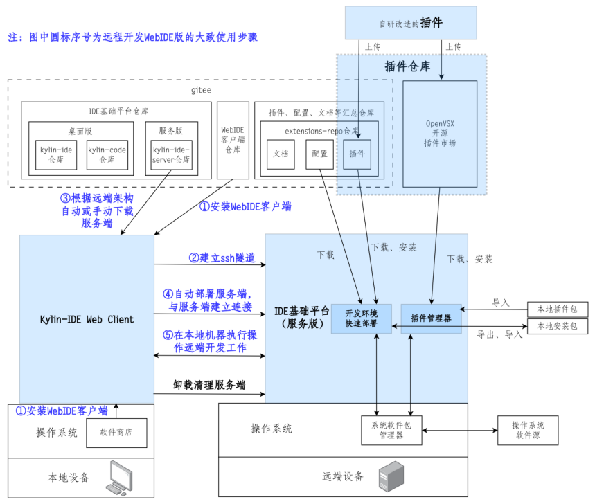
- 分为客户端(kylin-ide-web-client)和服务端(kylin-ide-server)
  * kylin-ide-web-client
    - 小巧的图形化的远程开发管理软件，不依赖桌面版Kylin-IDE或VSCode
    - 根据远程机器架构自动部署服务端，或引导用户手动部署服务端
    - 用户连接远程机器时，在开发机和远程机之间建立ssh隧道，进行ssh登录认证
    - 登录认证后，启动浏览器，使用浏览器访问服务端
    - 获取途径，[地址](https://gitee.com/leven08/kylin-ide-web-client/releases/)
  * kylin-ide-server
    - 服务端是IDE基础平台的Web服务版本，与远程开发插件版共用一套服务端，改造自开源项目Code-OSS
    - 服务端通常由客户端自动部署，在某些无网络环境下，可在客户端引导下手动部署。[手动下载地址](https://gitee.com/mcy-kylin/kylin-ide-server/releases/)
- 支持的平台：见[支持的平台章节](./支持的平台.md)

## 使用说明
### WebIDE客户端主页面
  - 安装完成后，启动程序，将显示WebIDE客户端主页面；如下图所示，右上角包含“添加连接”、“刷新”按钮，中间区域用于显示添加的连接，窗口右下角用于显示客户端提示信息。
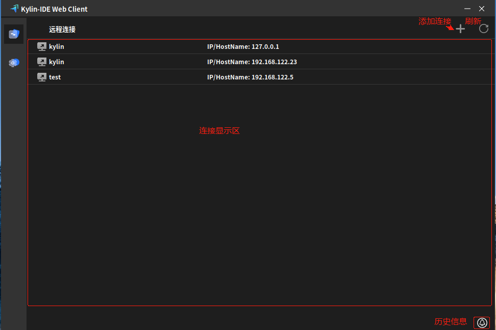

### WebIDE客户端设置页面
  - 客户端设置页面如下图所示，用于设置日志级别、主题样式、关闭面板，以及主页、当前版本、版权信息等。
    - 日志级别：日志优先级从高到底分为ERROR、WARN、INFO、DEBUG四个等级，客户端日志信息随着等级降低而更多。当鼠标放在日志开关上时会高亮，选中后会变成蓝色。
    - 主题设置：提供多种主题样式，用户可以根据喜好选择不同样式。
    - 关闭面板：用于设置客户端退出按钮的状态，默认点击窗口的关闭按钮时，客户端会最小化到任务栏；如果选择“退出程序”，则在点击窗口关闭按钮时客户端会退出。
    - 版本信息：显示当前客户端版本  
    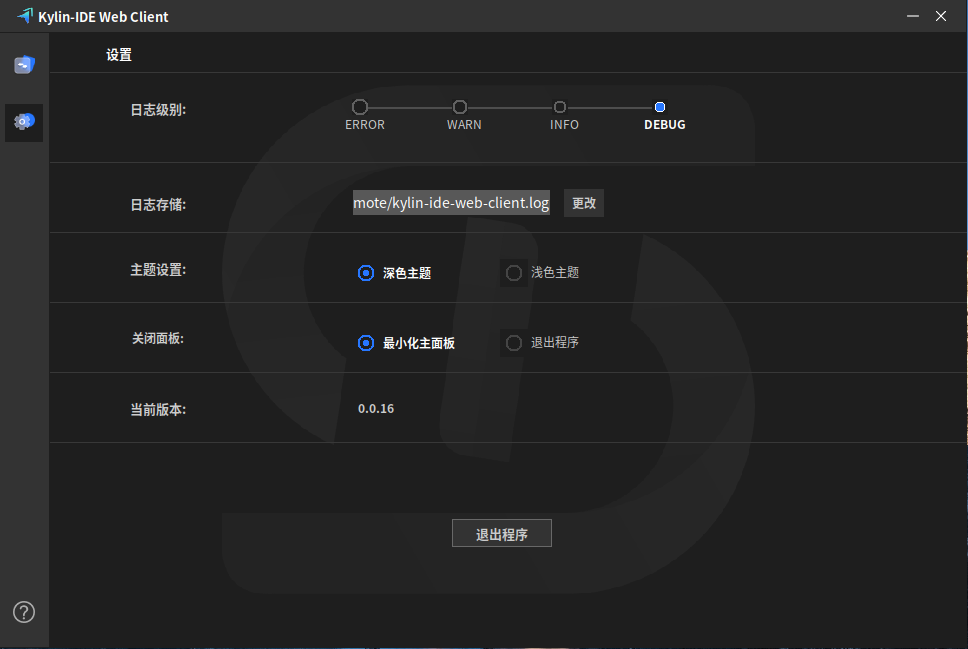
    
### 远程资源管理

- “远程资源管理器”提供了添加连接、连接配置信息修改、打开连接、删除连接、清理连接等功能：
- 添加连接：  
  - 点击主页面右上角添加按钮，弹出添加连接页面  
  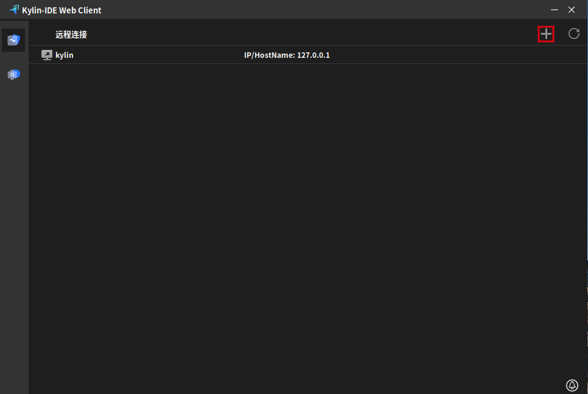
  - 添加基本信息：在添加页面中，基本信息包括远程机器的IP地址、用户名、软件包安装方式（在线安装、离线安装、软件源安装）、浏览器选择（默认浏览器、指定浏览器）、认证方式等。
    安装方式是指如何在远程机器上安装远程服务包，包括在线安装、软件源安装、离线安装。
    
    1）在线安装：自动从[gitee仓库](https://gitee.com/mcy-kylin/kylin-ide-server/releases)下载远程服务包，并将软件包放在本地机器的~/.cache目录，然后进行远程服务部署。

    2）软件源安装(目前未支持)：使用apt或yum命令从系统软件源下载远程服务包，并将软件包放在本地机器的~/.cache目录，然后进行远程服务部署。

    3）离线安装：在离线情况下，用户将远程服务包下载到本地机器后，指定存放目录，客户端从指定目录进行远程服务部署。
    在线安装和软件源安装会优先检查~/.cache目录下是否存在远程服务包，若有则使用该软件包，否则会进行下载。

    4）浏览器选择是指采用哪个浏览器打开远程开发环境，默认情况下使用系统默认浏览器，当用户指定了浏览器之后就优先使用该浏览器。
    
    5）认证方式是指在ssh连接到远程机器时采用的认证方式，默认选择密码认证，在连接时需要输入远程机器登录密码；如果选择秘钥认证，则在ssh连接时采用秘钥方式登录，默认秘钥存放路径为~/.ssh/id_rsa，用户可以指定具体的秘钥路径（如果秘钥设置了口令，则在连接时的密码输入框中需要输入秘钥口令，否则无法连接）。如果该文件不存在，则执行"ssh-keygen -t rsa"命令生成。 
    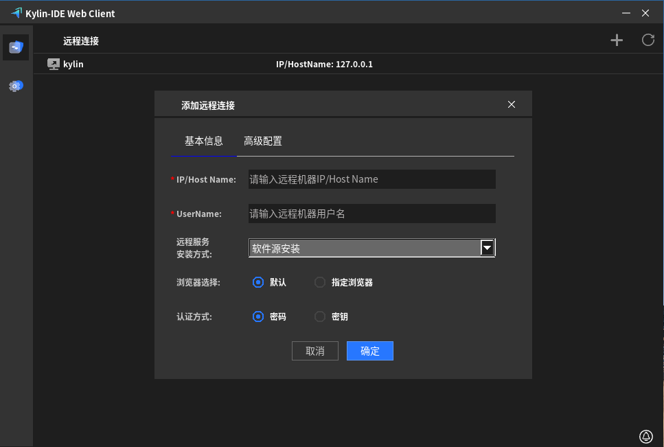

  - 添加高级配置：
    
    1）在高级配置中，用户可以设置与远程机器ssh连接所使用的端口号port，以及本地访问远程机器所使用的端口号transport（用于通过https://localhost:transport来访问远程开发环境）。  
    2) 自动更新远程服务，默认打开时，会在打开连接时检查已部署的远程服务版本是否为最新版本，如果不是则自动更新为最新版本；如果关闭则对已经部署的服务端包不进行版本检查。  
    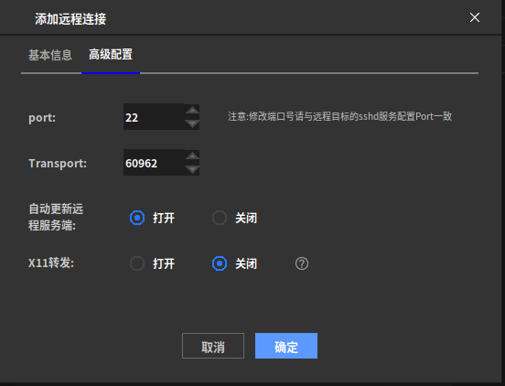  
    3) X11转发功能：在远程服务上进行图形化开发时，如果需要将图形程序显示在本地，则需要打开该功能，具体请参考[开启X11转发](#9开启x11转发)

  - 合法性检查：在切换高级配置页面或点击确认按钮进行连接创建时，会进行用户名、IP、浏览器路径等信息的合法性检查，如果为空或者格式错误将进行提示
    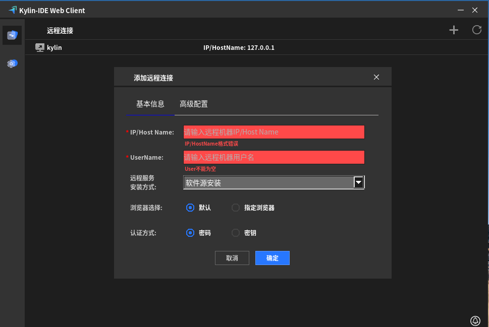

  - 点击确认后，会创建连接，并在主页面显示所创建的连接，包括用户名、IP地址，以及“打开连接”、“修改配置”、“删除连接”、“清理连接”等连接管理的快捷按钮
    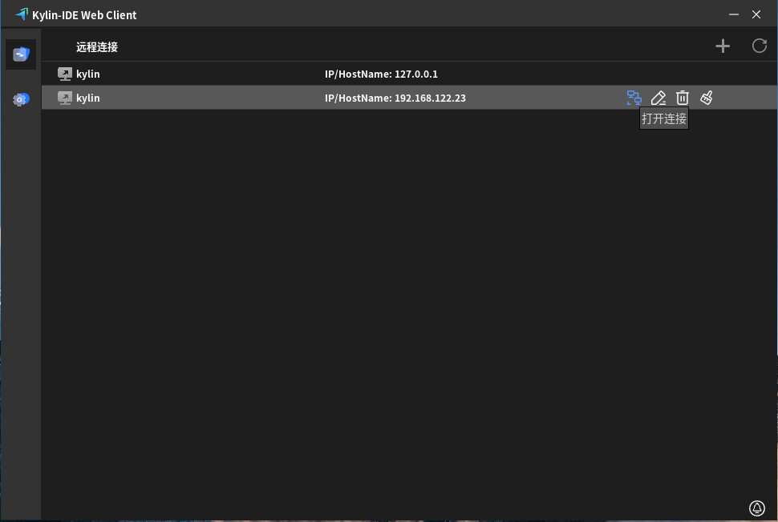

- 修改配置    
  - 将鼠标放在连接上，会在连接右侧显示四个快捷按钮，分别是打开连接、修改配置、删除连接、清理连接，点击第二个“修改配置”按钮将弹出修改页面  
  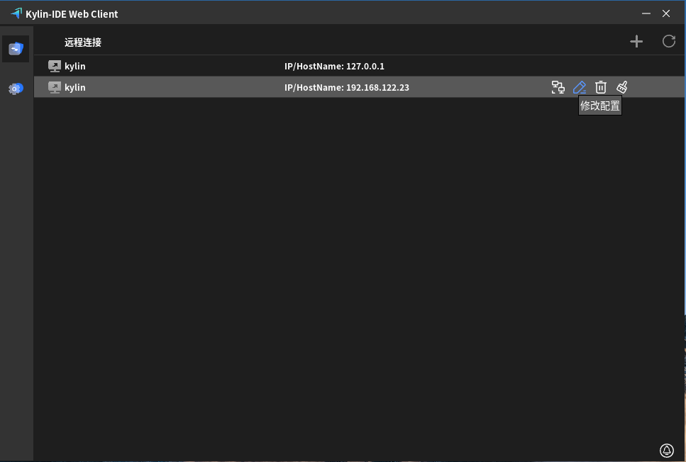
  - 修改页面中除用户名和IP地址不可修改外，其他基本信息均可修改  
  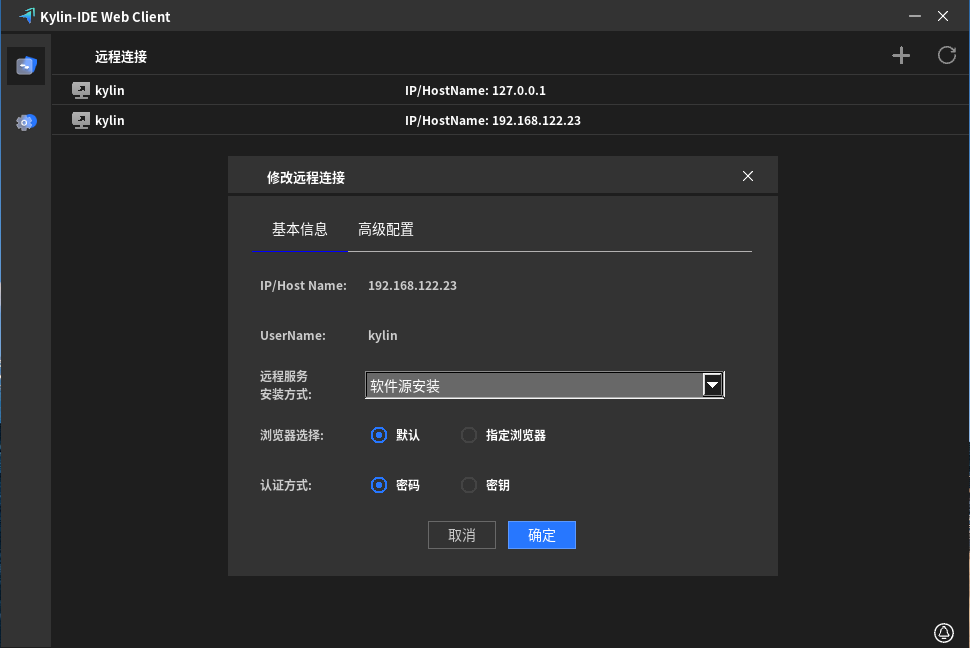
   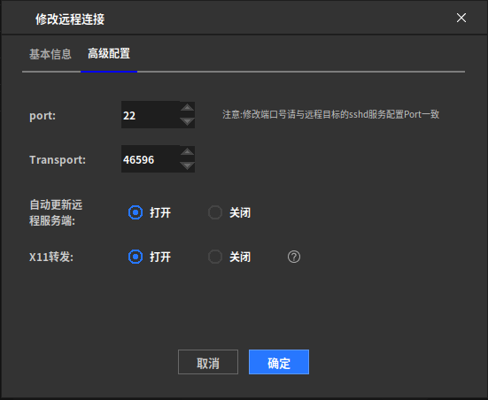
  
  注意：如果远程连接已经建立，修改配置后，需要清理掉原连接并使用新的配置重新创建连接。

- 删除连接：点击连接右侧的“删除连接”按钮将弹出删除连接确认框，当点击“确认”按钮后，连接将从主页面中删除
  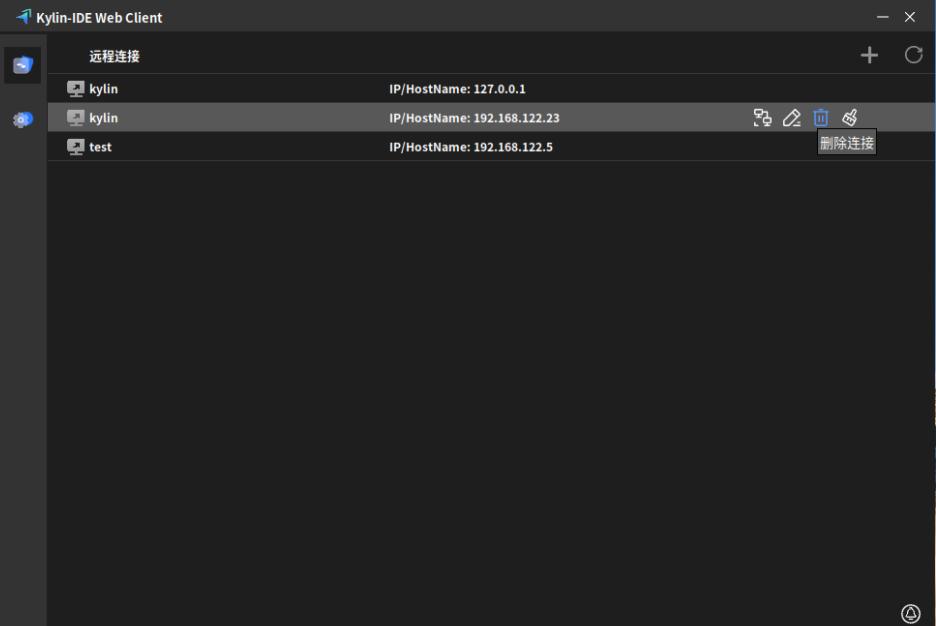
  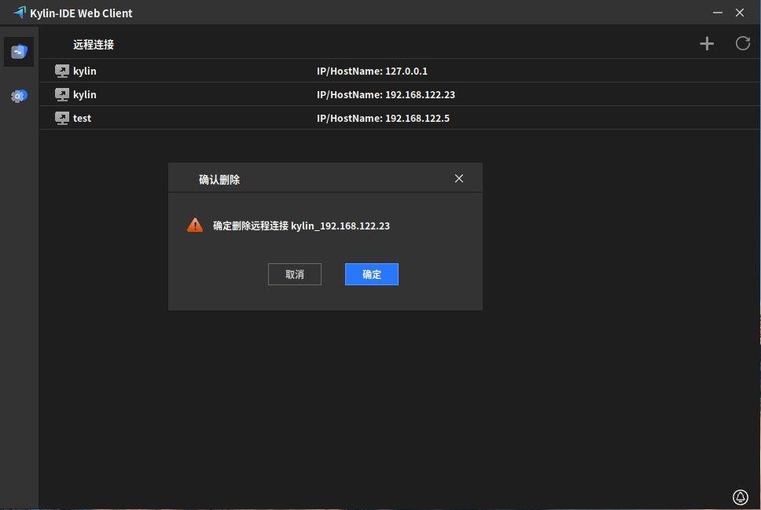

- 清理连接：点击连接右侧的“删除连接”按钮将弹出删除连接确认框，当点击“确认”按钮后，将弹出密码/秘钥口令输入框，在输入密码后，客户端将清理掉远程服务以及ssh相关连接，并将连接从主页面中删除。  
  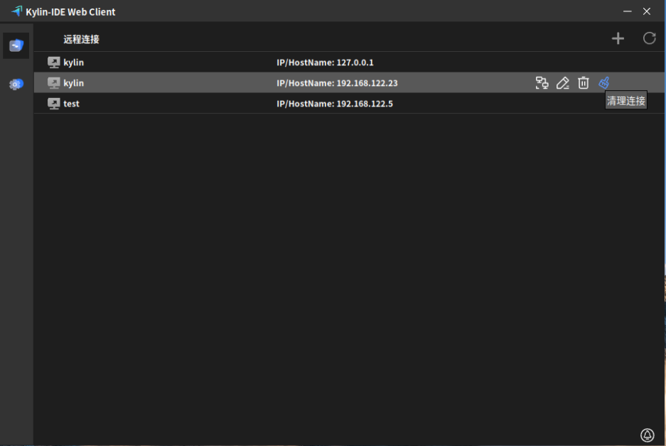
  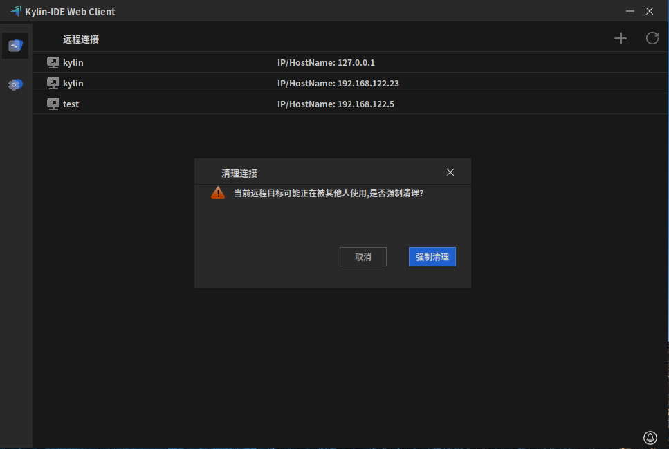

- 打开连接
  - 点击连接右侧“打开连接”按钮将弹出密码/秘钥口令输入框  
  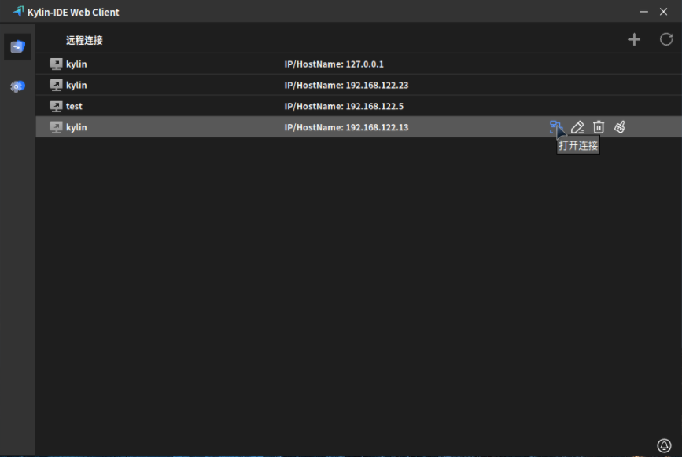
  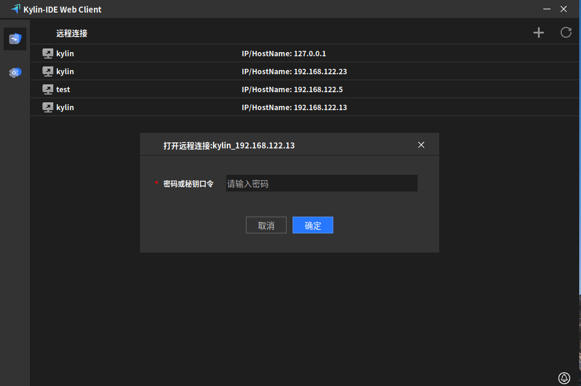
  - 当输入密码并点击“确认”后，客户端将创建与远程机器的ssh连接、完成环境检查、服务部署启动、打开浏览器显示远程开发环境等工作。

  - 打开浏览器：当远程机器连接成功后会打开本地浏览器显示远程开发环境。对于支持app模式的浏览器(例如chrome、奇安信等)，采用app模式打开浏览器，所以打开的WebIDE远程开发环境隐藏了地址栏，并隐藏了浏览器传参中url具体细节，与本地开发环境外观上类似；针对不支持app模式的浏览器，需要在使用时导入证书或者接受不信任地址，具体可以参考[远程开发章节中-浏览器导入证书方法](./远程开发.md#8浏览器导入证书方法)。  
  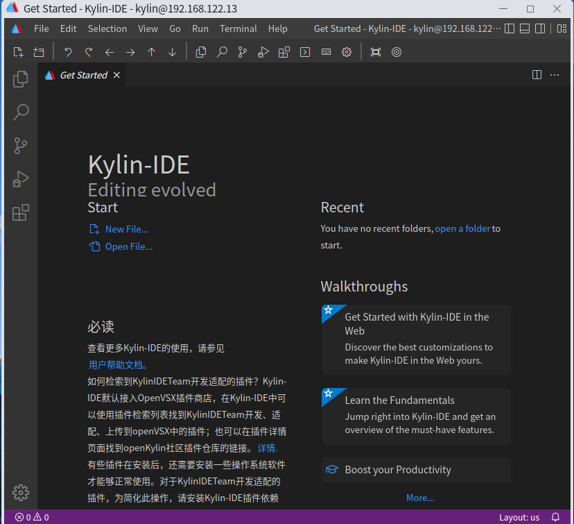


### 提示信息管理
 - 在使用过程中，会在窗口右下角以提示框的形式显示关键信息，并且点击底部的历史信息按钮，能够显示历史信息。本软件会定时清理过期的提示信息。
 - 提示信息类型：本软件提供INFO、WARN、ERROR、SUCCESS、远程服务软件下载等类型提示窗
 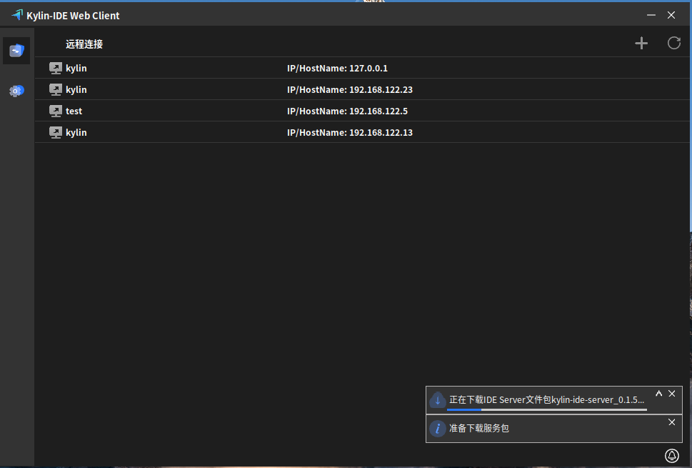
 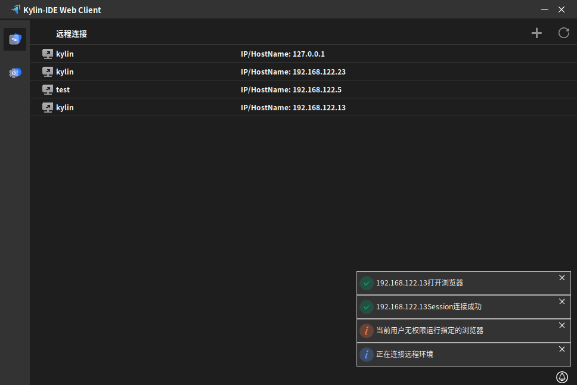

 - 历史提示框：当点击历史信息按钮时，会弹出历史信息列表，显示所有的历史信息，无信息时显示"无新通知"，点击上方的折叠按钮后会隐藏信息
 
   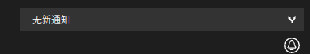
   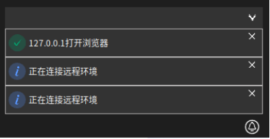

 - 提示信息关闭：当点击信息框右上角的关闭按钮时则关闭提示信息，系统会在一定时间后自动关闭信息。


### 插件安装、多语言开发、调试功能使用
  - 通过远程开发插件打开远程开发环境后，其使用方法和Kylin-IDE(KylinCode)编辑器类似。
  - 远程插件市场设置
    - 默认使用OpenVSX插件市场，如果更改插件市场，请在设置中进行修改：点击左下角的设置->在弹出的页面中搜索gallery关键字->在输入框中输入serviceUrl和itemUrl。
      
  
  - 插件安装
    - 打开远程开发环境后，可通过窗口上方标题显示的ip来区分所连接的远程环境与本地环境。
    - 远程开发环境插件的安装方法和Kylin-IDE(KylinCode)相同
    - 插件安装后，在“LOCALHOST:PORT-已安装”中显示远程开发环境已安装的插件
     

  - 多语言开发
    - 提供C、C++、Java、Python、Go、JavaScript语言的代码开发功能，包括代码编辑、编译、调试、运行等功能，具体使用条件和方法请参见对应章节。

### 卸载
  - 服务端卸载
    - 检查远程机“server-main”服务进程是否存在，如果存在请杀死该进程，或等进程自动退出
    - 删除远程机用户目录下~/.kylin-ide-server 目录
    
  - 客户端卸载
    - 使用dpkg命令或者rpm命令进行卸载，同时删除用户目录下~/.kylin-ide-remote目录和~/.config/kylin-remote-ide目录


### 开启X11转发
  - linux平台  
    远程开发WebIDE版支持在Linux平台开启X11转发，进而支持GUI程序相关开发。X11转发功能开启需要服务端与客户端同时配置X11转发功能，如下：
    * 远程机sshd服务开启X11转发
    ```shell
    #修改 X11Forwarding 配置项为 yes
    sudo vi /etc/ssh/sshd_config
    #重启sshd服务
    sudo systemctl restart ssh/sshd
    ```
  * 客户端开启ssh转发
      * 方法一：在客户端连接配置页中打开X11转发开关

          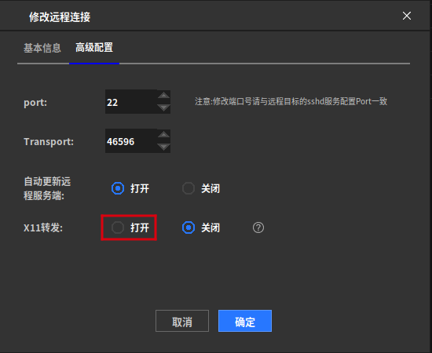
      
          - 在打开x11开关时，会弹窗提示是否断开当前正在使用的连接，点击“断开”后会将已打开的连接关闭，重新打开连接时才能生效。

          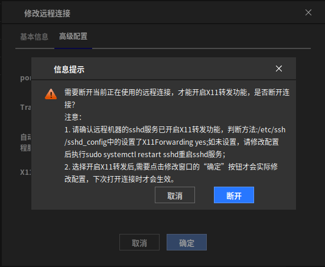

          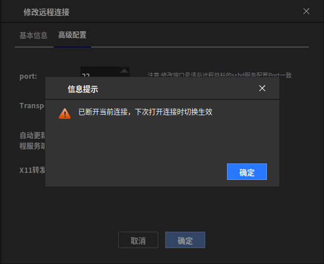

          - 打开x11开关后，点击“修改远程连接”页面的确认按钮，提交修改。再次点击“打开连接”，此时x11功能即可生效。

          

          - 如果点击“取消”，则不会修改x11开关状态。

          - 在添加连接页面打开x11开关时，因为新增连接并没有打开连接，只提示服务端sshd配置方法。
          
          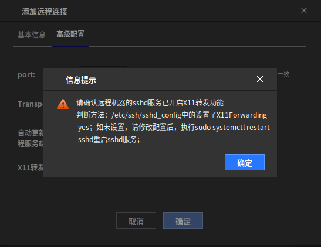

          - 当前用户的本地127.0.0.1连接无需设置x11功能


      * 方法二：修改ssh配置文件

      ```shell
      #客户端ssh配置文件位于~/.ssh/config 如下：
      Host 192.168.1.101
        HostName 192.168.1.101
        User test
        ForwardX11 yes
        ForwardX11Trusted yes

      #添加ForwardX11 yes及ForwardX11Trusted yes
      #若无对应IP Host项直接添加对应Host即可，其他ssh相关配置也可在此配置文件直接添加。
      ```
  - windows平台  
    windows系统作为客户端使用X11功能时，需要在windows中安装Xming软件，具体如下：  
    - 点击修改页或添加页中“安装Xming”按钮，弹出Xming安装引导页面，根据引导完成安装
    - 设置Xming.exe程序的安装路径，并点击确认（若不设置，在打开连接时无法启动Xming服务） 
   
      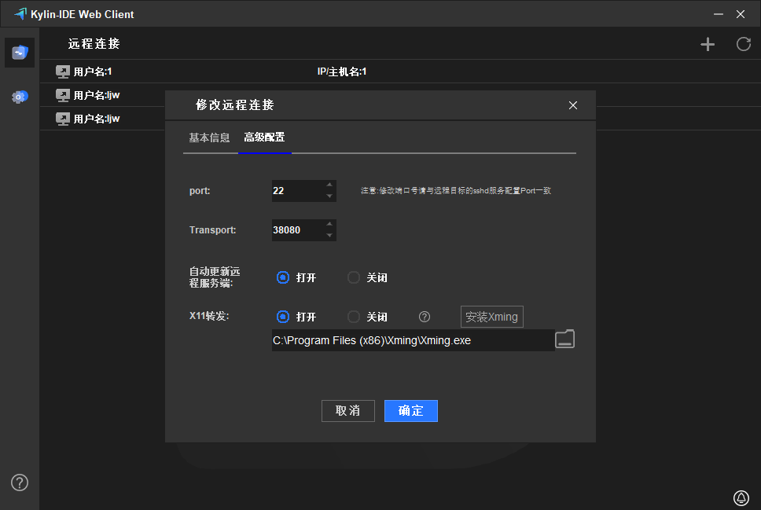
    -  远程机sshd服务开启X11转发
      ```shell
      #修改 X11Forwarding 配置项为 yes
      sudo vi /etc/ssh/sshd_config
      #重启sshd服务
      sudo systemctl restart ssh/sshd
      ```
      注意：在使用过程中，在windows中会根据display变量信息启动一个或多个Xming服务 ，请在使用完成后手动关闭。