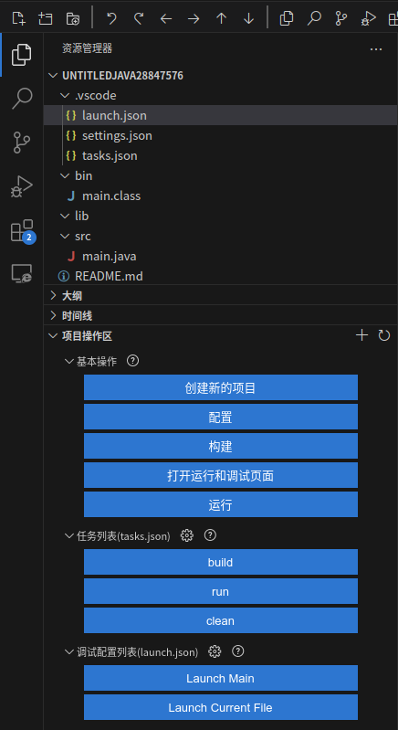
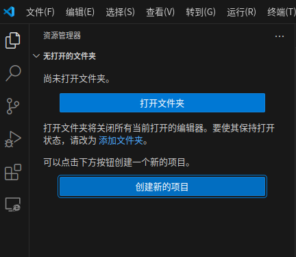
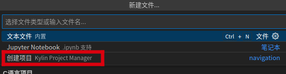
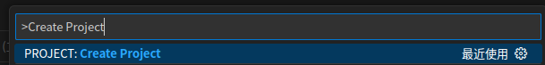
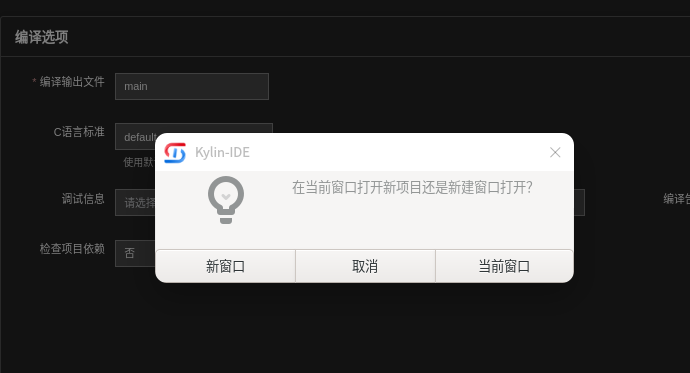
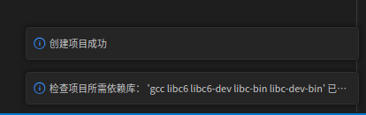
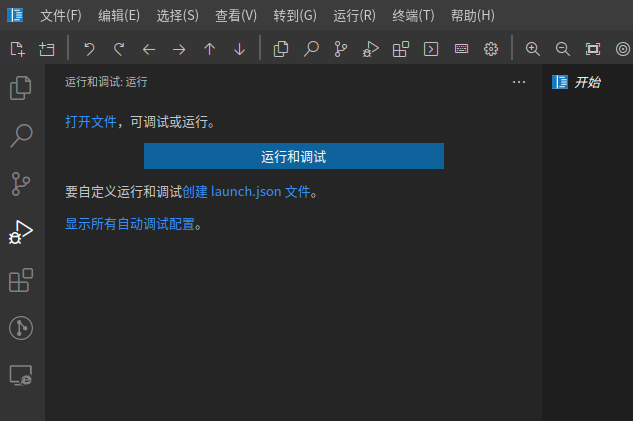
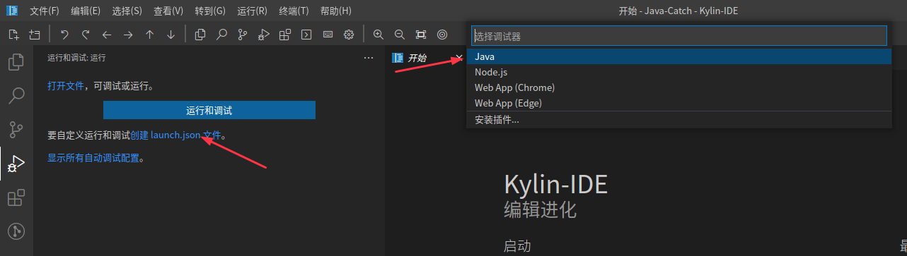

# 项目管理
## 1、插件安装
- 点击最左侧插件图标，通过Kylin-IDE推荐插件或直接检索找到 Kylin Project Manager(kylinideteam.kylin-project-manager)插件并安装
- 下文适用于Kylin Project Manager插件版本大于0.2.1

## 2、项目管理插件操作区

- 在资源管理器视图展开“项目操作区”，包括：

> 基本操作、任务列表、调试配置列表、执行Node.js配置脚本等




- 基本操作：

> 提供项目创建、配置、构建、调试、运行等相关功能入口；

- 任务列表：

> 通过解析当前工作区第一个项目的tasks.json，显示各个任务按钮，悬停显示任务信息，点击可以执行具体任务。

- 调试配置列表：

> 通过解析当前工作区第一个项目的launch.json，显示各个调试按钮，悬停显示调试信息，点击可以进入调试页面执行该调试。
 
- 执行Node.js配置脚本：

> 通过解析当前工作区第一个项目的package.json，显示脚本按钮，悬停显示脚本信息，点击调起终端通过npm执行。

- 刷新按钮：

> 如果项目内容发生变化，可点击右上角刷新图标刷新操作区；

- 自定义按钮

> 点击右上角添加自定义按钮，弹出下拉选择。
> - 包括：
>  - 添加自定义IDE命令调用按钮
>    ``` 
>    可以添加一个自定义按钮：
>    ·输入按钮标题XXX；
>    ·输入Kylin-IDE的commmand；
>    ·刷新操作区后自定义按钮区显示XXX按钮；
>    ·点击该按钮可以执行该command；
>    ```
>  - 添加自定义终端命令执行按钮
>    ``` 
>    可以添加一个自定义按钮：
>    ·输入按钮标题；
>    ·输入Linux终端命令；
>    ·刷新操作区后自定义按钮区显示XXX按钮；
>    ·点击该按钮可以打开一个Kylin-ID内置终端并执行该命令；
>    ```

## 3、创建新的项目

- 新建项目入口:
  - IDE 无打开的文件夹或工作区时，资源管理器区域显示“创建新的项目”

    
  - 点击“文件”主菜单-->“新建文件...”，在弹出来列表中选择“创建项目”或“Create Project”

    
  - 通过 Ctrl+Shift+P 调起命令窗口，输入“Create Project”或“project.createProject”，选择 PROJECT:Create Project

    

- 项目创建页面内包括：

    - 全部语言类型：可以选择不同的语言和项目类型的项目列表；
    - 请选择项目标签：可以选择不同项目标签的项目列表，支持多选；
    - 快速部署开发环境，可以点击跳转到Kylin-IDE开发环境部署模块；
    - 项目列表，可以点击图标，进入对应类型项目创建功能；

### 3.1、创建C/C++项目示例:创建C语言应用项目

在项目创建页面选择第一行：C语言应用项目

#### 3.1.1、第一页

- “项目类型”目前只支持simple项目
- 点击“项目构建方式”
- 可以切换选择“makefile”、“cmake”
- 点击下一页

#### 3.1.2、第二页 项目基本信息

- 输入合法项目名称(必填)
- 选择项目目录(必填)
- 输入更多信息
- 点击下一页

#### 3.1.3、第三页 编译选项

- 输入合法编译输出文件名(必填)
- 选择C语言标准（C++项目选择C++标准）
- 输入更多编译参数
- 点击创建

#### 3.1.4、创建成功

- 弹出 C/C++环境检查通过提示
- 弹出创建项目成功提示
- 弹出新项目页面（如当前页面未打开项目，则会在本视窗打开，如果已打开项目，会弹出询问打开方式）
- 首次打开新项目会弹出是否信任此文件夹中文件的作者。点击“是，我信任此作者”，即可进行后续项目编写使用。





#### 3.1.5 C/C++其他项目创建

与C语言应用项目创建流程相似，此处略

## 4、配置当前项目
- 需要了解基本的task.json、launch.json配置方法，见[如何配置工程的构建、调试、运行章节](./如何配置工程的构建-调试-运行.md)
- 项目操作区的配置按钮可以看作是操作task.json和launch.json的快捷方式。也可以通过菜单方式等创建，或直接创建文件

## 5、构建

构建按钮，为项目开发提供快捷操作
- 依赖tasks.json文件中的定义
- 点击构建按钮会执行tasks.json中label为build的task或类型为build的task

## 6、运行

  运行功能入口，为项目开发提供快捷操作

- 依赖tasks.json文件定义
- 点击会列出tasks.json中定义的task列表，选择一个task，选择继续而不扫描任务输出，通过终端执行程序运行

## 7、打开运行和调试页面

  调试功能入口，点击进入运行和调试页面

- 依赖launch.json文件
- 点击“打开运行和调试页面”按钮，进入运行和调试页面。



- 如图，此时项目没有launch.json文件。
- 点击“创建 launch.json 文件。



- 弹出调试器类型列表，请根据项目编程语言和类型选择相应的调试器类型
- 创建完成，会进入运行调试页面。可以按项目需要修改launch.json，可以点击左侧选择需要的调试配置项
- 点击绿色三角开始调试