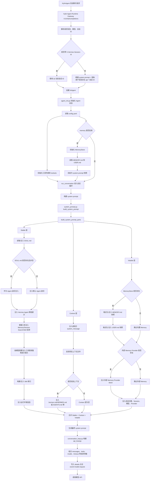
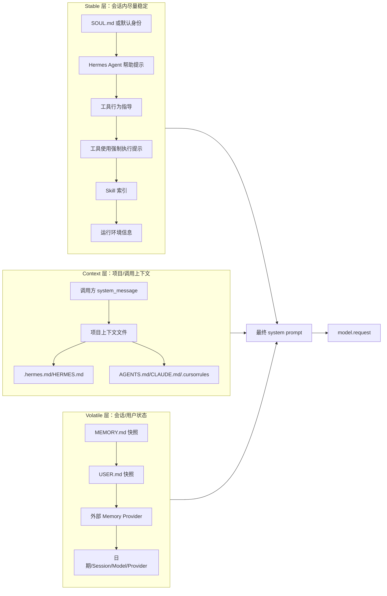

# Hermes Agent System Prompt 构建流程

本文说明一次会话请求中，Hermes Agent 如何构建并注入 `SOUL.md`、`MEMORY.md`、`USER.md`、Skill 索引、项目上下文、工具信息，最终形成 `model.request`。

## 总览流程图



## 分层构建细节



## 关键代码位置

| 阶段 | 文件 | 函数/位置 | 作用 |
|---|---|---|---|
| Gateway 接收聊天请求 | `/home/ok/.hermes/agent-runtime/gateway/platforms/api_server.py` | `_handle_chat_completions` | 解析 `/v1/chat/completions` 请求，确定 session id、模型、消息 |
| 创建 Agent | `/home/ok/.hermes/agent-runtime/gateway/platforms/api_server.py` | `_run_agent_completion` / `_create_agent` | 创建 AIAgent，并传入 session、模型、工具等运行参数 |
| 初始化 MemoryStore | `/home/ok/.hermes/agent-runtime/agent/agent_init.py` | memory 初始化区域 | 根据 `config.yaml` 的 memory 配置初始化 `MemoryStore` |
| 加载 MEMORY/USER | `/home/ok/.hermes/agent-runtime/tools/memory_tool.py` | `MemoryStore.load_from_disk` | 从 `MEMORY.md` 和 `USER.md` 读取内容，并冻结为 system prompt 快照 |
| 总装 system prompt | `/home/ok/.hermes/agent-runtime/agent/system_prompt.py` | `build_system_prompt` | 合并 stable/context/volatile 三层 |
| 分层构建 | `/home/ok/.hermes/agent-runtime/agent/system_prompt.py` | `build_system_prompt_parts` | 决定每类信息是否注入，以及注入顺序 |
| 读取 SOUL.md | `/home/ok/.hermes/agent-runtime/agent/prompt_builder.py` | `load_soul_md` | 读取、扫描、截断 `SOUL.md` 后作为身份注入 |
| 构建 Skill 索引 | `/home/ok/.hermes/agent-runtime/agent/prompt_builder.py` | `build_skills_system_prompt` | 从 skill 缓存、快照或目录扫描生成可用 skill 列表 |
| 构建项目上下文 | `/home/ok/.hermes/agent-runtime/agent/prompt_builder.py` | `build_context_files_prompt` | 发现并注入 `.hermes.md`、`HERMES.md`、`AGENTS.md`、`CLAUDE.md`、`.cursorrules` |
| 注入 MEMORY/USER | `/home/ok/.hermes/agent-runtime/agent/system_prompt.py` | volatile 层 | 调用 `format_for_system_prompt("memory")` 和 `format_for_system_prompt("user")` |
| 格式化 MEMORY/USER | `/home/ok/.hermes/agent-runtime/tools/memory_tool.py` | `format_for_system_prompt` / `_render_block` | 生成 `MEMORY (...)` 和 `USER PROFILE (...)` 块 |
| 构建模型请求 | `/home/ok/.hermes/agent-runtime/agent/conversation_loop.py` | `agent._build_api_kwargs(api_messages)` 附近 | 将 system prompt、历史消息、工具列表组装成模型 API 请求 |
| 写 details 日志 | `/home/ok/.hermes/agent-runtime/agent/conversation_loop.py` | `write_session_detail(..., "model.request", ...)` | 将 `model.request` 写入 `{session_id}-details.log` |

## 当前已加入的调试标记

这些标记会输出到 gateway 运行日志或服务输出中，可用来观察构建顺序：

```text
====此处初始化MemoryStore并准备加载MEMORY.md/USER.md
====此处从磁盘加载MEMORY.md和USER.md
====此处MEMORY.md和USER.md已加载并冻结为system prompt快照
====此处合并stable/context/volatile为最终system prompt
====此处开始构建system prompt总流程
====此处构建/注入SOUL.md身份信息
====此处读取SOUL.md身份文件
====此处SOUL.md读取完成并准备注入system prompt
====此处构建/注入Hermes Agent帮助提示信息
====此处构建/注入工具相关行为指导信息
====此处构建/注入工具使用强制执行信息
====此处构建/注入Skill索引信息
====此处开始扫描/构建可用Skill列表信息
====此处使用内存缓存的Skill索引信息
====此处使用磁盘快照构建Skill索引信息
====此处扫描Skill目录构建Skill索引信息
====此处构建运行环境提示信息
====此处构建/注入运行环境信息
====此处开始发现/构建项目上下文文件信息
====此处注入项目上下文文件内容
====此处构建/注入项目上下文文件信息
====此处构建/注入MEMORY.md记忆信息
====此处格式化/注入MEMORY信息到system prompt
====此处构建/注入USER.md用户画像信息
====此处格式化/注入USER信息到system prompt
====此处构建/注入外部Memory Provider信息
====此处构建/注入会话时间、Session、模型、Provider信息
====此处根据system prompt、历史消息、工具列表构建model.request参数
====此处写入会话详细日志model.request事件
```

## 从 details 日志看最终结果

一次请求发出后，会在：

```text
~/.hermes/sessions/{session_id}-details.log
```

中看到：

```text
"event":"model.request"
```

该事件中的 `api_kwargs.messages[0].content` 就是最终注入后的 system prompt，通常包含：

1. `SOUL.md` 或默认身份
2. Hermes Agent 帮助提示
3. Memory / Session Search / Skill 行为指导
4. 可用 Skill 索引
5. Host / Home / CWD 等运行环境
6. MEMORY 块
7. USER PROFILE 块
8. Conversation started / Session ID / Model / Provider

