#  Software Store
##  Overview
Software store is a graphical software management tool, which provides users with one-stop software services such as software search, download, installation, update and uninstall. As an application distribution platform, the software store recommends common software and high-quality software for users. Each software on the shelf has recorded detailed information for reference. You can download and install it according to your actual needs.

This manual includes the overall structure of the software store, detailed operation instructions from opening the software store, logging in to exiting each functional module, and analyzing the problems that may be encountered during the use of the client. If you have any questions when referring to the manual, please contact our technical service personnel.

 

## Start
Click the start menu tool in the lower left corner of the desktop to open the start menu column.

You can use the mouse to scroll up and down, search for the software name, search by first letter, search by category to search the software store, and click the software store search result to start the software store.

You can right-click the software store in the start menu to make multiple choices:

* Fixed to "All Software": Put the software store on top of all software, and quickly open the software store when you open the start menu.

* Pin to taskbar: After pinning to the taskbar, you can directly click the software store in the taskbar at the lower left corner of the desktop to quickly open it.

* Add desktop shortcut: After adding a desktop shortcut, find the software store icon on the desktop and click to open it quickly.

 

## Function module
### Account login
The software store supports the use of two states: an unlogged account and a Kirin ID account. If you are not logged in to your Kylin ID account, you can directly use the basic functions of the software store.

#### Kylin ID registration

The login account of the software store needs to register the Kirin ID first. If you have not registered, please click the login interface [registration] or jump to the Kirin unified user center for relevant registration when scanning the code for login for the first time.

#### Kylin ID login

If you have registered a Kirin ID, you can log in to the Kirin ID account directly. Click the [login] button in the upper right corner of the home page to open the [Qilin ID login center]. As shown in Figure 1, users can log in through account password, SMS verification code and wechat scanning code. Note that wechat scanning code login only supports v10-sp2 system version. Please look forward to more versions. There are differences in login interfaces according to different system versions, and the actual page shall prevail.

1) Password login
* After entering the account password and clicking the login button, a sliding verification interface will pop up for verification;

* After passing the verification, you can log in successfully;

* Password can choose whether to remember the password when logging in.

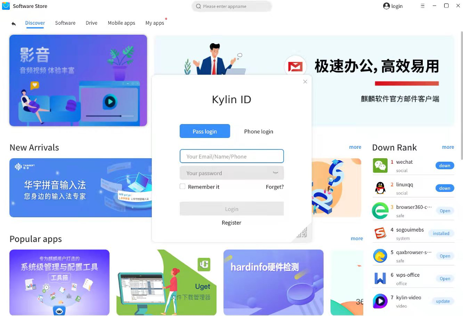

2) SMS login
* Enter the registered mobile phone number, click to get the verification code, and verify on the pop-up sliding verification interface;

* After passing the verification, send an SMS verification code to the registered mobile phone number, and enter the corresponding SMS verification code;

* Click Login to log in to the software store.

3) Wechat code scanning login
* Click the QR code in the lower right corner of the software store login box and use wechat to scan for quick login;
* Note: if the wechat account has not registered a Kirin ID, you need to scan the code again after registration.

If you forget your password, click [Retrieve Password] on the login interface to jump to the Kylin Unified User Center, and use any of the three methods of mobile phone number, email address, and secret security question to retrieve the password.

### Main menu
The title bar of the main interface of the software store includes: Discover, Software, Drive, Mobile apps, and my apps. The five columns are explained in detail below.

#### Discover
Open the software store and open the [Discover] by default, as shown in Figure 2. The homepage includes ad recommendations, new product launches, popular applications, and download rankings. Drag the scroll bar down to see the display of frequently used applications and mobile applications that everyone is using. . On the homepage, you can click on the ad slot or the software under any recommended section to jump to the software details page. For example, the download rankings on the homepage, popular apps, and mobile apps that everyone uses have software you want to open, update, or download. You can also directly click the button on the right side of the software. For new product launches, popular recommendations, and download rankings, you can also click the more button in the upper right corner of the module to enter the corresponding content page. Note that mobile applications currently only support the ARM architecture. If your architecture is not an ARM architecture, the mobile application sections that everyone is using will not be displayed.

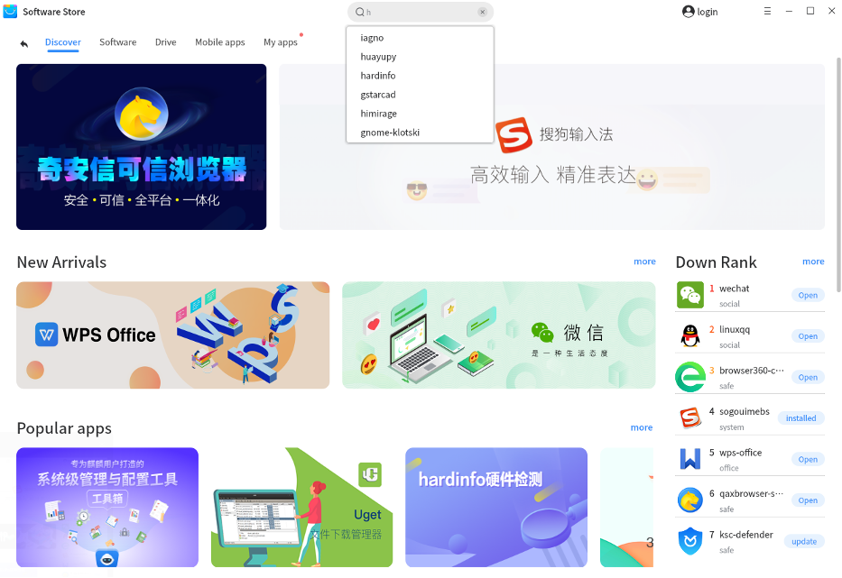

#### Software
When you click on the title software of the main page, enter the software interface. The software store provides a total of 12 software categories including boutique, office, development, social, image, audio and video, network, game, education, system, security, and others. At the same time, it supports the pre-launch column. Click any category in the secondary directory to view it. All software in this category, as shown in Figure 3. Under different categories, you can select the target software to enter the software details page. Under each category, multiple sorting methods such as default sorting, download ranking and score ranking are supported. The default sorting is recommended for you according to the self-developed popularity algorithm. The download ranking is sorted from high to low according to the download volume of all software under the current category, and the score ranking is sorted from high to low according to the scores of all software users in the current category. On this page, you can download the software directly. For the downloaded software, you can open it directly or click Update to open it. At the same time, the select all function is provided under each category page, click the select all button, all the not downloaded software will be selected, you can cancel a certain software or all the software, after the selection is completed, you can download the target software in batches. On the pre-launch page, you can view the software that will be launched. In the software card, you can directly click the official website button to enter the software's official website for detailed information, or you can click the software to enter the software details page to view the software information.

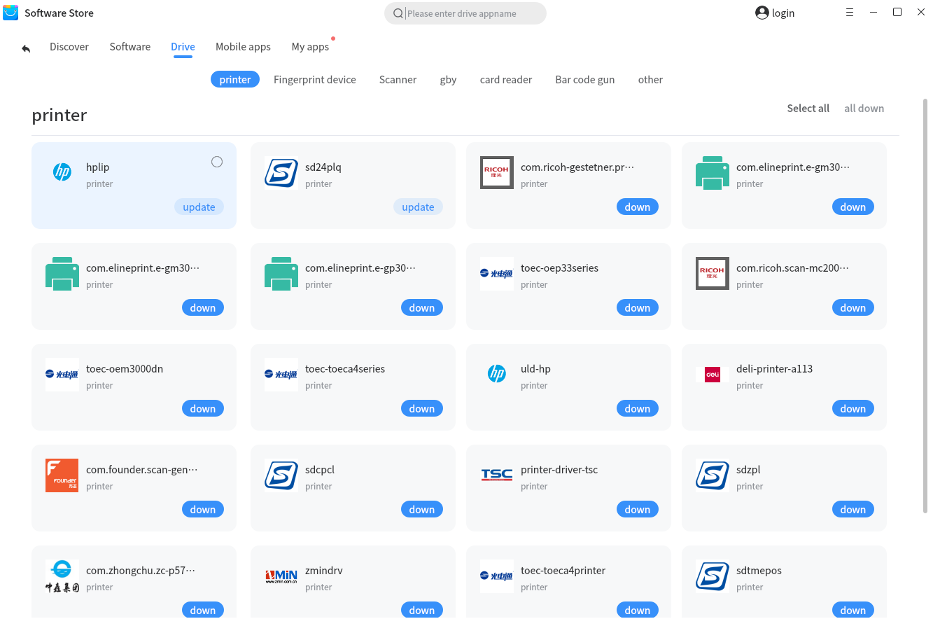

#### Drive
Click on the title driver of the main page to enter the driver page, which provides multiple types of drivers for printers, scanners, high-speed cameras, fingerprint devices, etc. Under each category, single driver or batch download functions are supported. Note that due to the different architectures of different driver adaptations, the actual driver types displayed on the driver page will be different.

#### Mobile apps
This page is only displayed under the ARM architecture. Click on the main page title mobile application to enter the mobile application page, which provides mobile application for users to use. The mobile application of Kylin Software Store is based on the KMRE compatible environment, supports one-click installation of compatible environments and applications, and supports one-second launch of massive mobile apps.

When you enter the mobile application page for the first time, you need to download the running environment of the Kylin mobile application. Click the download experience button. After the download and installation is complete, you will be prompted to restart the computer. After restarting the computer, open the mobile application page of the software store again, and wait for the initial environment to download Android application.

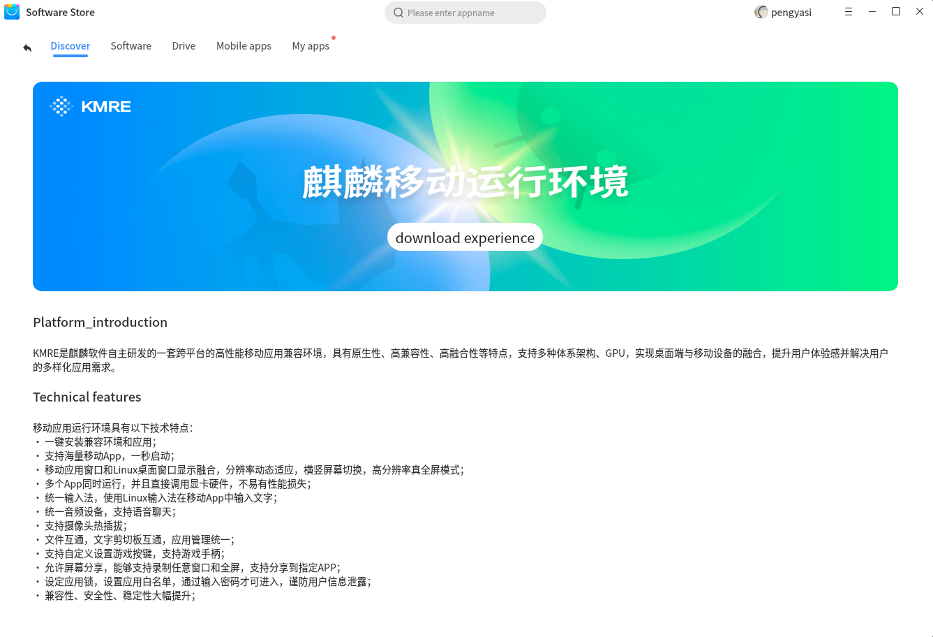

After initializing the Android environment, you can see the mobile application page as shown in Figure 6. This page supports multiple categories of application downloads. On each page, it supports three sorting methods: default ranking, download ranking and scoring ranking. You can select any category option to search, find and download your target software. After downloading the software, click open to directly open the Android application with rich experience.

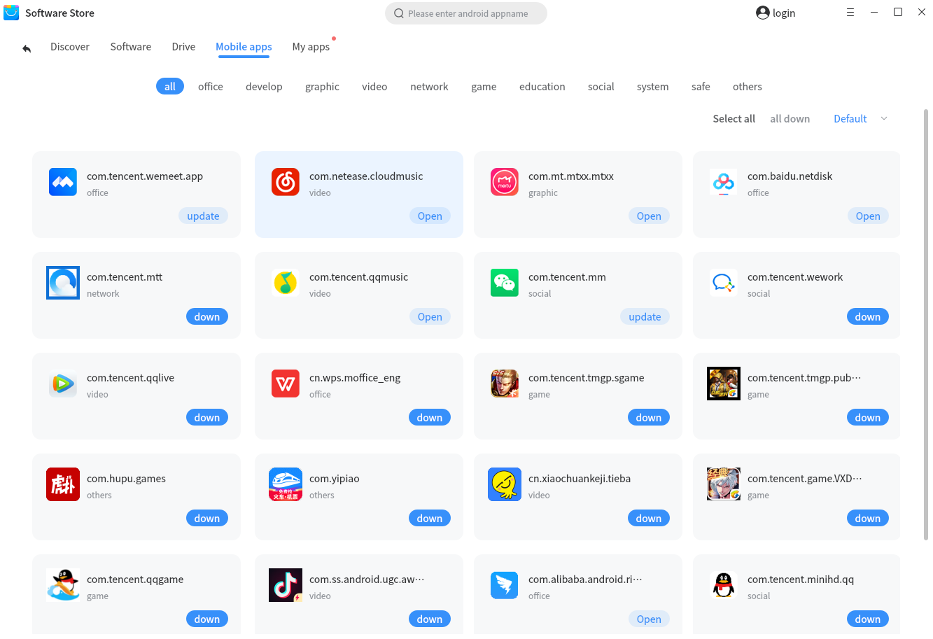

#### My apps
Click the title of the main page to open the personal application management page. You can view and operate the software that is currently being downloaded and needs to be updated and uninstall the installed software on the machine. At the same time, you can view the history of local installation and cloud installation.

1) Onload

After opening mine, the onload page is opened by default, as shown in Figure 7. If the software is being downloaded, the number of downloads will be displayed in the upper right corner of the downloading button, and the software being downloaded will be displayed in the form of a card on the page. Before the download is complete, you can pause, continue, or cancel the download of a certain software at any time. You can also execute the [All Pause] button to stop all downloads at the top right. At this time, you can click All to continue to resume the download until the software download is complete.

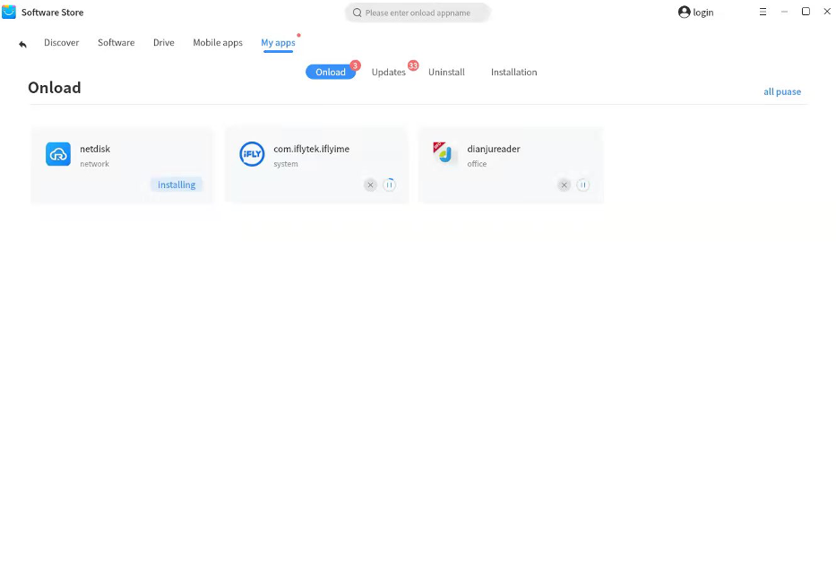

2) Updates

If there is an update to the local software, a red dot prompt will appear in the upper right corner of the title bar, and a quantity prompt will also appear in the application update, as shown in Figure 8. In the lower right corner of the software card, click Update to start updating the software, or select all in the upper right corner of the page, and click Update all. Before the software update is completed, you can pause, continue, or cancel the software update operation at any time. After the software is downloaded, it will be installed automatically. You can wait patiently until the open button appears, indicating that the software installation is complete.
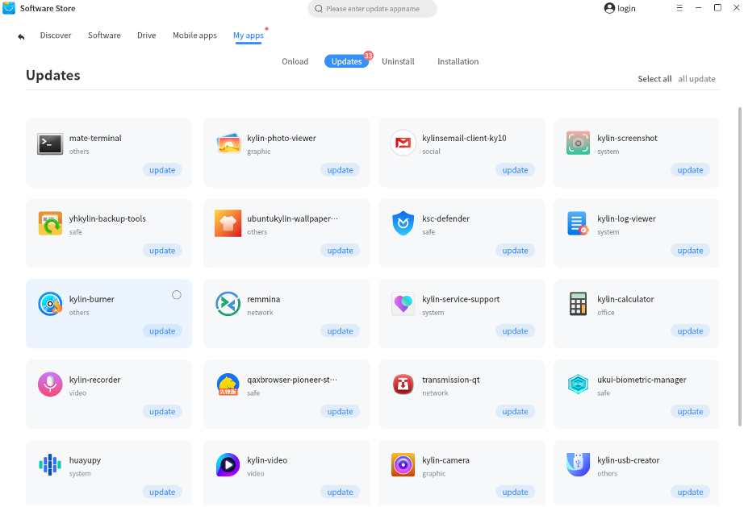

3) Uninstall

If you want to uninstall the native software downloaded and installed from the software store, in addition to right-clicking on the native startup menu to delete, you can also select the corresponding software card on this page and click Uninstall. If you need to perform batch operations, click select all in the upper right corner and choose one-click uninstall, as shown in Figure 9.

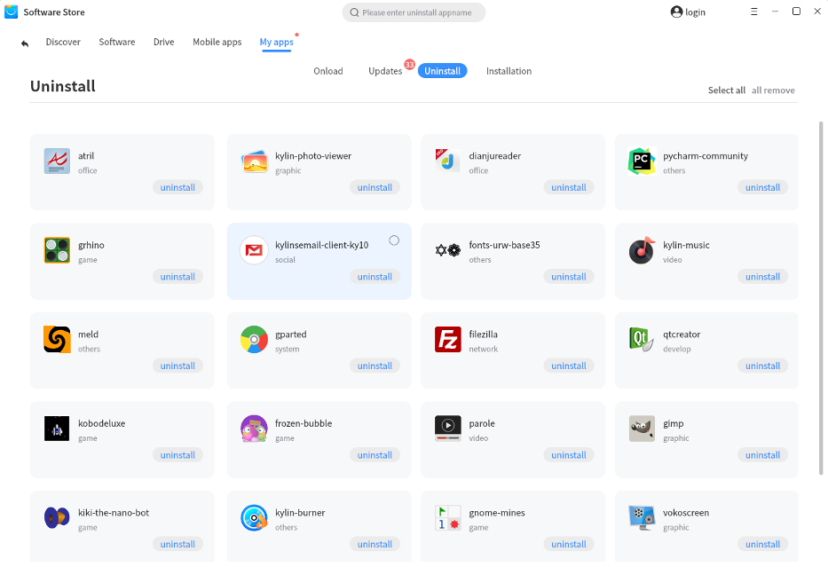

4) Installation

View the installation history of the software, as shown in Figure 10 The installation history of this machine is displayed by default, that is, the list of software downloaded and installed by this machine in the software store. If you have logged in to your Kylin ID account, you can view the software records installed by the account on other computer terminals under the cloud installation history through the account.

Some software has been uninstalled from this machine, you can click the download button on this page to download and install again.

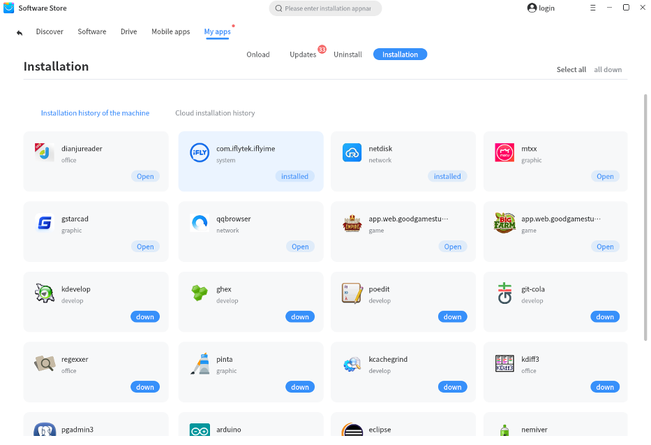

### Software details

Click any software to enter the software details interface, as shown in Figure 11. On the software details page, you can view the software’s icon, software name, package name, category, rating, download times, download size, current version, etc., and provide screenshots of the software and software introduction. If you download the software, you can click the download button in the upper right corner to download it. After the download is complete, it will be installed automatically. After the installation is complete, click Open to run the software directly.

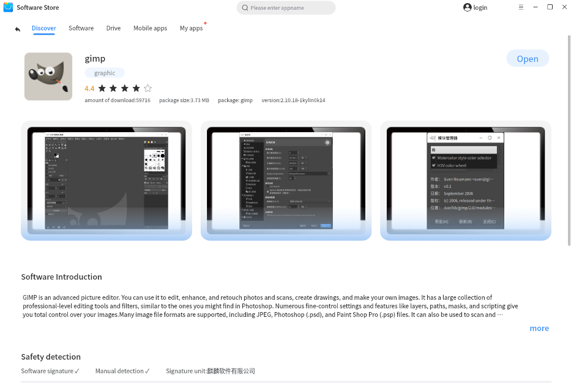

Kylin Software Store also supports security detection functions. If the software has been signed and passed manual detection, it will be in a "tick" state. The signed software will show the signing unit: Kylin Software Co., Ltd.

In the software details interface, you can view the software’s ratings and user comments. If you want to post ratings and comments on the software, please download the software first and log in to your Kylin ID account. The total score of the software score is 5 points. The software reviews are sorted by publication time by default, and the latest reviews will be displayed at the top.

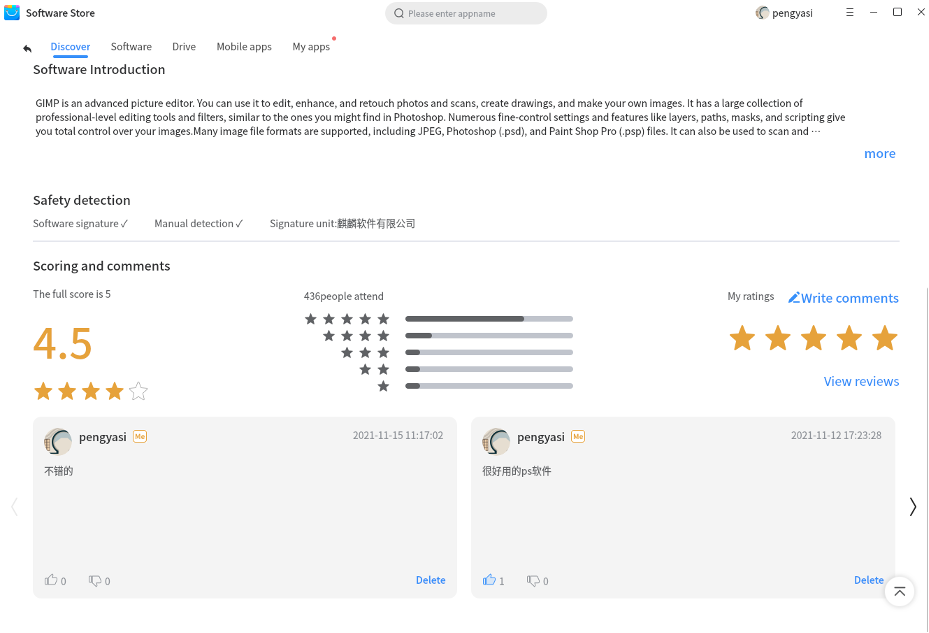

The user comment area of the software details interface is shown in Figure 12. After you log in, you can rate and comment on the software according to your personal preferences. Click on the five-pointed star to rate the software; after logging in to the Kirin ID and downloading and installing the software, you can enter the content of the comment in the comment box. Note that the number of words in the comment cannot exceed 200 words. After entering the comment, click Submit to enter the comment area below See the comment just posted, as shown in Figure 13. By default, the comment area will slide left and right to display comments. For example, to view all comments, click the View All button. When you continue to scroll down to view, comments will continue to load until all comments are loaded.

While viewing the software reviews, you can like or booze other people's comments and express your opinion on the comment. If you want to delete your comment, you can click the delete button in the lower right corner of your comment.

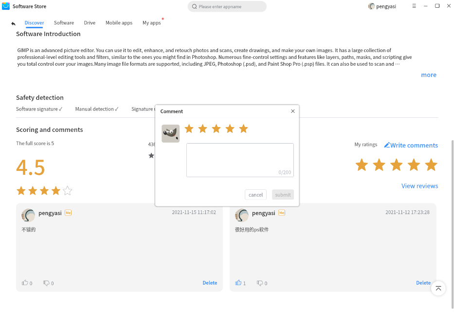

After all comments are expanded, you can click the return to top button in the lower right corner of the interface to return to the top, or click the return button in the upper left corner of the menu to return to the upper level and slide the comment interface left and right.

### Search
The software store has a search function. By default, the software on the software store is searched. The search method supports software name (Chinese characters, pinyin) search and software package name search. You can enter your search content in the search bar and click Enter or the search symbol on the search bar. If you want to delete the search content with one click, you can click the "x" icon in the search box. As shown in Figure 14, click the search box to enter the search content, and the relevant matching software will be displayed below the search box. If there is a target software, click to jump immediately.

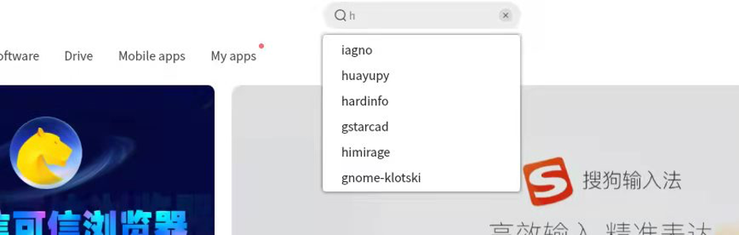

As shown in Figure 15, the software search results matching your search content will be displayed. If the search result is empty, you will be prompted "Sorry, the software you want is not found, you can choose the whole library to try", at this time, click the whole library to search for the software you want in the entire software source. When your search results are rich, you can swipe the page to find the target software.

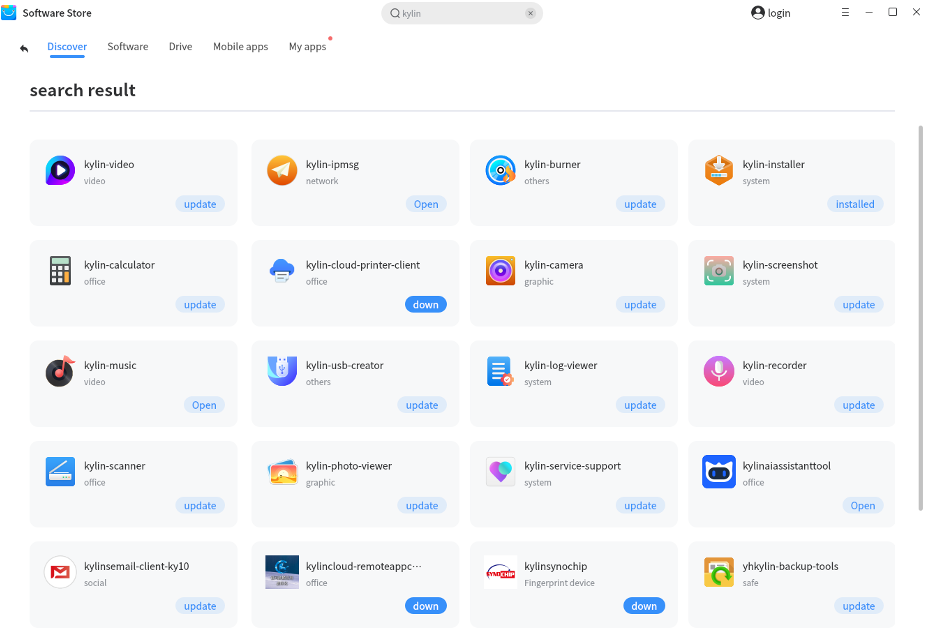

### Operation bar
The operation bar in the upper right corner of the Kylin Software Store client contains six functions: theme selection, settings, server address configuration, help documents, version instructions, and exit from the software store.

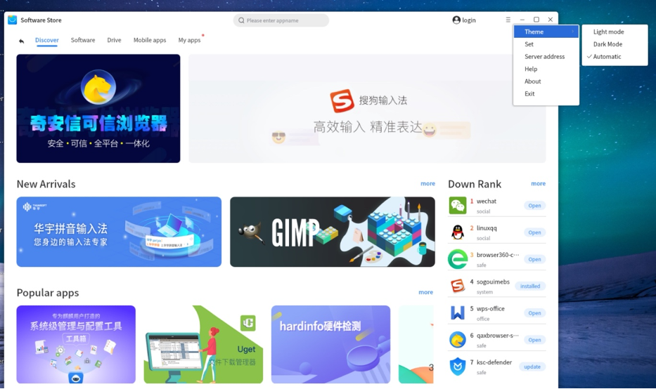

The software store client supports light mode and dark mode. You can choose the theme style of the software store that suits you. At the same time, the software store supports the theme automatic function, which can automatically switch according to the theme style of your computer.

As shown in Figure 17, you can set the store's automatic update and notification reminders after clicking the operation bar settings. When you open the automatic update software store, when the software store client version is updated, it will automatically update you to the latest version silently; when you open the automatic update software, when there is a new version of the software you downloaded in the store, it will automatically Silently update to the latest version for you; when you do not turn on the automatic software update, the store will push the software update notification by default, and you can also turn off the notification in the settings.

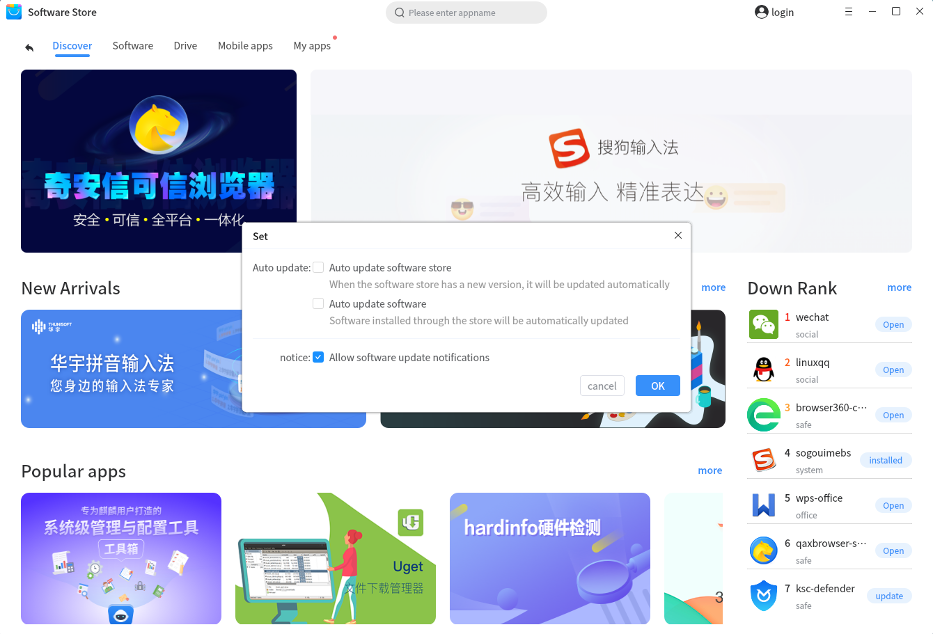

In the server address configuration function, as shown in Figure 18, you can see the server address, including the address of the software store and the address of Kylin ID. Since the server IP is unknown before the establishment, if you do DNS resolution in the LAN routing, resolve the server IP to api.kylinos.cn, the client can access it correctly.

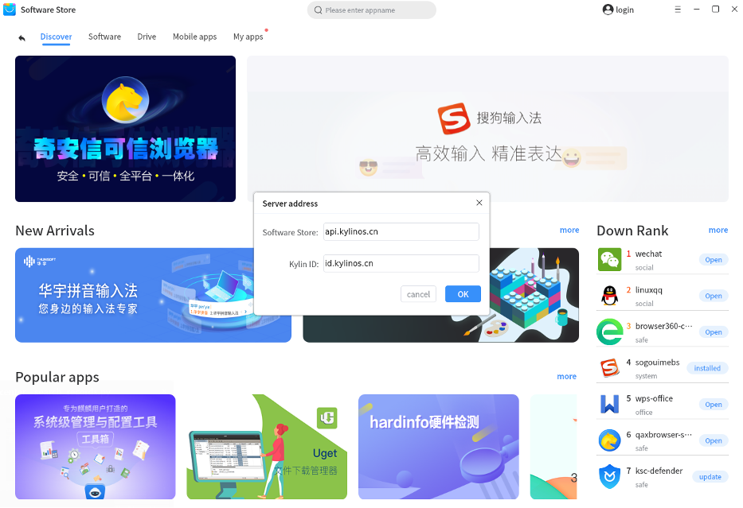

If you have any questions or error prompts during use, you can click the help menu in the operation bar, and the user manual of the software store client will be opened for you. You can refer to the user manual to find the corresponding solution.

If you want to check the client version of the current software store, you can open the About menu in the operation bar, and the current software store version, the store’s disclaimer and contact information will be displayed. When you click the exit button in the operation bar, you can directly exit the software store.

### Window operation
The upper right corner of the software store window supports minimizing and maximizing the window. At the same time, if you double-click the blank area of the software store page, you can also trigger the window to zoom in or out. Click the close button in the upper right corner to successfully exit the software store.

## Exit
The software store supports two ways to exit the software store.

* You can click the operation bar and click Exit to exit the software store.

* You can directly click the close button of the page window to exit the software store.

## Error code prompt
If you encounter the following error prompts when using the software store, you can refer to the corresponding error code prompts to try to solve the problem. If you still cannot solve the problem according to the instructions, please contact the after-sales service. We will work to solve the problems encountered by the software store. 

* #0001

Cause: A service abnormality is detected, which is usually caused by an abnormal background interface or an abnormality of the system bottom installer (apt or dpkg).

Solution:

(1) Restart the software store. If restarting the software store does not take effect, proceed to step (2);

(2) Repair the system bottom installer (apt or dpkg), delete the lock of the system bottom installer (rm /var/lib/dpkg/lock), enter apt-get install -f and dpkg --configure-in the terminal a.

* #0002

Reason: The download failure is usually caused by an abnormality of the underlying installer (apt or dpkg) of the system.

Solution:

(1) In the terminal, use apt-get install and add the name of the package to be installed to check the cause of the problem;

(2) The system bottom installer is abnormal: repair the system bottom installer (apt or dpkg), delete the lock of the system bottom installer (rm /var/lib/dpkg/lock), and enter apt-get install -f in the terminal and dpkg --configure -a;

(3) Dependence conflict: please contact technical service personnel.

* #0003

Reason: The installation failure is usually caused by the abnormality of the system bottom installer (apt or dpkg).

Solution:

(1) In the terminal, use apt-get install and add the name of the package to be installed to check the cause of the problem;

(2) The system bottom installer is abnormal: repair the system bottom installer (apt or dpkg), delete the lock of the system bottom installer (rm /var/lib/dpkg/lock), and enter apt-get install -f in the terminal and dpkg --configure -a;

(3) Dependence conflict: please contact technical service personnel.

* #0004

Reason: Uninstallation failure is usually caused by an abnormality of the underlying installer (apt or dpkg) of the system.

Solution:

(1) In the terminal, use apt-get remove and the name of the package to be uninstalled to check the cause of the problem;

(2) The system bottom installer is abnormal: repair the system bottom installer (apt or dpkg), delete the lock of the system bottom installer (rm /var/lib/dpkg/lock), and enter apt-get install -f in the terminal and dpkg --configure -a;

(3) Dependence conflict: please contact technical service personnel.

The above are the solutions corresponding to the software store error code prompts. If you encounter the above problems during use and cannot be solved according to the provided methods or you find other problems during use, you can contact our technical service personnel, we look forward to you Valuable advice. Thank you for your support to Kylin Software Store!
