#  软件商店
##  概述
软件商店是一款图形化软件管理工具，为用户提供软件的搜索、下载、安装、更新、卸载等一站式软件服务。软件商店作为应用分发平台，为用户推荐常用软件和高质量软件。每款上架的软件都有记录详细的信息以供参考，您可根据实际需要下载安装。

本手册包括软件商店总体结构，从打开软件商店，登录到退出各功能模块的详细操作说明以及在客户端使用过程中可能遇到的问题解析。如您在参考使用手册时存在疑问，请与我们的技术服务人员取得联系。

 

## 启动软件商店
点击开始菜单工具，打开开始菜单栏目。

您可以通过鼠标上下滚动、搜索软件名称、按首字母查询、按类别查询软件商店，点击软件商店查找结果即可启动软件商店。

您可以在开始菜单右键软件商店进行多种选择：

* 固定到“所有软件”：在所有软件中置顶软件商店，当打开开始菜单时，快速打开软件商店。

* 固定到任务栏：固定到任务栏后您可直接单击桌面左下角任务栏中软件商店快速打开。

* 添加桌面快捷方式：添加桌面快捷方式后，在桌面上找到软件商店的图标单击快速打开。

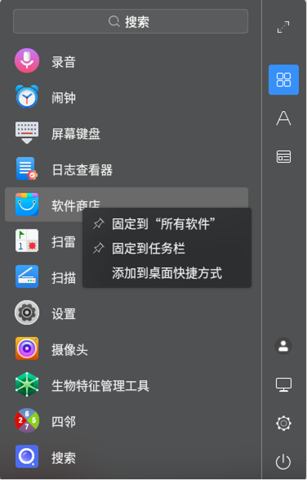

 

## 功能模块
### 账户登录
软件商店支持未登录账户和登录麒麟ID账户两种状态使用。未登录麒麟ID账户时，可直接使用软件商店基础功能。本章节以登录麒麟ID使用软件商店为例详细介绍使用步骤。

#### 麒麟ID注册

软件商店登录账户需先注册麒麟ID，如您尚未注册，请点击登录界面【注册】或首次扫码登录时，跳转至麒麟统一用户中心进行相关注册。

#### 麒麟ID登录

如您已注册麒麟ID，可直接登录麒麟ID账户。点击首页右上角【登录】按钮，便会弹出【麒麟ID登录中心】。如图2所示，用户可通过账号密码、手机短信验证码、微信扫码三种方式登录。注意微信扫码登录仅支持V10-SP2系统版本，更多版本敬请期待。根据不同系统版本，登录界面存在差异性，请以实际页面为准。

1) 密码登录

* 输入账号密码后点击登录按钮，会弹出滑动验证码进行验证；

* 验证通过后即可成功登录;

* 密码登录时可选择是否记住密码。

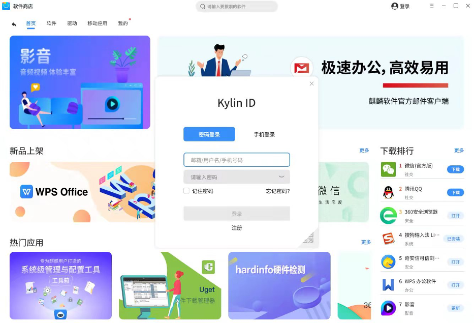

2) 短信登录

* 输入注册手机号，点击获取验证码，在弹出的滑动验证界面进行验证；

* 验证通过后向注册手机号码发送短信验证码，输入相应短信验证码；

* 点击登录即可登录软件商店。

3）微信扫码登录

* 点击软件商店登录框右下角二维码，使用微信扫一扫快速登录；
* 注意如果微信所在账户未注册过麒麟ID，需注册后再次扫码登录。

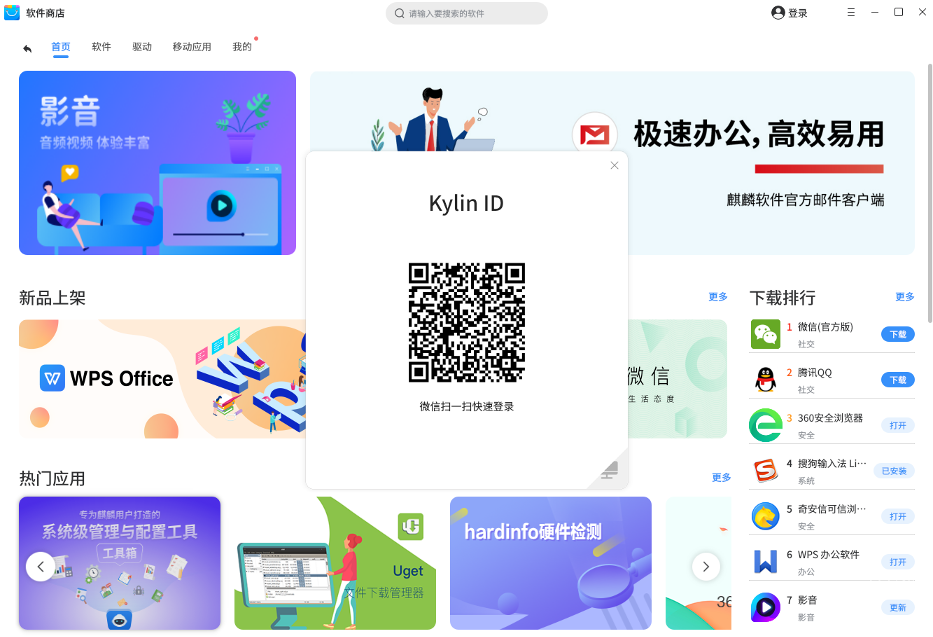

如您忘记密码，点击登录界面的【找回密码】，跳转至麒麟统一用户中心，使用手机号、邮箱、密保问题三种方式中任意一种找回密码。

### 主菜单
软件商店的主界面标题栏包括：首页、软件、驱动、移动应用、我的五大栏目。以下分别对五大栏目进行详解解说。

#### 首页
打开软件商店，默认打开【首页】，如图4所示，首页包括广告推荐、新品上架、热门应用、下载排行，向下拖拽滚动条可以看到常用应用展示、大家都在用的移动应用。在首页您可以点击广告位或是任一推荐板块下软件，即可跳转至软件的详情页面。如首页的下载排行、常玩应用、大家都在用的移动应用有您想打开、更新、或下载的软件，您也可以直接点击该软件右侧的按钮。对新品上架、热门推荐、下载排行，您也可点击该模块右上角更多按钮进入相应内容页面。注意，移动应用目前仅支持ARM架构，如您的架构不是ARM架构，则不显示大家都在用的移动应用板块。

#### 软件
点击主页面标题【软件】时，进入软件界面。软件商店提供了包括精品、办公、开发、图像、影音、网络、游戏、教育、社交、系统、安全、其他共12种软件分类，同时支持上架预告栏目，点击二级目录中任意类别即在查看该类别中所有软件，如图5所示。在不同的类别下，您可以选择目标软件进入软件详情页面。在各类别下面，支持默认排序、下载排行、评分排行多种排序方式，默认排序依据自研热度算法为您推荐应用，下载排行根据当前该类别下所有软件的下载量由高到低排序，评分排行根据当前该类别上所有软件用户评分由高到低排序。在该页面，您可以单个下载或批量下载软件，对已经下载的软件您可以直接打开或点击更新后打开该软件。在上架预告页面可查看即将上架的软件，在软件卡片中，可直接点击官网按钮进入该软件官网了解详细信息，您也可以点击该软件进入软件详情页查看软件信息。

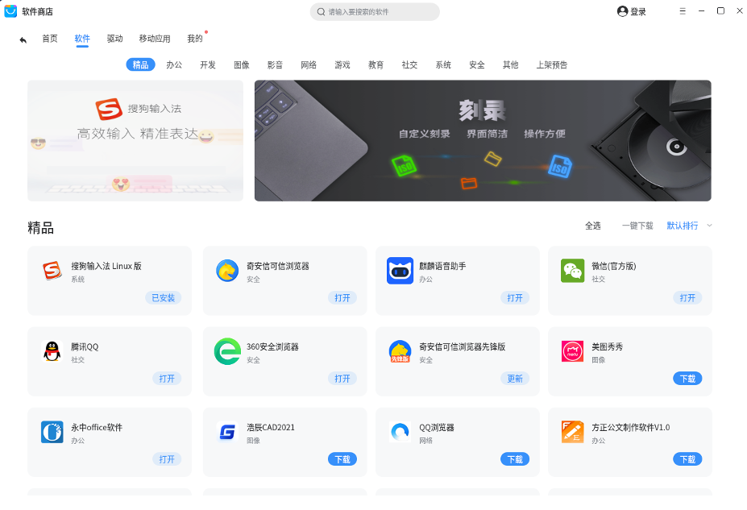

#### 驱动
点击主页面标题【驱动】即可进入驱动页面，该页面提供打印机、扫描仪、高拍仪、指纹设备等多种类型的驱动。在每个类别下，均支持单个驱动下载和批量下载功能。注意，因不同的驱动适配的架构不同，在【驱动】页面中实际显示的驱动类型会有所差别。

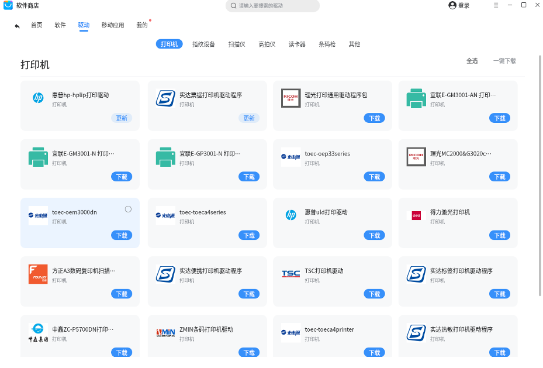

#### 移动应用
软件商店为用户提供麒麟软件自主研发的高性能的移动运行环境KMRE（目前仅支持ARM架构，更多架构敬请期待），实现桌面端与移动设备的融合，提升用户体验并解决您的多样化需求。

点击主页面标题【移动应用】即可进入移动应用页面，首次进入移动应用页面时需要下载麒麟移动运行环境，点击下载体验按钮，下载安装完成后，会提示您重新启动电脑，重启电脑后再次打开软件商店移动应用页面，等待初始化环境后即可下载安卓应用。

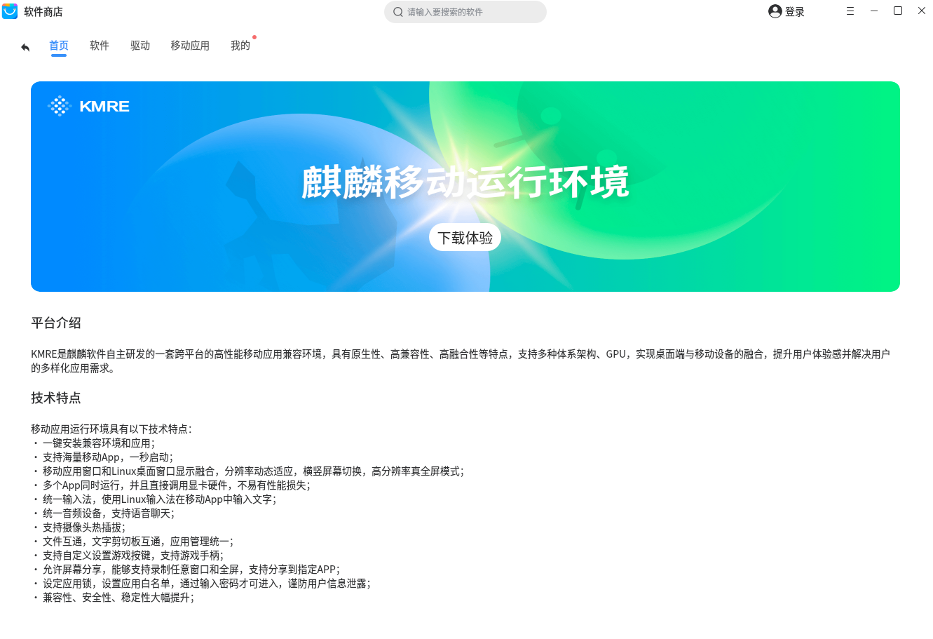

初始化安卓环境后即可看到如图7所示的移动应用页面，该页面支持多种类别的应用下载，注意不同机型上显示类别可能不完全相同，请以实际为准。在各页面，支持默认排行、下载排行、评分排行三种排序方式。您可以选择任一类别选项，搜索、下载您的目标软件。下载软件后，点击打开可直接使用该安卓应用，体验感丰富。

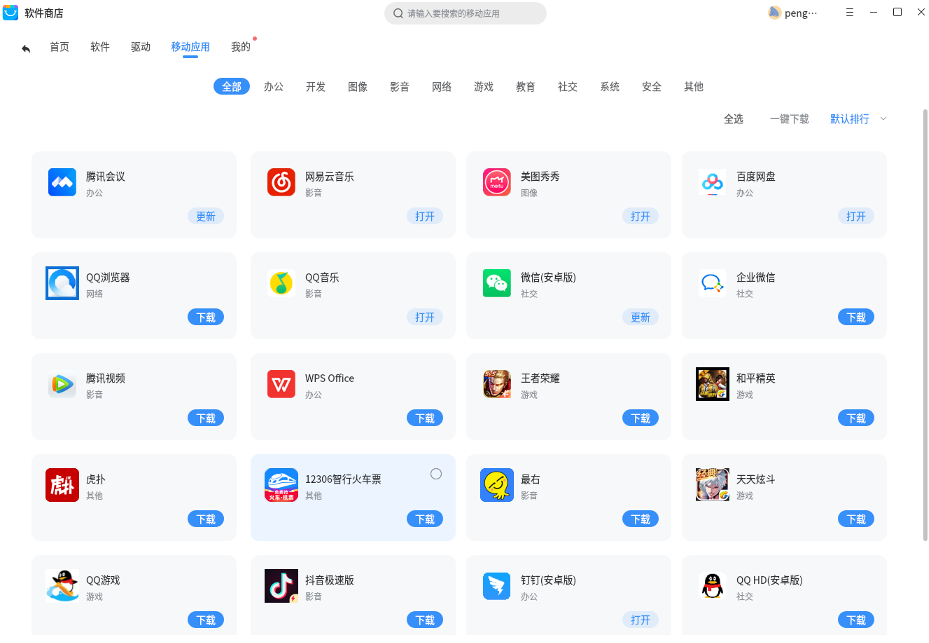

#### 我的
点击主页面标题【我的】打开个人应用管理页面，可以查看和操作当前正在下载、需要更新的软件以及卸载本机已安装的软件，同时可以查看本机安装、云安装的的历史记录。

1) 正在下载

打开【我的】后，默认打开【正在下载】页面，如图9所示。如正在下载软件，正在下载按钮的右上角将显示下载个数，页面中以卡片形式显示正在下载的软件。在下载完成前，可随时暂停、继续、取消下载某一软件，也可执行右上方【全部暂停】一键停止所有下载，此时，可点击全部继续恢复下载，直至软件下载完成。

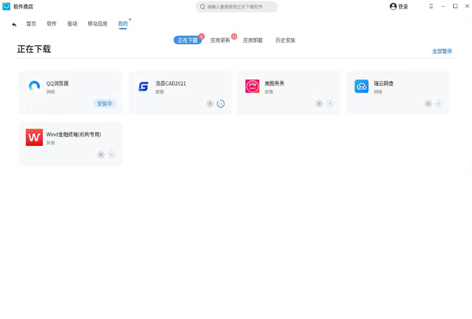

2) 应用更新

如本机软件有更新，在标题栏【我的】右上角会出现红点提示，且应用更新也会出现数量提示，如图10所示。在软件卡片右下角，点击【更新】可开始更新该软件，或在页面右上角选择【全选】后，点击【全部更新】。软件在更新完成前，可随时暂停、继续、取消软件更新操作。软件下载完成后会自动安装，请耐心等待，直到出现【打开】按钮即说明软件安装完成。

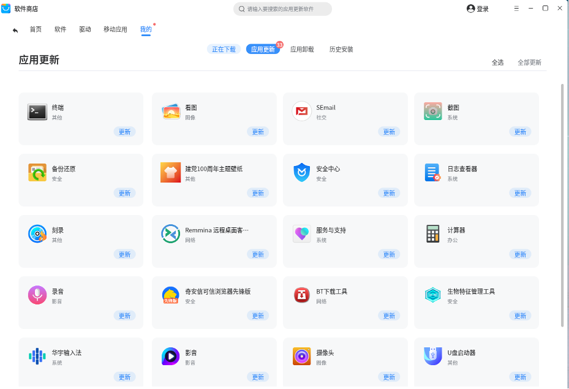

3) 应用卸载

如想卸载从软件商店下载安装的本机软件，除在本机启动菜单中单击右键进行删除，还可在此页面选择相应软件卡片，点击【卸载】。如需批量操作，则点击右上角【全选】，选择【一键卸载】，如图11所示。

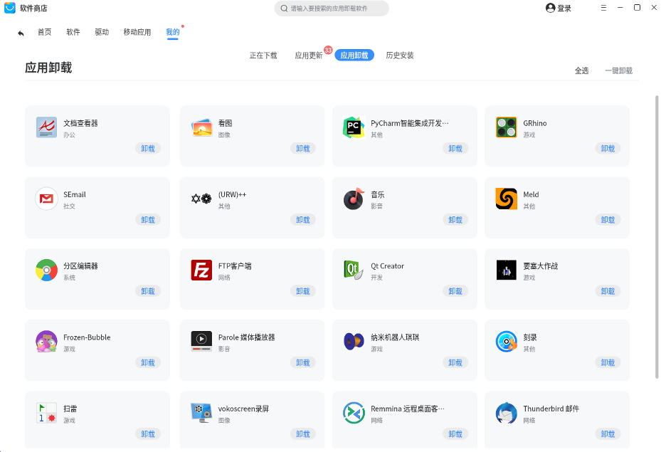

4) 历史安装

查看软件的安装历史，如图12所示。默认显示本机安装历史，即本机在软件商店中下载安装的软件列表。如您登录麒麟ID账号，可通过在云安装历史下查看该账号在其他电脑终端安装的软件记录。

若某些软件已从本机卸载，可在该页面点击【下载】重新下载安装。

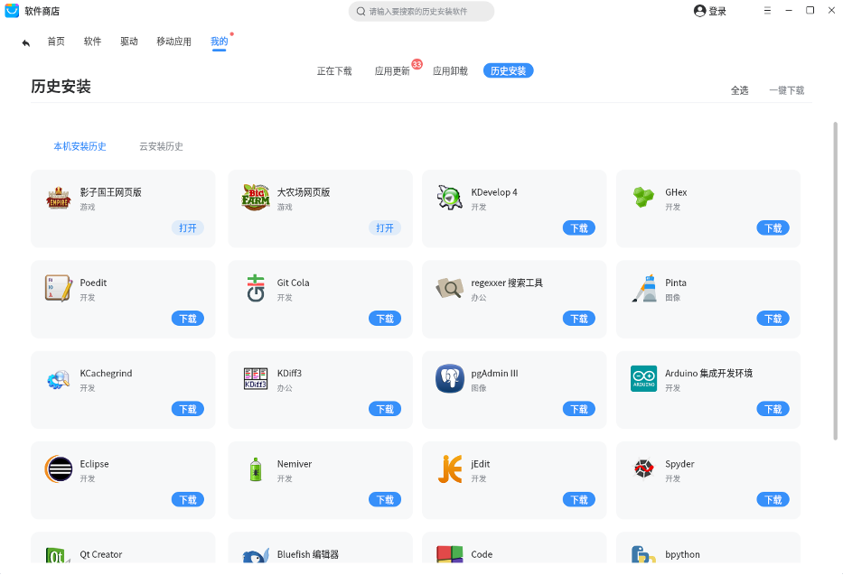

### 软件详情
点击任意一款软件可以进入软件详情界面，如图13所示。软件详情页可查看该软件的图标、软件名称、软件包名、类别、评分、下载次数、下载大小、当前版本等，并提供软件的使用截图和软件介绍。如下载该软件，可点击右上角【下载】按钮进行下载，下载完成后自动安装，安装完成后点击【打开】可直接运行该软件。

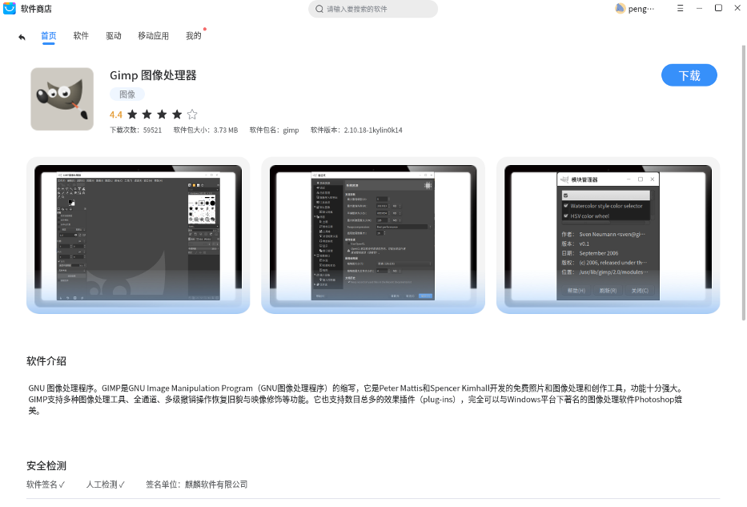

软件商店同时支持安全检测功能，如软件已经签名，并且通过人工检测，则会是“勾”的状态。已签名软件将显示签名单位：麒麟软件有限公司。

在软件详情界面可以查看该软件的评分以及用户的评论，如您想对该软件发表评分与评论，请先下载该款软件并登录麒麟ID账户。软件评分的总分为5分，软件评论默认按发表时间排序，最新的评论会显示在最上方。

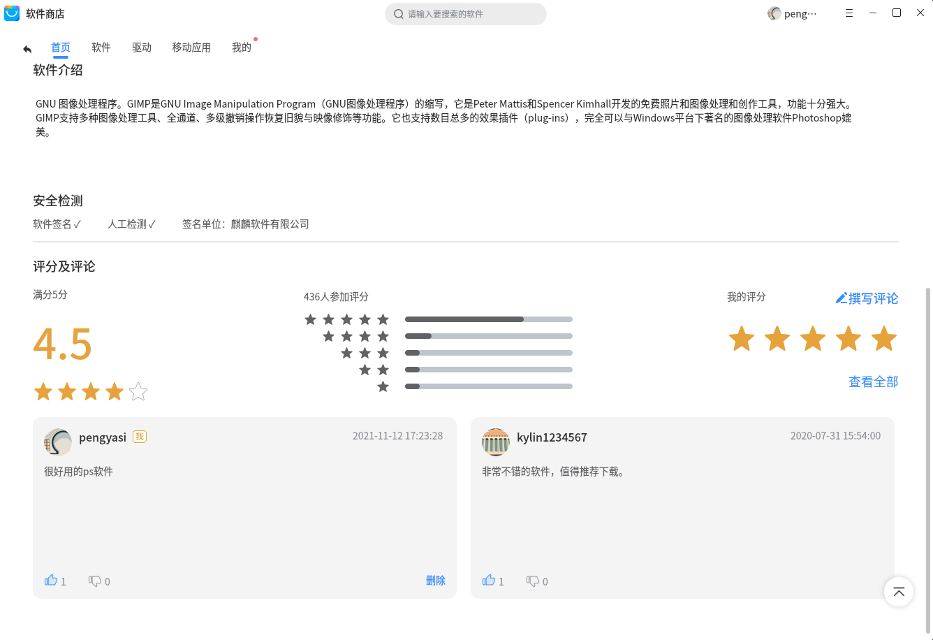

软件详情界面的用户评论区如图14所示，您登录后，可以根据个人喜好对软件进行评分和评论。鼠标点击五角星即可对该软件进行评分；登录麒麟ID并下载安装该软件后可在评论框输入评论内容，注意评论字数不能超过200字，评论输入完成后点击提交即可在下方评论区看到刚发表的评论。评论区默认左右滑动展示评论，如查看所有的评论内容，点击【查看全部】按钮，如图15所示。当继续向下滚动查看时，会不断加载评论，直到所有评论都加载完毕为止。

在查看软件评论的同时，您可以对他人评论点赞或喝倒彩，发表对该评论的看法，如您想删除您的评论可以点击您评论右下角的删除按钮。

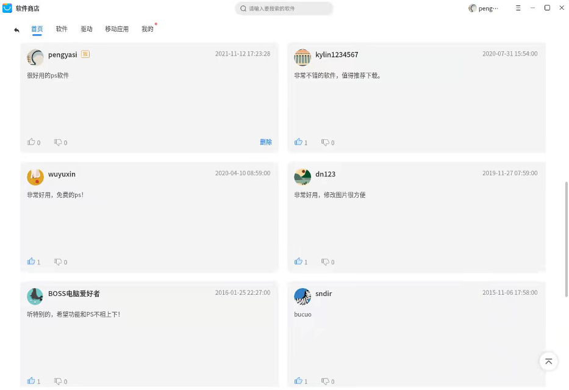

评论全部展开后，可以点击界面右下角的【回到顶部】按钮返回到顶部，或者点击菜单左上角【返回】按钮返回到上一级左右滑动评论界面。

### 搜索栏
软件商店带有搜索功能，默认搜索软件商店已上架的软件，搜索方式支持软件名称（汉字、拼音）搜索、软件包名搜索。您可以在搜索栏输入您的搜索内容，点击回车或搜索栏上的搜索符号，如您想一键删除搜索内容，可点击搜索框中“x”图标。如图16所示，点击搜索框输入搜索内容，搜索框下方将显示相关匹配的软件，如有目标软件点击即可立即跳转。

如图17示例，将显示符合您搜索内容的软件搜索结果。如搜索结果为空时，将提示您“抱歉，没有找到您想要的软件，您可以选择全库试试”，此时点击全库即可在整个软件源搜索您想要的软件。当您的搜索结果较为丰富时，您可以滑动页面找到目标软件。

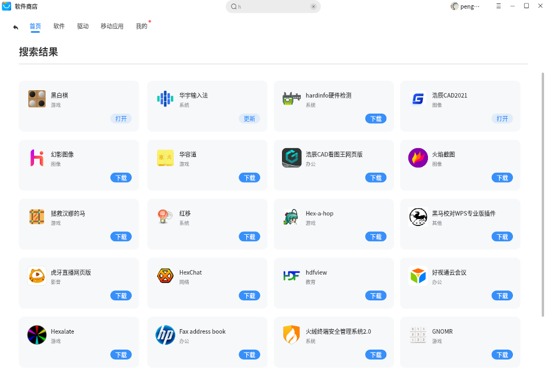

### 操作栏
软件商店客户端右上角操作栏包含主题选择、设置、服务器地址配置、帮助文档、版本说明、退出软件商店六大功能。

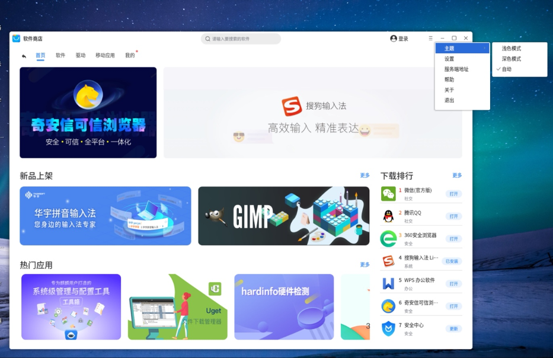

软件商店客户端支持浅色模式和深色模式，您可以选择适合您的软件商店主题风格，同时软件商店支持主题自动功能，根据您电脑的主题风格实现自动切换。

如图19所示，点击操作栏设置后可对商店自动更新、通知提醒进行设置。当您开启自动更新软件商店时，当软件商店客户端版本发生更新时，将自动静默为您更新至最新版本；当您开启自动更新软件时，您在商店下载的软件有新版本时，将自动为您静默更新至最新版本；当您未开启自动更新软件时，商店将默认推送软件可更新通知，您也可以在设置中关闭该通知。

在服务端地址配置功能上，如图20所示，可以看到服务端地址，包括软件商店地址和麒麟ID的地址。由于服务器IP搭建前是未知的，如您在局域网路由中做DNS解析，将服务器IP解析为api.kylinos.cn，客户端即可正确访问。

如您在使用过程中有疑问或是出现错误提示，您可以点击操作栏中帮助菜单，将为您打开软件商店客户端的使用手册，您可参照用户手册查找相应的解决方法。

如您想查看当前软件商店的客户端版本，您可以打开操作栏中关于菜单，将显示当前软件商店的版本以及商店的免责声明、联系方式。当您点击操作栏退出按钮时，可直接退出软件商店。

### 窗口操作
软件商店窗口右上角支持最小化、最大化窗口，同时如您双击软件商店页面空白处，也可触发放大、缩小窗口。点击右上角关闭按钮可成功退出软件商店。

 

## 退出软件商店
软件商店支持两种方式退出软件商店。

1) 您可点击操作栏，点击退出即可退出软件商店。

2) 您可直接点击页面窗口退出软件商店。

 

## 错误码
如您在使用软件商店时遇到以下错误提示，您可参考对应的错误代码提示尝试解决问题，如根据指示仍无法解决，请您联系售后，我们将致力于为您解决软件商店遇到的问题。

* #0001

出现原因：检测到服务异常，通常是由于后台接口异常引起，或系统底层安装器（apt或dpkg）异常引起。

解决方法：

(1)重启软件商店，若重启软件商店不生效则操作步骤(2);

(2)进行系统底层安装器（apt或dpkg）的修复，删除系统底层安装器的锁（rm /var/lib/dpkg/lock），在终端输入apt-get install -f 以及dpkg --configure -a；

(3)在终端使用apt-get install 加上需要安装的包名查看问题原因。

* #0002

出现原因：通常是由于系统底层安装器（apt或dpkg）异常引起的下载失败。

解决方法：

(1)在终端使用apt-get install 加上需要安装的包名查看问题原因；

(2)系统底层安装器异常：进行系统底层安装器（apt或dpkg）的修复，删除系统底层安装器的锁（rm /var/lib/dpkg/lock），在终端输入apt-get install -f 以及dpkg --configure -a；

(3)依赖冲突问题：请您联系技术服务人员；

* #0003

出现原因：通常是由于系统底层安装器（apt或dpkg）异常引起的安装失败。

解决方法：

(1)在终端使用apt-get install 加上需要安装的包名查看问题原因；

(2)系统底层安装器异常：进行系统底层安装器（apt或dpkg）的修复，删除系统底层安装器的锁（rm /var/lib/dpkg/lock），在终端输入apt-get install -f 以及dpkg --configure -a；

(3)依赖冲突问题：请您联系技术服务人员；

* #0004

出现原因：通常是由于系统底层安装器（apt或dpkg）异常引起的卸载失败。

解决方法：

(1)在终端使用apt-get remove 加上需要卸载的包名查看问题原因；

(2)系统底层安装器异常：进行系统底层安装器（apt或dpkg）的修复，删除系统底层安装器的锁（rm /var/lib/dpkg/lock），在终端输入apt-get install -f 以及dpkg --configure -a；

(3)依赖冲突问题：请您联系技术服务人员；

以上为软件商店错误码提示对应的解决方法，如您在使用中遇到以上问题且根据提供的方法未能解决或您在使用过程中发现其他问题，可联系我们的技术服务人员，我们期待您宝贵的建议。感谢您对软件商店的支持！

 

