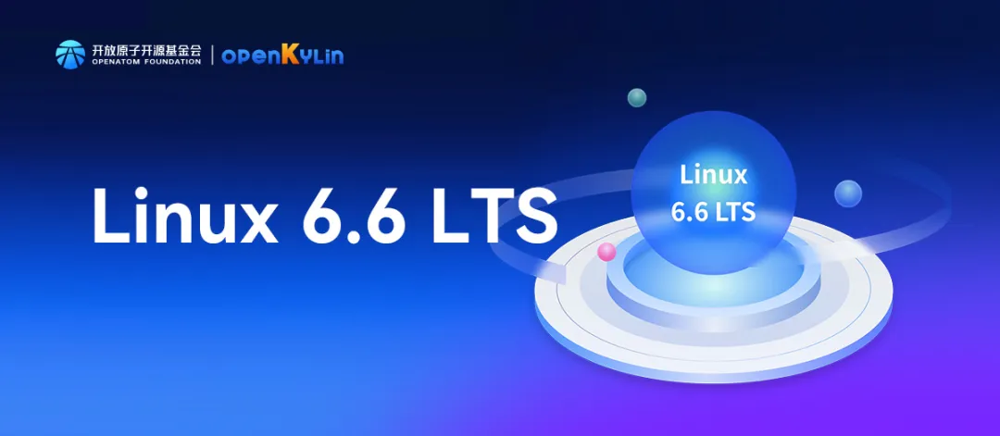
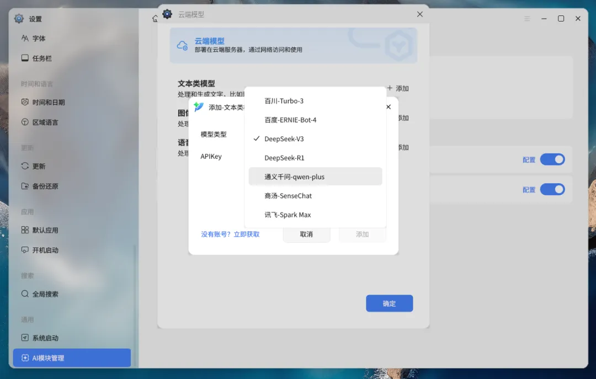
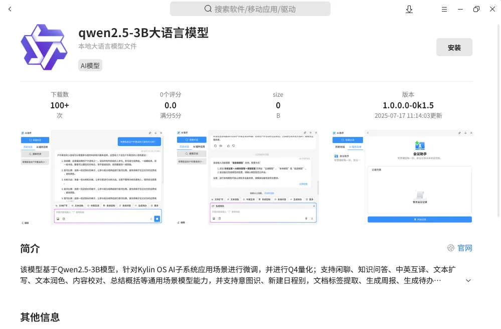
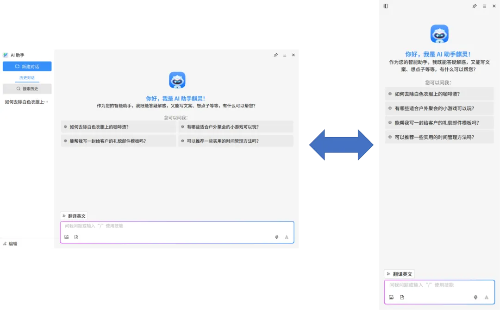
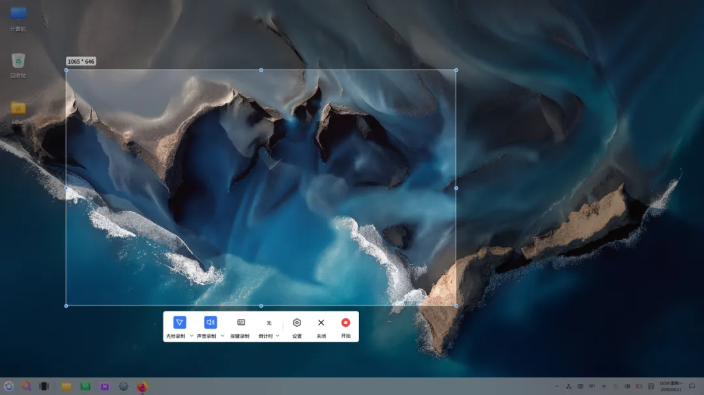
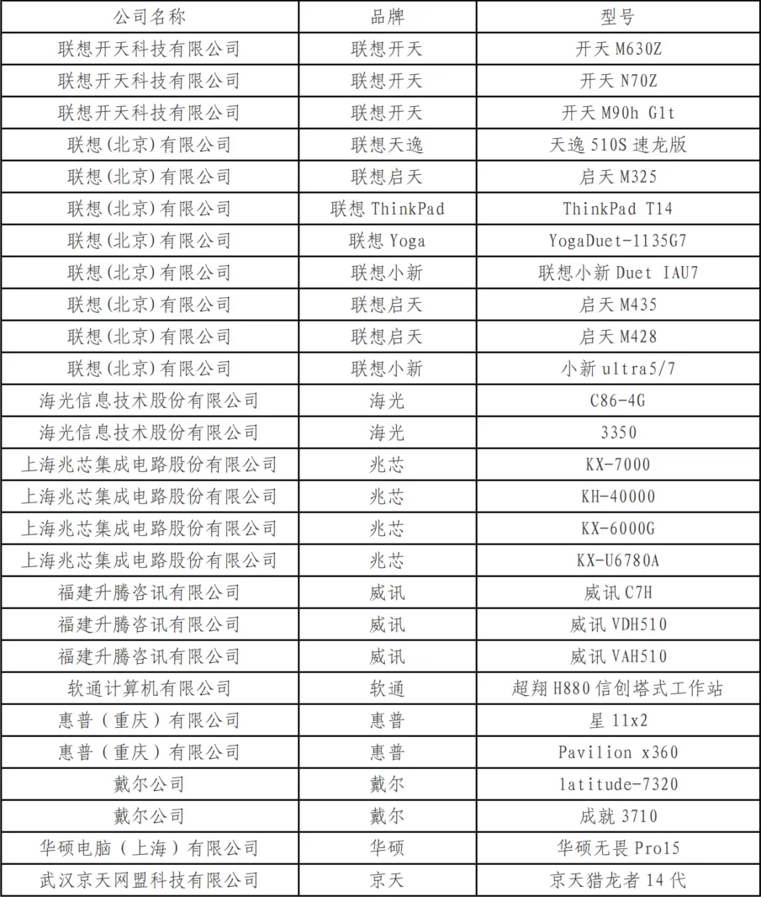
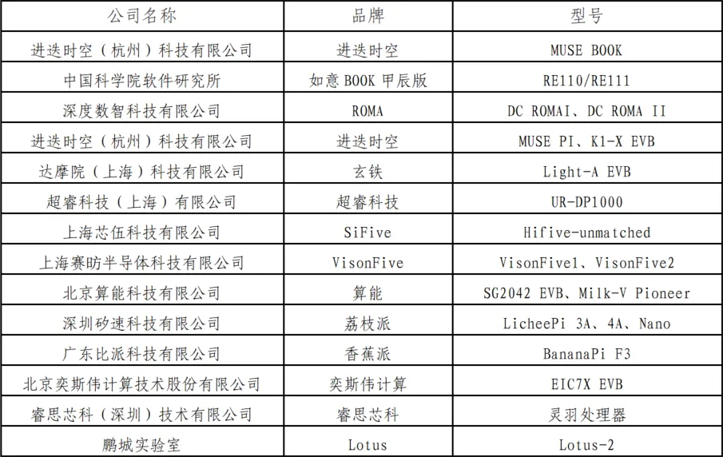
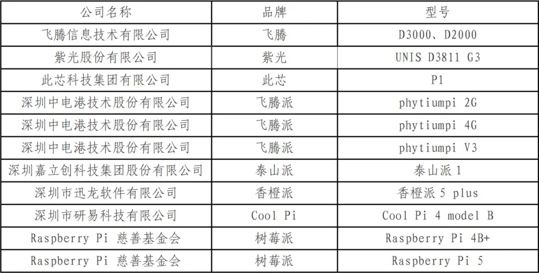

# openKylin 2.0 SP2版本发行说明
OpenAtom openKylin（简称 “openKylin”） 2.0 SP2版本于2025年8月26日，正式发布！本次版本更新在底层核心能力上，持续维护 6.6 稳定版内核，深度适配海光、飞腾、兆芯、龙芯等国产主流芯片，并积极推动 RISC-V 开放指令集架构生态融合，构建坚实多元的算力底座。

该版本的主要特性更新还包括：新增集成 DeepSeek、通义千问、商汤等云端与本地大模型，初步构建起桌面智能交互中枢；首次默认搭载“磐石架构”，融合不可变系统、KARE 及开明包格式三大核心技术，显著提升系统级高稳固性并确保应用生态的广泛兼容；全新 UKUI 4.20 桌面环境融入动态光影引擎与 AI 技术，带来沉浸式交互体验；配套原生开发 SDK 升级至 3.0 版本，新增 273 个接口，深度适配 UKUI 桌面环境与 wlcom 合成器；广泛适配支持联想开天、中科可控、进迭时空等品牌超 100 款终端设备。现诚邀所有社区开发者和用户共同见证并体验全新一代openKylin智能桌面开源操作系统！

## 亮点特性
### 6.6内核持续稳定兼容
openKylin 2.0 SP2版本针对6.6稳定版内核进一步优化和完善，累计合入上游及内核底层优化补丁10000+，并在社区会员单位的支持下，完善对海光C86-4G系列处理器、飞腾D3000系列平台、兆芯KX-7000平台、龙芯3A6000平台、格兰菲Arise2系列显卡、中关村实验室HAOC的支持，同时推动超睿等RISC-V厂商基于openKylin 6.6内核适配及代码合入，向RISC-V内核统一迈出坚实一步！
      

### AI能力大跃迁
openKylin 2.0 SP2搭载全新升级AI子系统及AI助手，致力于打造全能桌面智能中枢。本次升级深度整合了DeepSeek、通义千问等主流云端大模型，实现用户零门槛调用实时AI能力，满足日常及专业分析需求；同时，针对数据敏感场景，可通过openKylin软件商店安装Qwen2.5-3B本地大模型，实现离线运行，平衡安全与效率。

####
##### 在线模型
支持DeepSeek、百度文心一言、阿里通义千问、商汤、讯飞星火、百川等国内主流在线大模型，一键绑定API密钥即可接入使用。

##### 本地模型
本地大模型安装流程简化，用户在openKylin软件商店即可快速下载安装。

#### AI助手全新改版
新版AI助手在界面UI显示及交互上全面优化，新增支持窗口和侧边栏双模式切换，多模态交互支持图片/文档等格式文件拖拽分析，还可以自定义设置快捷指令。新增本地文档处理功能，支持用户导入本地文档构建专属知识库，提供准确问答服务。

### “磐石架构”完全体正式上线
磐石架构的核心是构建一个“不可变”的基础操作系统环境，并基于该环境通过配套生态兼容和管理技术，为用户提供基础稳定和安全的同时，保留原有操作习惯和丰富的应用生态。在openKylin上，磐石架构主要包括三个核心技术：不可变系统、KARE兼容环境和开明包格式，三者协同工作，有效解决了传统 Linux桌面发行版的更新升级与生态兼容矛盾的痛点问题，推动其向更高效、安全的方向发展。

#### 默认不可变系统
    - 2.0 SP2版本正式默认启用不可变系统模式，安装系统后即为不可变系统环境
    - 新增维护模式功能，用户开启后可以从任意源安装应用及调试运行环境
    - 支持维护模式状态通过桌面水印的方式提醒
    - 支持多版本内核共存及切换功能
#### KARE 3.0
    - 容器引擎切换为轻量级的CRUN，提升程序启动运行速度及可控性
    - 新增与开明包共享image的能力，提升系统资源调度效率
    - 统一KARE环境构建日志、应用安装运行日志、后台服务日志等日志路径
#### 开明软件包格式
    - 升级运行架构，由“runtime+app”改为“base+runtime+app”，提升运行效率及灵活性
    - 容器引擎切换为轻量级的CRUN，提供更多运管理机制和安全防护配置方式
    - 优化基础功能，包括新增签名功能、文件反查接口等
    - 新增开明可视化构建工具、支持增量构建功能等
    - 新增数百款开明应用上架
    - 完成十余款系统预装应用开明化替代

### wlcom合成器日趋完善
openKylin社区Wayland SIG组持续优化完善wlcom合成器，致力于为社区用户提供体验更加流畅、功能更加完善、性能更加卓越的Wayland显示协议合成器，本次版本发布，wlcom主要有以下方面优化：
    - 新增拖拽窗口贴边效果及选择预览效果
    - 重构drm backend
    - 服务端装饰统一使用ukui主题框架参数
    - 优化多种特效实现，效果更加流畅
    - 提供获取个别特殊按键状态接口

### UKUI 4.20桌面环境
基于UKUI 4.0 “轻量化感知” 设计原则基础上，UKUI 4.20以 “更流畅的交互、更智能的体验、更个性化的配置、更安全的基座” 为核心目标，从五个优化方向进行桌面交互重构，为用户带来更高效、更智能、更贴心的桌面体验。

#### 轻量视觉的沉浸式延伸
延续UKUI 4.0的设计原则，UKUI 4.20新增动态光影引擎，实现从“看得清”到“看得懂”的跨越，让界面更美观、交互更自然。

#### 智慧锁屏

小组件与屏保进搭配组合，用户无需打开应用即可获取数据，以满足用户不同的场景和需求。

#### 交互自由的场景化扩容

将“轻松的交互体验”理念扩展至多模态交互（语音/手势/AI预测），建立“人-机-环境”自然对话系统，让操作系统更懂用户需求。

#### 智能架构的原生融合

首次在系统层引入AI中间件，使效率工具（如文件搜索）进化为认知助手，让系统具备更强的智能服务能力。

#### 全局动效优化

UKUI 4.20完成窗口显示/隐藏动效、应用组动效、桌面图标动效等46个交互动效。

#### 其他优化更新
1、主题：

    全新“磐石”壁纸上线，磐石筑基，踏浪而行

2、控制面板

    新增AI模块管理

    新增运维模式管理模块

    优化原字体管理器功能集成到字体模块

    新增系统启动模块（可配置grub默认启动项、grub启动延时等）

    优化触控校准与触摸屏导航合并

    新增屏保新增天气、音乐、相册三种样式可选

    优化任务栏配置选项

    新增键盘模块新增虚拟键盘设置选项

    优化护眼模式，新增调节色温实时预览功能；

    ........

3、文件管理器

    实现桌面环境服务的插件化，提供统一服务框架，通过统一服务框架加载插件的方式拉起服务，对桌面环境服务进行统一管理和维护

    文件管理器UI/UE体验优化

    文件搜索功能优化，集成智能搜索

    文件管理器共享与远程体验优化

4、系统监视器

    系统监视器增加磁盘详情读写页

5、声音

    断开音频设备时暂停播放

6、输入法配置

    全局输入法配置工具UI界面升级优化

7、 声音

    新增断开音频设备时暂停播放的功能

8、多任务视图

    新增工作区名称自定义功能

9、开始菜单

    新增支持拖拽固定到任务栏的操作

10、任务栏

    增加托盘图标自定义（显示/隐藏）

    多屏模式下任务栏显示配置自定义

11、虚拟键盘

    显示/隐藏逻辑优化

    多屏幕支持

    wlcom适配支持

    ......

### 系统录屏工具上线
正式上线并预装openKylin系统录屏软件，支持一键启动、声音录制、区域录制、倒计时等众多经典功能，并重点支持在wlcom环境下运行，为openKylin用户提供真正好用、易用的录屏体验！

### 原生开发全链路赋能开发者
openKylin原生开发环境以全链路赋能开发者为核心，构建了覆盖多场景的技术底座。在openKylin 2.0 SP2阶段，openKylin系统SDK最新升级到3.0，整体新增15个功能模块与273个接口，助力开发者深度适配UKUI及wlcom；AI SDK进一步扩展20+专用接口，强化基于openKylin的原生智能开发能力；同时与社区伙伴厂商合作，基于openKylin嵌入式构建工具，深度支持机器人、小手机、小电脑等智能创新硬件适配开发。配套KylinCode集成开发环境提供一站式编码、调试服务，并在openKylin社区自动化开发者平台的支持下，实现仓库创建、代码构建到镜像发布的全流程自动化管理，降低开发门槛，加速原生应用创新落地。

## 版本修复的重点Bug清单
### 系统应用
【AI助手】修复AI助手有进程且界面未唤出时，右键文件选择“发送至AI助手”时未唤出AI助手窗口的问题

【AI助手】修复ppm pgm pbm tiff格式的图片，会回复“输入文本无效，请修改后重新发送”的问题

【AI助手】修复wlcom环境下高概率出现划词不能出现划词悬浮条的问题

【AI助手】修复切换至窗口模式，偶现窗口默认尺寸不正确，且无法拖拽、拉伸的问题

【AI助手】修复划词悬浮条唤出时，使用alt+tab唤出快速切换区会闪退，唤出多任务视图会先显示图标再消失的问题

【AI助手】修复图片处理后点击重新回答按钮无法重新进行扫描黑白件或智能抠图的问题

【AI助手】修复在提示词模板添加提示词后，关闭AI助手，再次打开后所有提示词都被清空了的问题

【AI助手】修复点击“取消置顶”无效的问题

【AI助手】修复英文朗读时断断续续，不流畅的问题

【AI助手】修复软件商店下载qwen2.5-3B大语言模型，重启系统后设置不出现“本地模型”的问题

【AI模块管理】【本地模型】AI模块管理界面默认不显示本地模型

【AI模块管理】修复云端账号接口Key信息泄露风险问题

【KMRE】修复docker 服务无法启动的问题

【U盘管理工具】修复插入移动硬盘，重启机器，无法弹出移动硬盘的问题

【录屏】修复wlcom环境下，设置和关于界面存在两个标题栏的问题

【刻录】修复wlcom模式下，更改主题后，界面未全部同步，只更改部分界面的问题

【备份还原】【公测】修复无法删除备份的问题

【备份还原】修复还原出厂备份提示失败的问题

【天气】修复首次从托盘小图标处打开天气时，出现双标题栏等问题

【安装器】修复使用安装器安装包，初始化环境结束后提示安装失败的问题

【安装器】修复安装器安装包后开始菜单不能运行的问题

【开明包格式】修复应用弹窗存在双窗口的问题

【开明包格式】修复开明包应用字体与系统默认字体不一致的问题

【开明包格式】修复更新6.6.0.15内核后无法使用开明应用，设置面板响应慢的问题

【开明包格式】修复软件商店安装开明应用提示0003的问题

【录屏】【公测】修复wlcom环境下录屏存在双标题栏的问题

【录屏】修复在龙芯机型上，无法正常录制视频，录制会自动退出的问题

【录屏】修复录屏应用打不开的问题

【录屏】修复录屏画面卡在某处的问题

【录音】修复在龙芯机器上录制音频时，文件时长为0的问题

【智能剪切板】【公测】修复剪贴板显示错位的问题

【智能剪切板】【公测】修复剪贴板点复制会复制两遍，产生两个条目的问题

【智能剪切板】【公测】修复系统使用一段时间后，点击托盘剪切板图标无响应，复制粘贴也失效了的问题

【智能剪切板】修复wlcom模式下，菜单显示的位置不固定的问题

【智能剪切板】修复滑动条的显示与设计稿不符、与系统中其他滑动条也不一样的问题

【智能模糊搜索】修复AI索引无法打开的问题

【智能模糊搜索】修复搜索到的配置项无法打开的问题

【终端】修复终端子窗口标题菜单置于底层，仅子窗口置于底层的问题

【软件商店】修复英文环境下，kmre页面内介绍信息没有翻译为英文的问题

【音乐】修复点击进度条，只能一段一段前进，且无法正常后退的问题

### 桌面环境组件
【网络管理】修复从任务栏无法断开无线连接的问题

【网络管理】修复点击任务栏网络图标，点击下方"更多网络设置"无反应的问题

【蓝牙】修复在龙芯3A6000上蓝牙设备配对成功后一直显示未连接状态，点击无法连接的问题

【触控板】修复“插入鼠标时禁用触控板”功能不生效的问题

【账户信息】修复切换用户至标准用户，打开设置-账户信息，设置窗口闪退的问题

【登录选项】修复绑定微信后，登录锁屏界面无法调用微信/生物识别认证的问题

【登录锁屏】修复RISC-V架构上屏保界面鼠标点击右键，屏保界面卡住，随后直接进入桌面的问题

【登录锁屏】修复登录界面输错密码后点击重置密码，实测重置密码点击确定不起作用的问题

【登录锁屏】修复音乐屏保、天气屏保显示异常的问题

【显示】【公测】修复系统更新后背景缩小的问题

【显示器】修复显示器亮度、下拉框均与设计稿不一致的问题

【控制面板】修复grub验证功能密码设置异常的问题

【控制面板】修复删除已添加的应用后，开机启动界面显示异常的问题

【控制面板】修复在wlcom模式下控制面板更新界面自动检测更新后，点击其他模块界面会重叠在一起的问题

【控制面板】修复在控制面板使用鼠标滑动页面，页面滑动过程中显示异常的问题

【控制面板】修复控制面板添加用户时无法设置安全问题的问题

【控制面板】修复普通用户点击账户信息，控制面板闪退的问题

【控制面板】修复每次打开控制面板第一次选择远程桌面都会弹窗提示请选择一个输出设备的问题

【控制面板】修复部分机型存在缺少“有线网络”“无线局域网”的问题

【控制面板】修复部分机型点击控制面板WIFI列表内任意WIFI无反应的问题

【控制面板】修复部分机型重启后在控制面板打开或无线局域网开关，异常卡顿的问题

【控制面板】修复龙芯架构控制面板-键盘中的输入法编辑按钮，点击后控制面板闪退的问题

【控制面板】修复龙芯架构点击控制面板-显示器，控制面板发生闪退的问题

【摄像头】修复在设置中切换摄像头闪退的问题

【文件管理器】【公测】修复以root身份打开peony ，丢失主题，界面显示异常的问题

【文件管理器】【公测】修复系统使用时遇到的不能删除文件夹的问题

【文件管理器】修复U盘格式化为exfat 格式，设备名称处输入15个字符，格式成功，但设备名设置失败的问题

【文件管理器】修复从U盘中拷贝长文件名文件到文件管理器中，点击保存-应用后，文管中不存在扩展目录的问题

【文件管理器】修复使用快捷键ctrl+shift+N新建文件夹，文件夹名称未处于编辑状态的问题

【文件管理器】修复删除桌面文件时，桌面会闪一下的问题

【文件管理器】修复剪切一个文件名称带有"#"的文件粘贴到其他目录下，但原来目录下仍然存在该文件的问题

【文件管理器】修复插入U盘启动器做的启动盘，本地分区中的图标显示错误的问题

【文件管理器】修复文件对话框处于搜索状态时，点击搜索按钮关闭搜索，文件对话框的搜索框未恢复为路径的问题

【文件管理器】修复文件对话框显示界面打开属性界面卡死的问题

【文件管理器】修复文件搜索会进入循环，导致页面无限刷新的问题

【文件管理器】修复文件管理器多选文件时会出现冲突的问题

【文件管理器】修复桌面上文本文件和图片的只读角标位置异常的问题

【文件管理器】修复桌面最下面一行显示不全的问题

【文件管理器】修复点击文件管理器-智能空间-点击智能空间引导/使用手册，无法打开查看的问题

【文本编辑器】修复wlcom环境下重命名文件后，再次右键文件名，文件名会有瞬间的空白的问题

【主题】修复切换窗口外观，控制面板卡死的问题

【主题】修复强调色蓝色没有选中效果的问题

【主题】修复最大化背景界面，“选择图片”列表一直抖动的问题

【主题】修复预览图不支持切换主题的问题

【会话管理器】修复ukui-session-service组件内存占用异常的问题

### 系统支撑
【grub引导】修复恢复出厂设置失败的问题

【grub引导】修复无法引导安装内核的问题

【磐石架构】修复不可变系统完成关机更新或回退后会黑屏一段时间才重启系统的问题

【磐石架构】修复维护模式下，侧边栏插件会导致桌面黑屏的问题

【磐石架构】修复维护模式下，无法关闭保留维护模式下数据的问题

【系统安装】修复全盘加密安装失败的问题

【系统安装】修复全盘加密弹窗填写完成按ENTER键，退出设置，且未设置成功的问题

【系统安装】修复在华为 MateBook上安装时找不到引导项的问题

【系统安装】修复安装时选择语言为英文，安装界面显示异常，没有轮播图的问题

【系统安装】修复安装轮播图播放时文和图对应错误的问题

【系统安装】修复新版本无法安装维、哈、柯、德、西、法、京等语言的问题

【系统安装】修复直接创建用户、稍后创建用户，OOBE界面鼠标焦点默认不在用户名栏的问题

【系统安装】修复非UEFI方式无法启动安装程序的问题

【系统服务】【公测】修复audio服务没有关闭日志，重启后每次会在用户目录生成日志文件的问题

【更新升级】修复不可变系统版本回退后，再次点击开始进行回退界面一直卡住不动的问题

【更新升级】修复不支持查看本次更新变更的文件清单的问题

【更新升级】修复升级完成后右上角弹出的提示重启弹窗内容显示英文的问题

【更新升级】修复控制面板点击更新提示"检查更新异常"的问题

【声音】修复不存在扬声器以及内置话筒时，输入输出音量无法调节的问题

【声音】修复单声道选项设置不生效，开启后声道平衡选项条可调节的问题

【声音】修复接入蓝牙耳机和USB耳机，在任务栏声音设置界面切换到USB模拟输出，则会自动变为蓝牙输出的问题

【声音】修复来回切换输出设备，控制面板声音页面卡顿的问题

【声音】修复部分机型扬声器或模拟耳机情况下插入USB设备，输出输入设备未自动变为USB输出/输入的问题

【内核】修复升级到新版内核后，重启卡在logo界面（机器品牌logo，未到系统logo）的问题

【树莓派5】修复安装启动openkylin系统不成功的问题

【电源管理】修复睡眠唤醒后登录界面无法进入系统，按钮显示重试，只能强制关机重新进入系统的问题

## X86适配清单

## RISC-V适配清单

## ARM适配清单

## Loong64适配清单
